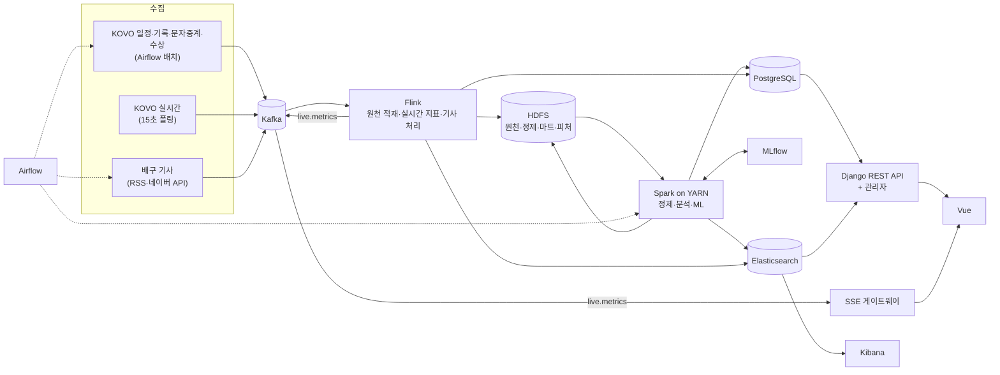

# 배구 전력 분석 플랫폼 요구사항 명세서

| 항목 | 내용 |
|---|---|
| 문서 버전 | v1.0 |
| 작성일 | 2026-11-16 (최초 2026-11-02) |
| 상태 | **재개발 기준선.** 1차 구현(저장소 `master`, 커밋 `d1094e7`) 결과를 반영해 확정했다. 남은 결정은 [10. 미결정 사항](#10-미결정-사항) |
| 관련 문서 | [아키텍처 설계서](02-architecture.md), [상세 설계서](03-design.md), [ERD](04-erd.md), [화면 설계서](05-screen-spec.md), [인터페이스 명세서](06-interface-spec.md), [테스트 계획서](07-test-plan.md), [개발 가이드](08-dev-guide.md), [운영 매뉴얼](09-operations.md), [개발 계획서(WBS)](10-wbs.md), [LLM 검토](reference/llm-options.md) |

| 버전 | 변경 내용 |
|---|---|
| v0.1 | 최초 작성 |
| v0.2 | 1차 범위를 국내(KOVO)로 확정. 해외 리그 데이터 출처 검토 결과를 [11. 향후 확장](#11-향후-확장-해외-리그-데이터)에 추가 |
| v0.3 | KOVO 사이트 코드 분석 결과 반영: 데이터 출처표(4.1.1), 랠리 단위 기록 수집(COL-10), 사이드아웃·브레이크 분석(ANL-11), 데이터 규모 추정, 문자중계 코드표(부록 A) |
| v0.4 | 과거 시즌·선수 기록 출처 확인 결과 반영: 시즌 코드 범위, 주요 기록 API, 선수 통산·수상 기록, 수집 제외 사이트(archive, dbbank) |
| v0.5 | SSAFY 정리노트(노션) 강의 내용을 바탕으로 기술 스택 보강: 관련 강의 매핑(2.2), 람다 아키텍처(2.4), Kafka 설계(2.5), MLflow 모델 관리(2.6), 제외 기술(2.7), LLM 선택 기능(ANL-12, WEB-15) |
| v0.6 | Airflow·Hadoop·Spark·Flink·Elasticsearch·Kibana 필수 적용 확정: 기술별 적용 범위와 완료 기준(2.8), 실시간 처리 필수화(COL-06, PIPE-06, WEB-04), 경기 재생 기능(PIPE-11), Hadoop YARN 추가, 단계별 계획 조정 |
| v0.7 | 설계서 v0.1 결정 반영: Kafka 토픽 추가(`live.metrics`, `ops.collection-log`), Flink `raw-archiver`의 HDFS 원천 적재(PIPE-03), SSE 게이트웨이 확정, Airflow LocalExecutor, 데이터 마트·실시간 테이블과 경기 확정 상태 추가, 메모리 계획 |
| **v1.0** | **1차 구현 결과로 전면 보정(재개발 기준선).** ① 모든 요구사항에 1차 구현 상태와 확정한 세부 내용을 적었다. ② 구현하며 생긴 기능을 요구사항으로 추가: ANL-13(포지션별 능력치 카드), ANL-14(선수 Elo), WEB-16(능력치 순위 화면), WEB-17(예측 검증 화면), ADM-06(품질 검사 결과 관리), ADM-07(작업 실패 알림), NFR-25~27, NFR-35~36, NFR-41~44, NFR-51~53. ③ 실제와 달랐던 내용 수정: KOVO컵 미수집, 순위는 자체 계산(COL-05), 선수 프로필 미수집(COL-01), 수집 이력은 Kafka·Elasticsearch에 보관(COL-08), ML 라이브러리(Spark MLlib), 차트 직접 구현, Kafka 토픽 8개(`kovo.player` 추가), 문자중계 코드표(`ST`·`ET`는 세트 시작·종료). ④ 미결정 사항 정리(DB, KOVO API 접근, 과거 데이터 범위, 기사 출처, 회원 기능, 예측 평가 기준 확정). ⑤ [7. 업무 규칙](#7-업무-규칙) 장 신설. ⑥ 단계별 계획을 재개발 순서로 바꿈. ⑦ 부록 B 요구사항 추적표 추가 |

**1차 구현 상태 표기**: `완료` 요구사항대로 동작 확인 / `부분` 일부만 구현 또는 범위 축소 / `대체` 다른 방법으로 같은 목적을 달성 / `미구현` 아직 없음.

---

## 1. 개요

### 1.1 목적
한국 프로배구(V-리그) 데이터를 수집하고, 머신러닝 기반 전력 분석 결과와 경기 일정·정보·기사를 한곳에서 제공하는 웹 서비스를 만든다. 동시에 데이터 엔지니어링 핵심 기술(Airflow, Hadoop, Spark, Flink, Elasticsearch, Kibana)을 실제 데이터 흐름에 적용한다.

### 1.2 범위
| 구분 | 포함 | 제외 |
|---|---|---|
| 데이터 | V-리그 남녀부 정규리그·포스트시즌(준플레이오프·플레이오프·챔피언결정전)의 일정·결과·경기 기록·문자중계, 2005년 출범 시즌부터 현재까지. 선수 수상·주요 기록. 국내 배구 기사 메타데이터 | KOVO컵·올스타전·시범경기·연습경기, 유소년 대회, 해외 리그(2차 확장, [11장](#11-향후-확장-해외-리그-데이터)), 감독·코칭스태프, 선수 사진·구단 로고 |
| 분석 | 팀 전력 지수(Elo), 팀 강약점, 경기 결과·세트 스코어 예측, 상대 전적, 선수 효율 지표·백분위, 선수 유형, 포지션별 능력치, 선수 폼, 사이드아웃·브레이크, 실시간 승리 확률, 예측 검증 | 영상 분석 |
| 서비스 | 웹사이트(PC·모바일 반응형), 관리자 화면, 운영 대시보드 | 네이티브 앱, 티켓 예매, 유료 기능, 광고 |

### 1.3 용어
| 용어 | 설명 |
|---|---|
| 원천 데이터(Raw) | 수집한 API 응답 그대로의 JSON. 가공하지 않고 HDFS에 영구 보관 |
| 봉투(envelope) | 수집기가 원천 응답에 출처(엔드포인트, 요청 파라미터, 수집기, 실행 id, 수집 시각)를 붙인 메시지 형식 |
| 정제 데이터(Curated) | 중복 제거, 형식 통일, 보정, 품질 검사를 마친 데이터 |
| 서빙 데이터 | 웹에서 바로 조회하도록 PostgreSQL에 적재한 데이터 |
| 데이터 마트 | 화면이 바로 읽도록 미리 계산한 요약 테이블(시즌 요약, Elo, 능력치 등) |
| 시즌 코드 | KOVO의 3자리 시즌 번호. `001` = 2004-05(2005 출범), `022` = 2025-26, `023` = 2026-27 |
| 경기 키 | `시즌 코드-경기 번호`(예: `023-6`). 경기 번호는 한 시즌 안에서 리그·성별을 통틀어 유일하다. 화면 주소·API·메시지 키에 쓴다 |
| 문자중계 | KOVO `/stat/real-time`의 랠리 단위 이벤트 목록(서브, 리시브, 공격, 득점, 교체 등). 2023-24 시즌(`020`)부터 제공 |
| 경기 상태 | `SCHEDULED` 예정, `LIVE` 진행 중, `FINISHED` 결과 있음, `CONFIRMED` 확정(박스스코어·문자중계 적재와 품질 검사 통과), `CANCELLED` 미진행 |
| 순위 자격 | 소속 팀이 치른 세트의 1/3 이상 출전한 선수. 선수 순위·백분위·능력치 순위의 비교 대상([BR-07](#7-업무-규칙)) |
| 전력 지수 | 팀의 현재 경기력을 나타내는 Elo 점수(시작 1500) |
| 사이드아웃률 / 브레이크율 | 상대 서브 랠리 중 득점 비율 / 자기 서브 랠리 중 득점 비율 |
| 능력치 카드 | 선수의 포지션별 능력을 1~99점으로 매긴 카드. 60 = 같은 성별·포지션 순위 자격 선수 평균, 표준편차 1당 12점 |
| 재생(replay) | 끝난 경기의 문자중계를 실시간 경로로 다시 흘려보내는 것. 비시즌 개발·시연용 |
| 백테스트(walk-forward) | 각 시즌을 그 이전 시즌들로만 학습한 모델로 예측해 실제 성능을 재는 방법 |
| 배치 / 스트리밍 | 정해진 주기에 모아서 처리 / 들어오는 즉시 처리 |

---

## 2. 시스템 구성

### 2.1 아키텍처 개요

구성 요소, 배포, 저장소 배치, 기술 결정은 [아키텍처 설계서](02-architecture.md)를 따른다.

### 2.2 기술 스택과 역할

"관련 강의"는 팀의 SSAFY 정리노트(노션)에서 해당 기술을 다룬 강의다. 버전은 [아키텍처 설계서 8장](02-architecture.md#8-기술-스택과-버전).

| 영역 | 기술 | 역할 | 관련 강의 |
|---|---|---|---|
| 개발 환경 | Docker, Docker Compose(프로필별 실행), WSL2 | 전체 구성 요소를 컨테이너로 실행 | 데이터 파이프라인과 리눅스(WSL), Docker 개념 및 활용 |
| 워크플로 | Airflow 3 (LocalExecutor) | 수집 → 적재 확인 → 정제 → 분석 → 예측 순서와 일정, 재시도·실패 알림 | 없음 |
| KOVO 수집 | Python requests | KOVO 공개 JSON API 주기 조회(폴링). 요청 간격을 프로세스 간에 공유 | 데이터사이언스 - 데이터 수집(OPEN API, 실시간 Polling), 관통PJT-01 |
| 기사 수집 | 언론사 RSS(표준 XML 파서), 네이버 뉴스 검색 API, 정규식 | 기사 메타데이터 수집, 배구 기사 선별 | 데이터사이언스 - 데이터 수집(OPEN API), 파이썬 - Regex |
| 메시지 큐 | Kafka(KRaft), confluent-kafka | 수집기와 처리 계층 분리. 설계는 2.5절 | Kafka 기초 개념 및 세팅, 프로듀서와 컨슈머, 최적화 |
| 스트림 처리 | Flink(PyFlink) | `raw-archiver`(HDFS 원천 적재), `live-metrics`(실시간 지표·승리 확률), `article-enricher`(기사 중복 제거·태깅) | 없음 |
| 실시간 전달 | Django ASGI(Uvicorn) SSE 게이트웨이 | Kafka `live.metrics`를 브라우저로 전달 | 없음 |
| 배치 처리 | Spark(PySpark) on YARN | 원천 정제, 품질 검사, 데이터 마트, 검색 색인, 선수 유형·능력치, 예측 피처 | 없음 |
| 데이터 레이크·자원 관리 | Hadoop HDFS, YARN | 원천(JSON)·정제·마트·피처(Parquet) 보관, Spark 자원 관리 | 데이터 파이프라인(데이터 레이크) |
| 머신러닝 | Spark MLlib(다항 로지스틱 회귀, 랜덤 포레스트, K-means), Hyperopt | 경기 세트 스코어 예측, 선수 유형 군집 | AI & 기계학습 기초·방법론, 머신러닝 알고리즘1·2 |
| ML 실험·모델 관리 | MLflow(Tracking, Model Registry) | 실험 기록, `champion` 별칭으로 서비스 모델 관리. 2.6절 | MLFlow 기본 개념과 세팅, 실험 환경 구축 |
| 서빙 DB | PostgreSQL 16 | 서빙 테이블·데이터 마트, Airflow·MLflow 메타데이터 | DB 기초, SQL 기본·심화(윈도 함수) |
| 검색 | Elasticsearch(nori) | 기사 전문 검색, 팀·선수 통합 검색·자동완성, 로그·지표 저장 | 없음 |
| 모니터링 | Kibana, Filebeat, Metricbeat | 수집 성공률, Kafka 컨슈머 랙, Airflow 지연, 오류 로그, 품질 문제 대시보드 | 없음 |
| 백엔드 | Django 5, Django REST Framework | 조회 API, 회원 인증(토큰), 관리자 화면 | Django - Web Framework, Model & ORM & Serializer, Relationships, Authentication |
| 프론트엔드 | Vue 3, Vite, Vue Router, Pinia, axios | 화면, 전역 상태(로그인, 시즌·성별 선택), API 호출, SSE 수신 | Vue, Component State Flow, State Management, AJAX |
| 차트 | SVG 컴포넌트 직접 구현 | 전력 지수 추이, 레이더, 점수 흐름, 승리 확률 막대 등 | (시각화 원칙은 AI 파이썬 III) |
| LLM (선택) | 미정([reference/llm-options.md](reference/llm-options.md)) | AI 경기 프리뷰(ANL-12), 데이터 질의응답(WEB-15) | AI 파이썬 I, AI LangChain, AI Agent |
| 협업 | Git | 기능별 커밋, 코드 리뷰 | GIT |

### 2.3 DB: PostgreSQL (확정)
분석용 SQL(윈도 함수, CTE, `DISTINCT ON`), JSONB(능력치·백분위·예측 확률 저장), Django 지원, Spark JDBC 적재, advisory lock(동시 적재 직렬화) 때문에 PostgreSQL로 확정했다. 한 서버에 `service`(서빙), `airflow`, `mlflow` 세 DB를 둔다.

### 2.4 파이프라인 구조: 람다 아키텍처

원천을 먼저 저장한 뒤 가공하는 ELT 방식을 써서, 가공 로직이 바뀌어도 원천부터 다시 처리할 수 있게 한다(PIPE-08).

| 계층 | 구성 | 처리 내용 |
|---|---|---|
| 배치 레이어 | Airflow → 수집기 → Kafka → Flink `raw-archiver` → HDFS(원천) → Spark → HDFS(정제·마트·피처) + PostgreSQL → 모델 학습·예측 | 일정·결과·경기 기록·랠리 기록을 확정 처리 |
| 스피드 레이어 | 실시간 수집기 → Kafka(`kovo.live`) → Flink `live-metrics` → PostgreSQL + Kafka(`live.metrics`) | 진행 중인 경기의 점수, 세트별 지표, 실시간 승리 확률. 경기가 없을 때는 종료 경기를 재생(PIPE-11)해 같은 경로로 처리 |
| 서빙 레이어 | PostgreSQL → Django REST API → Vue / `live.metrics` → SSE 게이트웨이 → Vue | 화면별로 미리 계산된 테이블을 조회하고, 진행 경기 지표는 SSE로 전달. 경기가 확정(`CONFIRMED`)되면 경기 화면은 공식 기록을 쓴다 |

### 2.5 Kafka 설계

| 토픽 | 메시지 키 | 생산자 | 소비자 |
|---|---|---|---|
| `kovo.schedule` | 시즌 코드(일정), `season-list-{gcode}`(시즌 목록) | 시즌·일정 수집기 | Flink `raw-archiver` |
| `kovo.match` | 경기 키(예: `022-3`) | 경기 상세 수집기 | `raw-archiver` |
| `kovo.rally` | 경기 키 | 문자중계 수집기(종료 경기) | `raw-archiver` |
| `kovo.live` | 경기 키 | 실시간 수집기, 경기 재생기 | Flink `live-metrics`, `raw-archiver` |
| `kovo.player` | 선수 코드 | 수상·주요 기록 수집기 | `raw-archiver` |
| `news.article` | 정규화한 기사 URL | 기사 수집기 | Flink `article-enricher`, `raw-archiver` |
| `live.metrics` | 경기 키 | Flink `live-metrics` | SSE 게이트웨이 |
| `ops.collection-log` | 수집 작업 이름 | 모든 수집기 | `raw-archiver`, Filebeat(→ Elasticsearch) |

| 항목 | 설정 | 이유 |
|---|---|---|
| 파티셔닝 | 경기 키를 메시지 키로 사용(경기 토픽 3파티션, 나머지 1) | 같은 경기 이벤트가 같은 파티션에 들어가 순서가 보장된다. 키 기반이므로 파티션 수는 바꾸지 않는다 |
| 프로듀서 신뢰성 | `acks=all`, `enable.idempotence=true`, 발행 후 `flush`로 전달 확인 | 유실·중복 방지 |
| 압축 | `compression.type=lz4` | 압축률과 CPU 사용의 균형 |
| 직렬화 | JSON(UTF-8) | 개발·디버깅이 쉬움 |
| 시작 위치 | `raw-archiver`·`article-enricher`: 커밋 위치, 없으면 가장 오래된 것 / `live-metrics`: 커밋 위치, 없으면 최신 / SSE 게이트웨이: 항상 최신 | 적재는 빠짐없이, 실시간 처리는 최신부터 |
| 보관 | 7일(`retention.ms=604800000`) | 장기 보관은 HDFS가 담당 |
| 클러스터 | 개발: 단일 브로커(KRaft, 복제 1), 토픽 자동 생성 끔 / 운영: 브로커 3대, `min.insync.replicas=2` | 개발 자원 절약, 운영 시 장애 대비 |

### 2.6 ML 실험·모델 관리 (MLflow)

| 항목 | 내용 |
|---|---|
| Experiment | `match-winner`(경기 결과 예측), `player-types`(선수 유형 군집) |
| Run 기록 | params: 모델 종류, 하이퍼파라미터, 피처 목록, 학습·검증·시험 시즌 / metrics: 정확도, Log Loss, Brier, 같은 시험 시즌의 Elo 기준선, 시즌별 백테스트 지표 |
| 튜닝 | Hyperopt(TPE)로 탐색하고 각 시도를 하위 Run(Nested Run)으로 기록. 주간 재학습은 30회 |
| 모델 레지스트리 | 등록 모델 `match-winner`, 서비스 모델은 별칭 `champion`. 재학습 때 현재 champion의 설정과 새로 찾은 설정을 **같은 데이터로 학습해 같은 시험 시즌으로 채점**하고, 이긴 설정(같으면 새 설정)을 전체 시즌으로 다시 학습해 새 `champion`으로 등록한다. 관리자가 다른 버전으로 바꿀 수 있다(ADM-05) |
| 예측 방식 | 별도 모델 서버 없이 Airflow 배치(`ml_daily_predict`, 매일 07:00)가 `champion` 모델로 7일 안의 예정 경기를 예측해 PostgreSQL에 저장. Django는 조회만 한다 |
| 저장소 | 메타데이터: PostgreSQL `mlflow` DB / 모델 파일: Docker 볼륨 |

### 2.7 쓰지 않기로 한 기술

| 기술 | 제외 이유 |
|---|---|
| Selenium, BeautifulSoup | KOVO가 JSON API로 데이터를 제공하고 기사 본문은 수집하지 않는다 |
| scikit-learn, XGBoost | 학습·예측을 Spark MLlib로 YARN 위에서 한다. 약 4,700경기 규모에서 다항 로지스틱 회귀가 랜덤 포레스트보다 계속 나았다 |
| Chart.js, ECharts | 디자인 토큰·접근성을 맞추려고 SVG 컴포넌트로 직접 그렸다 |
| asyncio·aiohttp | 실시간 수집은 동시 경기가 2~3개뿐이고 요청 간격(초당 1회)이 병목이라 순차 요청으로 충분하다 |
| 이미지 딥러닝, LLM 파인튜닝 | 1차 범위 밖. LLM은 프롬프트와 DB 조회로 충분 |
| Avro 직렬화 | JSON으로 충분 |
| Celery·Redis | Airflow는 LocalExecutor로 충분 |

### 2.8 핵심 데이터 기술 필수 적용 범위

아래 6개 기술은 MVP에 필수로 포함한다. 각 기술은 완료 기준을 만족해야 적용된 것으로 본다.

| 기술 | 필수 적용 범위 | 관련 요구사항 | 완료 기준 | 1차 결과 |
|---|---|---|---|---|
| Airflow | 모든 배치 작업 스케줄링: 일정·결과 수집(매일), 경기 후 기록·랠리 수집(20분마다), 과거 시즌 백필, 재처리, 수상 기록(주 1회), Spark 정제·마트, 주 1회 재학습, 매일 예측, 기사 수집(매시), 경기 재생 | PIPE-01, PIPE-09, COL-02~04, COL-07, COL-10, ANL-09 | 수집 → 적재 확인 → 정제 → 분석 → 서빙 DB 반영이 DAG로 자동 실행되고, 실패 시 재시도·알림이 동작 | 완료(DAG 10개) |
| Hadoop | HDFS: 원천(JSON)·정제·마트·피처(Parquet) 데이터 레이크 / YARN: Spark 작업 자원 관리 | PIPE-03, PIPE-04, PIPE-08, NFR-22 | 모든 수집 데이터가 HDFS 원천 경로에 쌓이고, Spark 작업이 YARN 위에서 실행됨 | 완료 |
| Spark | 원천 정제, 품질 검사, 랠리 → 경기·선수 단위 집계, 데이터 마트, 검색 색인, 선수 유형·능력치, Spark MLlib 예측 모델 | PIPE-04, PIPE-05, PIPE-08, PIPE-10, ANL-01~06, ANL-11, ANL-13 | 원천에서 피처·데이터 마트까지 Spark 작업으로 생성되고, 시즌 단위 재처리가 가능 | 완료(작업 10개) |
| Elasticsearch | 기사 전문 검색(nori), 팀·선수 통합 검색과 자동완성, 전 구성 요소 로그·지표 저장 | PIPE-07, WEB-09, WEB-10, NFR-12, NFR-23 | 통합 검색 응답 95%가 1초 이내이고, 모든 구성 요소의 로그가 수집됨 | 완료(검색 p95 32ms) |
| Kibana | 운영 대시보드: 수집 성공률, Kafka 컨슈머 랙, Airflow 작업 지연, 오류 로그, 기사 수집 현황, 품질 문제 | ADM-04, NFR-23 | 관리자가 대시보드 한 곳에서 파이프라인 상태를 확인 | 완료 |
| Flink | `raw-archiver`: 수집 토픽 전체의 HDFS 원천 적재 / `live-metrics`: 실시간 지표·승리 확률·`live.metrics` 발행 / `article-enricher`: 기사 중복 제거·태깅 | PIPE-03, COL-06, PIPE-06, PIPE-07, PIPE-11, WEB-04 | 모든 토픽이 HDFS에 적재되고, 실시간 지표가 수집 후 30초 이내 화면에 반영되며, 비시즌에는 재생으로 같은 흐름을 시연 가능 | 완료(재생으로 지연 약 3초 확인, 실제 생중계는 미검증) |

---

## 3. 사용자 정의

| 사용자 | 설명 | 주요 기능 |
|---|---|---|
| 비회원 | 사이트 방문자 | 일정·결과·순위·분석·예측·실시간·기사 조회, 검색 |
| 회원 | 이메일로 가입한 사용자 | 비회원 기능 + 관심 팀·선수 설정, 홈 화면 "내 관심" |
| 관리자 | 운영자(Django `is_staff`) | 수집 현황 확인, 수동 실행·재처리, 데이터 품질 확인·보정, 모델 교체, 모니터링 |
| 시스템 스케줄러 | Airflow | 정기 수집·정제·분석·학습·예측 |

---

## 4. 기능 요구사항

우선순위: **필수**(MVP에 포함) / **선택**(일정이 허락하면 구현). 세부 설계 위치는 [부록 B](#부록-b-요구사항-추적표).

### 4.1 데이터 수집 (COL)
| ID | 요구사항 | 상세 | 우선순위 | 1차 구현 |
|---|---|---|---|---|
| COL-01 | 시즌·팀·선수 기본 정보 수집 | 시즌 목록과 시즌별 리그 코드, 팀(코드, 이름, 정식 이름, 성별, 홈 경기장·연고지), 선수(코드, 이름, 성별, 포지션, 키). 팀·선수는 일정과 경기 기록 응답에서 만든다. 팀 이름은 후원사에 따라 바뀌므로 가장 최근 경기 기준 이름을 쓴다. **감독은 수집하지 않는다(2026-11-11 결정):** 코칭스태프 API는 구단 사이트 식별 헤더가 있어야만 답하므로 NFR-04에 따라 제외. 선수 생년·국적·상태(현역·군 복무·은퇴)는 컬럼만 두고 수집하지 않았다([10장](#10-미결정-사항) 4번) | 필수 | 부분 |
| COL-02 | 경기 일정·결과 수집 | 경기 번호, 일시, 장소·도시, 홈/원정, 라운드, 중계사, 세트 스코어, 세트별 점수·소요 시간, 관중 수, 심판. 매일 06:00 현재 시즌 전체 + 경기일에는 14:00~23:40 20분마다 해당 시즌 | 필수 | 완료 |
| COL-03 | 경기별 기록 수집 | 팀·선수별 공격(시도·성공·피블로킹·범실), 공격 종류별(오픈·퀵오픈·시간차·이동·후위·속공) 기록, 서브, 블로킹(시도·성공·유효·어시스트), 리시브, 디그, 세트, 범실 합계, 경고, 세트별 출전 여부, 등번호, 포지션, 주장 여부. 경기 종료 후 1회 | 필수 | 완료 |
| COL-04 | 과거 시즌 기록과 수상 기록 수집 | 2005년(`001`)부터 모든 시즌의 일정·결과·경기 기록을 1회 일괄 수집(재실행 시 확정 경기는 건너뜀). 선수 시즌·통산 기록은 수집한 경기 기록으로 계산한다. 수상·트리플크라운·기준 기록 달성은 선수별 `/players/{코드}/honor`로 처음 한 번 DB의 모든 선수를 받고, 매주 월요일 최근 400일 안에 뛴 선수를 다시 받는다 | 필수 | 완료 |
| COL-05 | 순위·누적 기록 | 팀 순위와 부문별 선수 순위는 KOVO 순위 API를 수집하지 않고 **정제된 경기 기록으로 계산한다**(규칙 [BR-04](#7-업무-규칙)~[BR-07](#7-업무-규칙)). 승점 감점 같은 공식 처분은 반영되지 않는다 | 필수 | 대체 |
| COL-06 | 실시간 경기 데이터 수집 | 예정 시각 10분 전부터 경기 종료(또는 시작 후 4시간)까지 15초마다 현재 세트의 문자중계를 조회해 새 이벤트만 발행. 재시작하면 마지막으로 처리된 이벤트부터 이어 받는다 | 필수 | 완료 |
| COL-07 | 기사 수집 | 매시 언론사 스포츠 RSS 5곳(연합뉴스·뉴시스·동아일보·한국경제·한겨레, 각 robots.txt 허용 경로)과 네이버 뉴스 검색 API(키가 있을 때, 검색어 "프로배구", "V리그 배구")에서 배구 기사만 골라 제목, 요약(160자), 언론사, 원문 링크, 발행 시각을 수집. 본문·이미지·기자 이름은 수집 단계에서 버린다. 피드 하나가 실패해도 나머지는 계속한다 | 필수 | 완료 |
| COL-08 | 수집 이력 관리 | 수집 실행마다 시작(`RUNNING`)과 결과(`SUCCESS`·`FAILED`, 보낸 메시지 수, 오류)를 Kafka `ops.collection-log`로 남겨 Elasticsearch(`ops-collection-*`)와 HDFS에 보관한다. 관리자 "수집 현황"과 Kibana에서 본다 | 필수 | 완료 |
| COL-09 | 중복·변경 감지 | 같은 항목을 다시 수집해도 정제 시 가장 최근 수집본만 쓴다(경기는 경기 키, 문자중계는 세트별 가장 최근 수집 실행). 확정(`CONFIRMED`) 경기는 정기 수집에서 다시 받지 않고, 기록이 정정되면 관리자가 재수집(ADM-02)한다 | 필수 | 완료 |
| COL-10 | 랠리 단위 플레이 기록 수집 | 끝난 경기의 문자중계를 세트별로(한 페이지 500건) 수집. 2023-24 시즌(`020`) 이전 경기는 요청하지 않는다. 1세트가 비어 있으면 아직 올라오지 않은 것으로 보고 다음 실행에서 다시 요청한다. 코드 체계는 [부록 A](#부록-a-문자중계-코드표) | 필수 | 완료 |

#### 4.1.1 KOVO 데이터 출처 (2026-11-03 직접 호출로 검증)

KOVO 웹사이트(kovo.co.kr)는 `user-api.kovo.co.kr`의 JSON API로 데이터를 불러온다. **로그인 없이 조회된다.** 응답은 `{"result": {"status": 200}, "payload": …}` 형태이고, HTTP 200이어도 `result.status`가 200이 아니면 실패다.

| 데이터 | API 경로 | 주요 조회 조건 | 제공 내용 | 사용 |
|---|---|---|---|---|
| 시즌·리그 목록 | `/stat/season-list` | `gcode`, `seasonCode`(선택) | 시즌 코드·이름·연도, 시즌별 리그 코드 목록 | 사용(COL-01) |
| 경기 일정·결과 | `/stat/game-schedule` | `gcode`, `seasonCode`, `leagueCode`, `gender`(1 남, 2 여), `page`, `size` | 경기 번호, 일시, 장소, 홈·원정 팀, 세트 스코어, **세트별 점수와 소요 시간, 관중, 심판, 중계사**, 결과. 응답은 `payload.content` + `payload.page.totalPages` | 사용(COL-02) |
| 경기 상세 기록 | `/stat/game-schedule/{gnum}` | `gcode`, `seasonCode`, `leagueCode` | `game`(경기 메타), `player`(선수별 세부 기록), `team`(두 팀 합계), `ranking` | 사용(COL-03) |
| 문자중계 | `/stat/real-time` | `season`, `gcode`, `gnum`, `hcode`, `acode`, `rset`(세트), `page`, `size` | `feed`(이벤트 목록), `lineup`. 페이지 정보가 없어 받은 수가 `size`보다 적으면 마지막 페이지 | 사용(COL-06, COL-10) |
| 선수 수상·주요 기록 | `/players/{코드}/honor` | 선수 코드 | `awards`, `tripleCrowns`, `standardRecords`(문장 목록, 예: "2025~2026 V-리그 라운드 MVP (5R)") | 사용(COL-04) |
| 팀 순위·선수 순위·팀 기록 | `/stat/league/team-rank`, `/stat/league/player-rank`, `/stat/team-records` | 시즌, 대회, 성별 | 순위, 승패, 부문별 순위 | 미사용(COL-05 자체 계산) |
| 선수 목록·정보·시즌 기록 | `/players`, `/players/{코드}`, `/players/{코드}/season-records` 등 | 성별, 상태, 선수 코드 | 프로필, 소속 이력, 시즌·통산 기록 | 미사용(프로필 수집은 미결정) |
| 주요 기록 목록 | `/stat/triple-crown-list`, `/stat/mvp-list`, `/stat/achive-list` | 시즌, 성별 | 트리플크라운, MVP, 기준 기록 달성 | 미사용(선수별 `honor`로 대체) |
| 코칭스태프 | `/teams/coaches` | - | 감독·코치 | 수집 금지(구단 사이트 식별 헤더 필요, NFR-04) |
| 관전 포인트 | `/stat/view-point` | 경기, 팀 | 상대 전적 등 | 미사용(자체 계산) |
| KOVO 뉴스·보도자료 | `/contents/news/...` | - | 기사 | 수집 금지(NFR-02) |

확인한 사실:
- **코드 체계**: 대회 `gcode` `001` V-리그(`002` KOVO컵은 수집하지 않음). 리그 `leagueCode` `201` 정규리그, `204` 준플레이오프, `202` 플레이오프, `203` 챔피언결정전. `200` 시즌 통산, `801` 올스타전, `901` 시범경기, `903` 연습경기는 경기 수집에서 제외. 시즌 코드는 `001`(2004-05) ~ `023`(2026-27).
- **경기 번호**는 한 시즌 안에서 리그·성별을 통틀어 겹치지 않는다(2025-26: 정규리그 1~252, 준PO 253~254, PO 255~258, 챔프전 261~270).
- **문자중계는 2023-24(`020`)부터만 있다.** `001`~`019`는 빈 목록을 돌려준다. 경기 상세는 2005년부터 있다. 따라서 랠리 기반 분석(사이드아웃·브레이크, 상황별 효율, 서브 압박, 세터 기여, 실시간 승리 확률의 기준 비율)은 2023-24 이후만 가능하다.
- 한 세트는 보통 250~300개 이벤트(5세트 120~190개, 긴 듀스는 500개 초과)라 `size=500`이면 대개 요청 1번이다. 이어 붙이면 `ST`~`ET`가 끊김·중복 없이 이어진다.
- 이벤트의 `rpage`는 묶음 순번이다. 랠리 하나, 선수 교체(`CI`/`CO`), 작전 타임(`CT`)이 각각 한 묶음이고 세트 시작 `ST`는 0번, 종료 `ET`는 200번이다.
- 한 시즌(약 266경기, 세트 약 950개) 전체 수집은 요청 약 1,250~1,300번, 초당 1회 기준 약 20분이다.

수집하지 않는 KOVO 사이트:
| 사이트 | 내용 | 제외 이유 |
|---|---|---|
| archive.kovo.co.kr | 과거 기록 보관 사이트 | robots.txt에서 모든 경로 수집 금지 |
| dbbank.kovo.co.kr | 기록 DB(경기 기록지 PDF 포함) | 로그인 필요(NFR-04). 같은 내용을 JSON API로 받는다 |

### 4.2 데이터 파이프라인 (PIPE)
| ID | 요구사항 | 상세 | 우선순위 | 1차 구현 |
|---|---|---|---|---|
| PIPE-01 | 작업 스케줄링 | Airflow DAG로 수집 → HDFS 적재 확인 → 정제 → 분석 → 서빙 DB 반영 순서를 관리. DAG 목록은 상세 설계서 5장 | 필수 | 완료 |
| PIPE-02 | 메시지 발행 | 수집기는 응답 원본을 봉투에 담아 Kafka에 발행. 토픽·키·전송 설정은 [2.5절](#25-kafka-설계) | 필수 | 완료 |
| PIPE-03 | 원천 데이터 보관 | Flink `raw-archiver`가 `kovo.*`·`news.*`·`ops.*` 토픽을 HDFS `/raw/topic={토픽}/dt={수집일}/`에 메시지 1건 = 1줄로 저장. 파일은 체크포인트 때 마감되어 읽는 쪽은 반쪽 파일을 보지 않는다 | 필수 | 완료 |
| PIPE-04 | 배치 정제 | Spark로 원본 파싱(명시적 스키마), 최신 수집본 선택, 형식 통일(포지션 코드 변환 등), 보정 적용, 품질 검사 후 Parquet으로 HDFS `/curated/kovo/`에 시즌별 저장 | 필수 | 완료 |
| PIPE-05 | 서빙 DB 적재 | 정제 데이터와 분석 결과를 PostgreSQL에 반영. 실행 전용 staging 스키마에 적재한 뒤 한 트랜잭션으로 병합(upsert, 원천에서 사라진 행 삭제) | 필수 | 완료 |
| PIPE-06 | 실시간 처리 | Flink가 `kovo.live`를 경기별로 처리해 점수·세트·서브권·연속 득점, 세트별 지표, 득점 흐름, 승리 확률을 계산하고 PostgreSQL에 upsert, `live.metrics`로 발행. 같은 이벤트를 다시 받아도 결과가 같아야 한다 | 필수 | 완료 |
| PIPE-07 | 기사 색인 | Flink가 기사 중복(같은 URL, 같은 정규화 제목, 7일)을 제거하고 팀·선수를 태깅한 뒤 PostgreSQL과 Elasticsearch(nori)에 저장 | 필수 | 완료 |
| PIPE-08 | 재처리 | 특정 경기·날짜·시즌을 KOVO에서 다시 받거나, HDFS 원천만으로 다시 정제할 수 있어야 함. 재처리 결과는 처음 처리와 같아야 한다(NFR-25) | 필수 | 완료 |
| PIPE-09 | 실패 처리 | 작업 실패 시 자동 재시도(수집·정제 3회 5분 간격, ML·기사 2회) 후 관리자에게 알림: 서비스 DB `job_alert` 기록 + 메신저 웹훅(설정 시). 같은 단계의 미확인 알림이 6시간 안에 있으면 다시 보내지 않는다 | 필수 | 완료 |
| PIPE-10 | 데이터 품질 검사 | 정제 때마다 오류 7종·경고 4종 규칙을 검사([6.4절](#64-데이터-품질-규칙))해 `quality_issue`에 기록. 오류가 있는 경기는 `CONFIRMED`가 되지 못한다. 매일 품질 관문: 최근 7일 경기에 미해결 오류가 있거나 정규리그 경기가 시작 6시간 뒤에도 결과가 없으면 실패(알림) | 선택 | 완료 |
| PIPE-11 | 경기 재생 | 종료 경기의 랠리 기록을 실제 속도 또는 배속(1~600)으로 `kovo.live`에 다시 발행해 실시간 흐름을 재현. 재생은 경기 상태와 공식 기록을 바꾸지 않고, 화면에 "재생"으로 표시 | 필수 | 완료 |

### 4.3 데이터 분석·머신러닝 (ANL)
| ID | 요구사항 | 상세 | 우선순위 | 1차 구현 |
|---|---|---|---|---|
| ANL-01 | 팀 전력 지수 | 끝난 경기마다 팀 Elo를 갱신하고 시즌 추이를 제공. 규칙은 상세 설계서 8.1 | 필수 | 완료 |
| ANL-02 | 팀 강약점 분석 | 공격 성공률, 리시브 효율, 블로킹, 서브 에이스, 디그, 범실, 사이드아웃, 브레이크 8개 지표를 리그 평균과 비교하고, 리그 내 순위를 0~100점으로 바꿔 레이더로 제공 | 필수 | 완료 |
| ANL-03 | 경기 결과 예측 | 경기 전 홈 승리 확률과 세트 스코어 6가지(3:0~0:3) 확률, 예상 세트 스코어. Spark MLlib 다항 분류. 경기 시작 전 정보만 쓴다(데이터 누출 금지). 7일 안의 예정 경기만 예측 | 필수 | 완료 |
| ANL-04 | 상대 전적 분석 | 두 팀의 통산 맞대결 승수와 최근 5경기 | 필수 | 완료 |
| ANL-05 | 선수 효율 지표 | 공격 성공률·효율, 리시브 효율, 세트당 블로킹·서브·디그·세트·범실과 같은 시즌·성별·포지션 순위 자격 선수 안 백분위 | 필수 | 완료 |
| ANL-06 | 선수 유형 분석 | 세트당 기록 13개 특징으로 성별마다 K-means 군집, 유형 이름 자동 부여, 같은 시즌·역대 유사 선수 5명과 유사도 | 선택 | 완료 |
| ANL-07 | 실시간 승리 확률 | 경기 중 점수·서브권과 두 팀의 사이드아웃·브레이크 비율로 세트·경기 승리 확률을 동적 계획법으로 계산 | 선택 | 완료 |
| ANL-08 | 선수 폼 추세 | 최근 5경기를 그 전 경기(3경기 이상)와 비교해 세트당 득점·공격 성공률·리시브 효율의 상승·하락을 통계적으로 판정 | 선택 | 완료 |
| ANL-09 | 모델 관리 | MLflow로 실험·모델 버전·평가 지표 기록([2.6절](#26-ml-실험모델-관리-mlflow)). 매주 월요일 재학습 | 필수 | 완료 |
| ANL-10 | 예측 검증 | 경기 종료 후 경기 전 예측의 적중 여부를 채점해 공개. 최근 4시즌 워크포워드 백테스트(시즌별 적중률·Log Loss·Brier, Elo 기준선 비교, 확신도 구간별 실제 적중률) | 선택 | 완료 |
| ANL-11 | 사이드아웃·브레이크 분석 | 랠리 단위로 사이드아웃률·브레이크율, 리시브 정확 후/그 외 리시브 후 첫 공격 성공률, 접전(양 팀 20점 이상, 5세트 10점 이상) 랠리 승률 | 선택 | 완료 |
| ANL-12 | AI 경기 프리뷰 | LLM이 분석 결과(승리 확률, 상대 전적, 핵심 지표)로 경기 전 프리뷰 작성. 글 속 숫자는 DB 값과 같은지 코드로 검사하고 화면에 "AI 작성" 표시 | 선택 | 미구현 |
| **ANL-13** | 포지션별 능력치 카드 | 선수-시즌마다 포지션별 능력치(예: OH 리시브·득점력·블로킹·서브·공격·수비)를 1~99점으로 매기고 가중 평균으로 종합 점수. 포지션별 통산 카드와 역대 순위(순위 자격 시즌 3번 이상). 모든 숫자에 근거 기록 표시. 규칙은 상세 설계서 8.6 | 선택 | 완료 |
| **ANL-14** | 선수 Elo | 선수마다 Elo를 두고 경기 전 팀 전력을 예상 출전 명단의 가중 평균으로 계산해 예측 피처로 쓴다(화면에는 쓰지 않음). 규칙은 상세 설계서 8.2 | 선택 | 완료 |

예측 모델 실적(2026-11-13, 챔피언 v11): 2025-26 시험 시즌 적중률 63.2%, Log Loss 0.6422(팀 Elo 기준선 62.8%, 0.6593).

### 4.4 웹 서비스: 사용자 기능 (WEB)
화면별 구성은 [화면 설계서](05-screen-spec.md)를 따른다(S01~S14).

| ID | 화면/기능 | 상세 | 우선순위 | 1차 구현 |
|---|---|---|---|---|
| WEB-01 | 메인(홈) | 진행 중 경기(20초마다 갱신), 오늘·다음 경기(승리 확률), 최근 결과(예측 적중 여부), 남녀부 순위 요약, 최신 기사, (로그인 시) 내 관심 | 필수 | 완료 |
| WEB-02 | 경기 일정·결과 | 시즌·남녀부·팀·월 필터, 목록 보기와 달력 보기 | 필수 | 완료 |
| WEB-03 | 경기 상세 | 세트 스코어·세트별 점수·시간, 경기 정보(장소·관중·심판·중계사), 팀 기록 비교, 선수 기록, 세트별 점수 흐름, 문자중계, 경기 전 예측과 실제 결과 비교, 데이터 품질 안내(누락 등) | 필수 | 완료 |
| WEB-04 | 실시간 경기 | 진행 중 경기 점수·서브권·연속 득점·세트 지표·득점 흐름·최근 득점·실시간 승리 확률을 SSE로 자동 갱신. 재생이면 "재생" 표시 | 필수 | 완료 |
| WEB-05 | 순위 | 팀 순위표(최근 5경기 포함), 부문별 선수 순위 7개 부문 | 필수 | 완료 |
| WEB-06 | 팀 상세 | 시즌 성적, 전력 지수 추이(시즌 초에는 지난 시즌 끝 10경기 함께), 강약점 레이더, 리그 평균 대비 지표, 선수 폼 변화, 선수단 기록, 최근·다음 경기, 관련 기사 | 필수 | 완료 |
| WEB-07 | 선수 상세 | 능력치 카드(시즌·통산), 수상·주요 기록, 포지션 내 백분위, 최근 폼, 선수 유형·유사 선수, 시즌별·경기별 기록, 관련 기사 | 필수 | 완료 |
| WEB-08 | 경기 프리뷰 (전력 분석) | 예정 경기의 승리 확률, 세트 스코어별 확률, 예측 신뢰 근거(모델 버전·시험 적중률·Elo 기준), 상대 전적, 최근 흐름, 시즌 지표 비교. 경기 상세 화면 안에 둔다 | 필수 | 완료 |
| WEB-09 | 기사 목록 | 최신순 20개씩, 팀·선수별 필터. 클릭 시 원문 사이트로 이동 | 필수 | 완료 |
| WEB-10 | 통합 검색 | 팀·선수·기사 검색(Elasticsearch), 머리글 검색창 자동완성(입력 멈춘 뒤 0.2초) | 필수 | 완료 |
| WEB-11 | 회원가입·로그인 | 이메일·닉네임·비밀번호 가입, 이메일 로그인, 로그아웃, 회원 탈퇴(비밀번호 확인). 소셜 로그인은 하지 않는다 | 선택 | 완료 |
| WEB-12 | 관심 팀·선수 | 팀·선수 각 10개까지. 홈 "내 관심"(관심 팀 순위·최근 5경기·다음/지난 경기, 관심 선수 최근 경기·시즌 기록·폼), 목록에서 관심 팀 경기를 앞에 두고 표시 | 선택 | 완료 |
| WEB-13 | 반응형 화면 | PC(1440px)와 모바일(390px) 모두 지원. 구간 규칙은 화면 설계서 3.3 | 필수 | 완료 |
| WEB-14 | 출처 표시 | 데이터 출처(KOVO)를 바닥글과 API 응답(`source`)에, 기사 출처(언론사)를 기사마다 표시 | 필수 | 완료 |
| WEB-15 | AI 데이터 질의응답 | "OO팀 최근 5경기 리시브 효율은?" 같은 질문에 에이전트가 DB 조회 도구를 써서 답변하고 근거 데이터 표시 | 선택 | 미구현 |
| **WEB-16** | 포지션별 능력치 순위 | 시즌별·역대 통산 전환, 남녀부·포지션 탭, 상위 3명 카드, 능력치별 정렬 표, 순위 자격 미달 선수 보기 | 선택 | 완료 |
| **WEB-17** | 예측 검증 화면 | 백테스트 적중률(Elo 대비), 시즌별 표, 확신도별 실제 적중률, 이번 시즌 실제 예측 결과와 모델 버전별 적중률 | 선택 | 완료 |

### 4.5 관리자 기능 (ADM)
관리자 기능은 Django 관리자 화면(`/admin/`)으로 만든다(화면 설계서 A01~A06).

| ID | 요구사항 | 상세 | 우선순위 | 1차 구현 |
|---|---|---|---|---|
| ADM-01 | 수집 현황 조회 | Airflow DAG별 최근 실행·상태·7일 실패 수, 수집기 실행 결과(최근 7일, 끝나지 않은 실행 포함), 작업 실패 내역 | 필수 | 완료 |
| ADM-02 | 수동 실행 | 예약 작업 즉시 실행, 경기·날짜·시즌 재처리(재수집 여부 선택, 재수집은 50경기까지), 과거 시즌 수집, 경기 재생. 입력 검사 후 Airflow REST API로 실행하고 누가·무엇을·언제 요청했는지 기록. 일시 중지된 DAG는 거절 | 필수 | 완료 |
| ADM-03 | 데이터 보정 | 선수·팀·경기·세트 점수·선수/팀 경기 기록의 한 항목을 근거와 함께 고친다. 저장 즉시 사이트에 반영되고, 이후 정제에도 계속 적용되어 재수집해도 유지된다. 보정은 지우지 않고 끈다(끄면 원래 값으로 복원) | 선택 | 완료 |
| ADM-04 | 모니터링 대시보드 | Kibana 대시보드 하나에서 수집 성공률·건수·실패, Kafka 컨슈머 랙, Airflow DAG 소요·시작 지연·작업 대기, 서비스별 오류 로그, 언론사별 기사 저장, 미해결 품질 문제 | 필수 | 완료 |
| ADM-05 | 모델 관리 | `match-winner` 등록 버전별 시험 성적(Elo 기준선 포함)과 실전 적중률 비교, 사유를 적어 서비스 모델(`champion`) 교체. 교체하면 예정 경기 예측을 바로 다시 만든다 | 선택 | 완료 |
| **ADM-06** | 품질 검사 결과 관리 | 품질 문제 목록(상태·심각도·규칙·시즌 필터), KOVO 원천에도 없는 문제는 "확인함"으로 표시(이후 실행에도 유지, 품질 관문을 실패시키지 않음), 메모, 다시 열기 | 선택 | 완료 |
| **ADM-07** | 작업 실패 알림 확인 | 관리 첫 화면에 "확인하지 않은 작업 실패 N건" 표시, 실패 내역에서 확인함 표시 | 선택 | 완료 |

---

## 5. 비기능 요구사항

### 5.1 수집 정책 (법적·윤리적 제약)
| ID | 요구사항 | 1차 구현 |
|---|---|---|
| NFR-01 | KOVO 요청은 모든 프로세스·컨테이너를 합쳐 1초에 1회 이하로 제한하고, 확정된 과거 데이터는 다시 요청하지 않는다 | 완료(잠금 파일 공유) |
| NFR-02 | 경기 기록·일정 등 사실 데이터만 수집한다. 구단 로고, 선수 사진·영상, KOVO 기사 본문은 수집·게시하지 않는다 | 완료 |
| NFR-03 | 회원 개인정보는 이메일·닉네임만 받고, 메일을 보내지 않으며, 탈퇴 즉시 삭제한다(정보통신망법 제50조의2 취지) | 완료 |
| NFR-04 | 로그인이 필요한 영역이나 접근 차단을 우회하지 않고, 다른 사이트인 척하는 요청 헤더를 보내지 않는다. User-Agent에 비상업 프로젝트임을 밝힌다 | 완료 |
| NFR-05 | 비영리 학습 프로젝트로 운영한다. 광고·유료화 시에는 KOVO 사전 승낙을 받는다(KOVO 이용약관 제23조) | 완료 |
| NFR-06 | 기사는 제목·요약(160자)·언론사·링크만 제공하고 본문은 원문 사이트로 연결한다 | 완료 |

### 5.2 성능
| ID | 요구사항 | 1차 측정 |
|---|---|---|
| NFR-11 | 일반 페이지 API 응답 시간: 95%의 요청이 500ms 이내 | p95 121ms(화면이 부르는 API 19개 × 30회, 2026-11-11) |
| NFR-12 | 검색 응답 시간: 95%의 요청이 1초 이내 | p95 32ms |
| NFR-13 | 경기 종료 후 1시간 이내에 결과·기록·분석이 사이트에 반영(KOVO가 기록을 올린 뒤 기준) | 경기 후 수집 20분 주기, 시즌 정제 약 2~3분 |
| NFR-14 | 실시간 경기 지표는 수집 후 30초 이내에 화면에 반영 | 재생 기준 평균 약 3초, 최대 4.5초(120배속). 실제 생중계 미검증 |

측정 방법: `python scripts/measure_latency.py`(Windows에서는 `127.0.0.1`로 잰다. `localhost`는 IPv6 시도로 요청마다 약 2초가 더해진다).

### 5.3 안정성·운영
| ID | 요구사항 | 1차 구현 |
|---|---|---|
| NFR-21 | 수집·파이프라인이 실패해도 웹 서비스는 마지막으로 성공한 데이터로 계속 동작한다. 검색 엔진이 꺼지면 검색 API만 503으로 안내한다 | 완료 |
| NFR-22 | 원천 데이터는 삭제하지 않고 HDFS에 보관해 언제든 재처리 가능 | 완료 |
| NFR-23 | 전 구성 요소의 로그를 Elasticsearch로 모아(Filebeat) Kibana에서 조회 | 완료 |
| NFR-24 | Docker Compose로 전체 개발 환경 실행. 메모리에 맞춰 프로필(app, batch, stream, search)별로 띄울 수 있다 | 완료 |
| **NFR-25** | 멱등성: 모든 수집·정제·적재 작업은 같은 입력으로 다시 실행해도 결과(행·id·색인)가 같다. 적재는 한 트랜잭션이라 사이트가 반쯤 바뀐 데이터를 보지 않는다 | 완료 |
| **NFR-26** | 자동 복구: 스트림 작업은 중단·재시작 후 마지막 체크포인트에서 1분 안에 다시 시작되고, 같은 작업이 두 번 제출되지 않는다. PC를 다시 켜면 `scripts/resume.ps1` 하나로 전체를 다시 띄우고 상태를 확인한다 | 완료 |
| **NFR-27** | HDFS 적재 확인: 정제는 이번 수집 실행의 모든 메시지가 HDFS의 마감된 파일에 들어간 것을 확인한 뒤에만 시작한다 | 완료 |

### 5.4 보안
| ID | 요구사항 | 1차 구현 |
|---|---|---|
| NFR-31 | 비밀번호는 Django 기본 해시로 저장하고, 8자 이상·흔한 비밀번호·숫자만·이메일과 비슷한 비밀번호를 거절한다 | 완료 |
| NFR-32 | 관리자 기능은 관리자 권한 계정만 접근(모델 교체는 최고 관리자만) | 완료 |
| NFR-33 | API 키, DB 비밀번호 등은 환경 변수(`.env`)로 관리하고 저장소에 올리지 않음 | 완료 |
| NFR-34 | Kafka, Elasticsearch, Kibana, Airflow, Flink, HDFS·YARN, MLflow 관리 화면은 외부에 공개하지 않음(개발 구성은 모든 포트를 127.0.0.1에만 연다) | 완료 |
| **NFR-35** | 가입·로그인 시도는 IP마다 분당 10회로 제한하고, 로그인 실패 문구로 가입 여부를 알 수 없게 한다 | 완료 |
| **NFR-36** | 로그인 뒤 이동 주소는 같은 사이트 경로만 허용하고, 검색 강조 표시는 HTML 이스케이프 뒤 `<mark>`만 넣는다 | 완료 |

### 5.5 사용성·접근성
| ID | 요구사항 | 1차 구현 |
|---|---|---|
| **NFR-41** | 글자 대비 4.5:1 이상(팀 컬러 포함), 키보드로 모든 조작 가능, 포커스 표시, 색만으로 뜻을 전하지 않음(승패·적중은 글자 병기) | 완료 |
| **NFR-42** | 모든 데이터 구역은 불러오는 중(뼈대)·비었음(이유 문구)·오류(다시 시도) 상태를 보여 준다 | 완료 |
| **NFR-43** | 필터·시즌·보기 방식·검색어를 주소(쿼리 문자열)에 담아 공유·뒤로 가기 시 같은 화면이 열린다 | 완료 |
| **NFR-44** | 운영체제의 "동작 줄이기" 설정을 켜면 애니메이션을 끈다. 터치 화면에서 버튼 높이 44px 이상 | 완료 |

### 5.6 유지보수성
| ID | 요구사항 | 1차 구현 |
|---|---|---|
| **NFR-51** | 외부 서비스(KOVO, Kafka, HDFS, DB) 없이 도는 단위 테스트를 모듈마다 둔다(수집기, DAG 보조 코드, Spark 순수 함수, Flink 계산, Django API) | 완료(약 180개) |
| **NFR-52** | 실제 KOVO 응답 표본(`collectors/samples/`)으로 파서 회귀 테스트를 한다 | 완료 |
| **NFR-53** | 운영 대시보드, 토픽, DB 생성은 코드로 관리해 다시 설치해도 같게 재현된다(`infra/`) | 완료 |

---

## 6. 데이터 요구사항

### 6.1 주요 엔터티

전체 테이블 정의(35개), 컬럼, 관계, 제약조건은 [ERD](04-erd.md)를 따른다.

| 도메인 | 엔터티 | 주요 속성 |
|---|---|---|
| 리그 | Season | 시즌 코드, 이름, 연도, 시작·종료일 |
| | Competition | 시즌, 대회 구분(gcode), 리그 코드, 종류(정규/포스트/컵) |
| | Team | 팀 코드, 이름, 정식 이름, 성별, 연고지, 홈 경기장, 활동 여부 |
| | Player | 선수 코드, 이름, 성별, 포지션, 키 |
| | PlayerHonor | 선수, 종류(수상/트리플크라운/기록 달성), 순서, 시즌, 제목, 원문 |
| 경기 | Match | 대회, 경기 번호, 라운드, 성별, 홈·원정 팀, 일시, 장소, 상태, 세트 스코어, 경기 시간, 관중, 심판, 중계사 |
| | SetScore | 경기, 세트 번호, 홈·원정 점수, 소요 시간 |
| | TeamMatchStat / PlayerMatchStat | 경기, 팀(선수), 박스스코어 20개 항목, 득점(팀은 상대 범실 득점 포함), 선수는 등번호·포지션·주장·세트별 출전 |
| | PlayerAttackStat | 선수 경기 기록, 공격 종류, 시도·성공·피블로킹·범실 |
| | RallyEvent | 경기, 세트, 이벤트 순서, 랠리 번호, 팀, 선수, 등번호, 동작·결과 코드, 등급, 직후 점수 |
| 분석 | TeamRating | 팀, 시즌, 경기, 날짜, 경기 후 Elo, 변화량, 경기 전 승리 확률 |
| | TeamSeasonSummary / PlayerSeasonSummary | 팀(선수) × 대회 성적, 비율 지표 8개, 사이드아웃·브레이크율·상황별 효율(팀), 순위 자격·백분위(선수) |
| | ModelVersion / MatchPrediction / PredictionBacktest | 모델 버전·지표 / 경기 전 예측과 적중 여부 / 워크포워드 예측 |
| | PlayerType / PlayerStyle | 선수 유형 그룹 / 선수-시즌 유형·특징·유사 선수 |
| | PlayerRating / PlayerCareerRating | 시즌 능력치 카드 / 포지션별 통산 카드 |
| | ModelChange | 관리자의 서비스 모델 교체 기록 |
| 실시간 | LiveMatchState / LiveSetMetric / LiveRally | 경기당 현재 상태 / 세트×팀 지표 / 득점 하나하나 (Flink가 갱신) |
| 기사·회원 | Article (+ ArticleTeam, ArticlePlayer) | 제목, 요약, 언론사, 원문 URL, 발행·수집 시각, 출처, 팀·선수 태그 |
| | User / FavoriteTeam / FavoritePlayer | 이메일, 닉네임, 비밀번호 해시 / 관심 팀 / 관심 선수 |
| 운영 | QualityIssue / Correction / JobAlert / ManualRun | 품질 문제 / 데이터 보정 / 작업 실패 / 수동 실행 기록 |

1차 설계에 있었지만 두지 않는 엔터티: PlayerTeamHistory(소속은 경기 기록으로 알 수 있음), CollectionLog(Kafka·Elasticsearch로 대체), AIPreview(ANL-12 구현 때 추가).

### 6.2 데이터 저장 위치
| 계층 | 저장소 | 형식 | 보관 |
|---|---|---|---|
| 메시지 | Kafka | JSON | 7일 |
| 원천 | HDFS `/raw/topic={토픽}/dt={yyyy-MM-dd}/` | JSON(메시지 1건 = 1줄) | 영구 |
| 정제 | HDFS `/curated/kovo/{테이블}/season_code={코드}/` | Parquet | 영구 |
| 마트·피처 | HDFS `/marts/kovo/…`, `/features/kovo/match/` | Parquet | 실행마다 교체 |
| 서빙 | PostgreSQL `service` | 테이블 | 2005 시즌부터 현재까지 전부 |
| 검색 | Elasticsearch `articles`, `entities` | 인덱스(별칭) | 기사 2년 목표(보관 정책 미적용), 팀·선수 매일 교체 |
| 로그·지표 | Elasticsearch `logs-volley-*`, `metrics-volley`, `ops-collection-*` | 인덱스 | 30일 목표(보관 정책 미적용) |
| 모델 | MLflow(PostgreSQL `mlflow` + 볼륨) | 모델 파일 | 영구 |

### 6.3 데이터 규모 (1차 수집 실적, 2026-11-13)
| 항목 | 값 |
|---|---|
| 시즌 | 2004-05(`001`) ~ 2026-27(`023`) |
| 끝난 경기 | 4,755개 |
| 선수 | 1,098명 |
| 문자중계 | 2023-24 시즌부터, 경기당 이벤트 약 1,000~1,500개 |
| 수상·주요 기록 | 수상 960건, 트리플크라운 368건, 기록 달성 156건 |
| 정제 처리 시간 | 2개 시즌 약 2분 20초(YARN 실행기 1개) |

### 6.4 데이터 품질 규칙
정제 때마다 검사한다(PIPE-10). 규칙의 계산식은 상세 설계서 4.2.

| 심각도 | 규칙 | 뜻 |
|---|---|---|
| 오류(경기 확정을 막음) | `SET_COUNT_MISMATCH` | 세트 스코어와 세트별 점수로 센 승리 세트 수가 다름 |
| | `INVALID_SET_SCORE` | 세트 점수가 경기 규칙(25점·5세트 15점, 2점 차, 듀스는 정확히 2점 차)에 맞지 않음 |
| | `MISSING_BOX_SCORE` | 끝난 경기에 선수 기록이 없음 |
| | `MISSING_RALLY` | 문자중계 제공 시즌(`020`부터)인데 세트 문자중계가 없음 |
| | `RALLY_SCORE_MISMATCH` | 문자중계로 센 세트 점수가 공식 점수와 다름 |
| | `STAT_RANGE` | 성공(+범실)이 시도보다 많음 등 |
| | `MISSING_VALUE` | 팀 코드·경기 날짜·선수 코드 누락 |
| 경고(보고만 함) | `BOX_SCORE_MISMATCH` | 팀 합계와 선수 기록의 합이 다름 |
| | `POINTS_MISMATCH` | 팀 득점과 세트 점수 합이 다름 |
| | `PLAYER_POINTS_MISMATCH` | 선수 득점 ≠ 공격+블로킹+서브 득점(2008-09 시즌 `005`부터 검사) |
| | `PLAYER_NAME_MISSING` | 문자중계에만 나온 선수라 이름이 없음 |

알려진 원천 누락(관리자가 "확인함" 처리): `022-163` 3·4세트 문자중계 없음, `020-43`·`020-234` 문자중계 전체 없음, 2008~2013 일부 경기 1세트 점수 0-0, 2011-12 상무신협 몰수 경기 10개 선수 기록 없음([reference/collectors-README.md](reference/collectors-README.md)).

---

## 7. 업무 규칙

재개발 때 반드시 같은 결과를 내야 하는 규칙이다. 계산식의 세부는 상세 설계서 8장.

| ID | 규칙 |
|---|---|
| BR-01 | **경기 식별**: 경기는 `시즌 코드-경기 번호`로 식별한다. DB id를 화면·API·메시지에 노출하지 않는다. 팀·선수는 KOVO 코드로 식별한다 |
| BR-02 | **경기 상태 전이**: 일정 수집 → `SCHEDULED`. 실제 실시간 경기에서 이벤트가 오면 `LIVE`, 경기 종료 이벤트 후 `FINISHED`(재생은 상태를 바꾸지 않음). 결과가 있고(결과 값 존재 + 3세트 이상) 오류 품질 문제가 없으면 정제가 `CONFIRMED`로, 오류가 있으면 `FINISHED`로 둔다. 결과가 없는데 예정일이 2일 넘게 지났으면 `CANCELLED`. 배치 병합은 일정에 결과가 아직 없다는 이유로 `LIVE`·`FINISHED`를 `SCHEDULED`로 되돌리지 않는다 |
| BR-03 | **랠리 승자**: 랠리는 `rgrade = +1` 이벤트를 낸 팀이 이긴다. 득점이 난 랠리에는 +1과 -1 이벤트가 정확히 하나씩 있다. 이 규칙으로 2025-26 시즌 1,042개 세트의 공식 점수가 모두 재현된다. 서브권은 직전 랠리를 이긴 팀에 있다 |
| BR-04 | **승점**: 3:0·3:1 승 3점, 3:2 승 2점, 2:3 패 1점, 그 외 패 0점 |
| BR-05 | **팀 순위**: 승점 → 승수 → 세트 득실률 → 점수 득실률 순. 상대 전적(승자승)은 적용하지 않는다. 모든 기준이 같으면 같은 순위(1, 1, 3). 득실률의 분모가 0이면 가장 좋은 값으로 본다. 정규리그 경기만 센다 |
| BR-06 | **포스트시즌권 표시**: 순위 1~3위 = 포스트시즌권, 4위 = 준플레이오프권(화면 표시 규칙) |
| BR-07 | **선수 순위 자격**: 소속 팀 세트의 1/3 이상 출전. 공격 성공률은 팀 세트당 공격 시도 2회 이상, 리시브 효율은 팀 세트당 리시브 1회 이상을 더 요구한다. 득점 부문은 출전 조건 없음. 이 사이트의 기준이다 |
| BR-08 | **지표 공식**: 공격 성공률 = 성공 / 시도, 공격 효율 = (성공 − 피블로킹 − 범실) / 시도, 리시브 효율 = (정확 − 실패) / 시도, 세트당 값 = 합계 / 출전 세트 수. 분모가 0이면 값 없음 |
| BR-09 | **포지션 코드**: 현재 코드 OH·OP·MB·S·L로 통일한다. 2021-22(`018`)까지의 옛 코드 L(레프트)→OH, C(센터)→MB, R(라이트)→OP, Li(리베로)→L은 정제 단계 한 곳에서 한 번만 바꾼다. 선수의 대표 포지션은 가장 최근 박스스코어 기준 |
| BR-10 | **팀 이름**: 가장 최근 경기의 이름을 쓴다. 과거 시즌을 다시 처리해도 더 최근 날짜(`last_seen_on`) 데이터만 이름을 덮어쓴다. 활동 팀 = 가장 최근 시즌에 경기한 팀 |
| BR-11 | **예측 대상과 고정**: 아직 시작하지 않고 7일 안에 열리는 경기만 예측한다. 시작한 경기의 예측은 바꾸지 않고, 결과가 나오면 적중 여부(홈 승리 확률 0.5 이상 = 홈 승 예측)를 채운다. 화면의 적중률은 경기 전에 저장된 예측만 센다 |
| BR-12 | **데이터 누출 금지**: 예측 피처는 그 경기 시작 시각보다 엄격히 이전의 정보만 쓴다. 이번 시즌 능력치 카드는 예측 피처에 쓰지 않는다 |
| BR-13 | **관심 목록**: 팀·선수 각 10개까지. 같은 대상은 한 번만 |
| BR-14 | **기사 중복**: 같은 정규화 URL(https 통일, 추적 파라미터·`#` 제거, 도메인 소문자)은 한 번만 저장. 앞 말머리·"(종합)" 등을 뗀 정규화 제목(10자 이상)이 7일 안에 같으면 먼저 저장된 기사로 본다 |
| BR-15 | **기사 태깅**: 팀은 현재 이름과 별칭이 단어 시작에 있을 때만. 선수는 최근 약 두 시즌 출전 선수만, 두 글자 이름은 그 선수의 팀이 함께 나올 때만, 동명이인은 팀으로 가려지지 않으면 태그하지 않는다 |
| BR-16 | **배구 기사 판정**: 제목·요약에 배구 낱말(배구, V리그, KOVO, 팀 별칭 등)이 있을 때만. "배구조"(지배구조 등)는 제외 |
| BR-17 | **데이터 보정**: 같은 (대상, 키, 항목)에 켜진 보정은 하나만. 보정은 정제 때 품질 검사 전에 적용된다. 끄면 원래 값으로 되돌린다 |
| BR-18 | **재생 구분**: 재생 데이터는 `mode = REPLAY`와 실행마다 새 세션 id를 가진다. 같은 경기에 새 세션이 오면 그 경기의 실시간 행을 지우고 처음부터 다시 계산한다 |

---

## 8. 제약사항 및 가정

- 데이터 출처는 KOVO 공개 웹사이트 API와 공개 뉴스 RSS·API로 한정한다. 해외 리그는 1차 범위에서 제외한다.
- 데이터 모델은 리그 구분 값(대회 `gcode`, 리그 코드)을 두어 컵대회·해외 리그를 추가할 때 구조를 크게 바꾸지 않도록 한다.
- V-리그 정규리그는 남녀부 합쳐 시즌당 252경기, 포스트시즌을 더하면 약 266경기다. 랠리 이벤트는 경기당 약 1,000~1,500건이다.
- 과거 시즌 일괄 수집은 시즌당 요청 약 1,300번(약 22분)으로, 21시즌 전체가 하루 안에 끝난다.
- 모든 구성 요소를 한 PC에서 실행하려면 호스트 32GB(WSL2 24GB 이상)가 필요하다. 서비스별 메모리 상한 합계는 약 22GB다([아키텍처 6.2](02-architecture.md#62-프로필과-서비스)).
- 실시간 처리는 필수로 구현한다. 경기가 없는 기간에는 종료 경기를 재생(PIPE-11)해 개발·시연한다.
- KOVO API는 공식 공개 API가 아니므로 구조가 바뀔 수 있다. 수집기는 명시적 스키마로 읽어 바뀐 필드를 바로 드러내고, 실제 응답 표본으로 회귀 테스트한다.

---

## 9. 단계별 개발 계획 (재개발)

의존 관계 순서로 나눴다. 각 단계 끝에 그 단계의 완료 기준(2.8절, 요구사항별 상세)을 확인한다.

| 단계 | 목표 | 포함 요구사항 | 핵심 기술 |
|---|---|---|---|
| 0단계: 환경 | Compose 프로필, PostgreSQL 3개 DB, Kafka 토픽, HDFS·YARN, Airflow, Flink, ES 이미지와 점검 작업(`dev_smoke_spark_yarn`, Flink 점검 작업, nori 확인) | NFR-24, NFR-33, NFR-34, NFR-53 | Docker Compose |
| 1단계: 데이터 기반 | 수집기(시즌·일정·경기 상세·문자중계) → Kafka → raw-archiver → HDFS → Spark 정제·품질 검사 → PostgreSQL. 정기·경기 후·백필·재처리 DAG, 실패 알림, 수집 이력 | COL-01~05, 08~10, PIPE-01~05, 08~10, NFR-01~06, 21~22, 25~27 | Airflow·Kafka·Flink·HDFS·Spark |
| 2단계: 서비스 MVP | Django API·회원 인증, Vue 화면(홈·일정·경기 상세·순위·팀·선수), 기사 수집·article-enricher·검색, 관리자(수집 현황·수동 실행·품질), Kibana 대시보드 | COL-07, PIPE-07, WEB-01~03, 05~07, 09~11, 13, 14, ADM-01, 02, 04, 06, 07, NFR-11, 12, 23, 31~36, 41~44 | Django·Vue·Elasticsearch·Kibana |
| 3단계: 전력 분석·실시간 | 분석 마트(Elo·시즌 요약·사이드아웃), 예측(피처·학습·예측·MLflow), 경기 프리뷰, 실시간 수집기·live-metrics·SSE·재생 | ANL-01~05, 07, 09, 11, COL-06, PIPE-06, 11, WEB-04, 08, NFR-13, 14 | Spark MLlib·MLflow·Flink |
| 4단계: 확장 분석 | 선수 유형, 폼, 예측 검증, 능력치 카드·순위, 선수 Elo, 수상 기록, 관심 팀·선수, 데이터 보정, 모델 관리 | COL-04(수상), ANL-06, 08, 10, 13, 14, WEB-12, 16, 17, ADM-03, 05 | Spark·MLflow |
| 5단계: 선택 | AI 프리뷰, AI 질의응답, 해외 리그 | ANL-12, WEB-15, EXT-01~06 | LLM |

---

## 10. 미결정 사항

| 번호 | 항목 | 결정 내용 / 남은 결정 | 상태 |
|---|---|---|---|
| 1 | DB | PostgreSQL | 확정 |
| 2 | KOVO API 접근 | 로그인 없이 조회 가능. 경기 상세는 2005년부터, 문자중계는 2023-24부터(4.1.1) | 확정 |
| 3 | 과거 데이터 범위 | 경기 기록은 2005년(`001`)부터 전 시즌, 문자중계는 `020`부터 | 확정 |
| 4 | 선수 프로필 수집 | 생년·국적·상태(현역·군 복무·은퇴)를 `/players` API로 수집할지. 지금은 컬럼만 있고 관리자 보정으로만 채울 수 있다 | **미결정** |
| 5 | 기사 출처 | 언론사 스포츠 RSS 5곳 + 네이버 뉴스 검색 API(키가 있을 때) | 확정 |
| 6 | 회원 기능 | 이메일 가입·토큰 인증·관심 팀/선수. 소셜 로그인 제외 | 확정 |
| 7 | 실시간 통신 방식 | SSE(Django ASGI 게이트웨이) | 확정 |
| 8 | 배포 환경 | 개발 PC 1대(Docker Desktop). 외부 공개(시연·운영) 서버와 도메인, 운영 구성 전환([아키텍처 11장](02-architecture.md#11-운영-환경-전환-시-바꿀-것)) | **미결정** |
| 9 | 예측 모델 평가 기준 | 같은 시험 시즌에서 경기 전 팀 Elo 확률(기준선)보다 Log Loss와 적중률이 모두 좋을 것. 화면에 기준선과 함께 공개 | 확정 |
| 10 | 일정·인원 | 개발 기간, 역할 분담 | **미결정** |
| 11 | LLM 사용 여부 | AI 기능(ANL-12, WEB-15) 포함 여부와 제공 방식. 검토안: PC에서 공개 모델 직접 실행(Ollama) 1순위, Groq 무료 등급 예비([reference/llm-options.md](reference/llm-options.md)) | **미결정** |
| 12 | KOVO컵 수집 | 컵대회(`gcode 002`)를 수집할지. 모델은 대회 종류 `CUP`를 지원하지만 수집·화면은 하지 않았다 | **미결정** |
| 13 | 보관 정책 | Elasticsearch 기사 2년·로그 30일을 ILM으로 적용할 시점 | **미결정**(운영 전환 때) |

---

## 11. 향후 확장: 해외 리그 데이터

1차 개발 범위에는 포함하지 않는다. 2차 확장 시 아래 검토 결과(2026-11-02 기준)를 바탕으로 도입하며, 도입 전에 robots.txt와 약관을 다시 확인한다.

### 11.1 출처별 검토 결과
| 판정 | 출처 | 근거 |
|---|---|---|
| 사용 가능 | API-Sports Volleyball (공식 데이터 API) | 무료 플랜 하루 100회 요청. 지원 리그와 표시 조건은 가입 후 확인 |
| 사용 가능 | Data Project 연맹 사이트 (`xxx-web.dataproject.com`) | robots.txt 전부 허용, 별도 약관 없음. 튀르키예·프랑스·독일·스페인·이탈리아 연맹 등 약 38개 연맹이 같은 구조. 연맹별 최신 시즌 갱신 여부 확인 필요 |
| 조건부 | SV.League (일본), Lega Volley Femminile (이탈리아 여자부) | 수집은 허용하지만 `ai-train=no` 표시. SV.League 약관은 전재·가공·배포 금지. ML 학습에 쓰려면 허락 필요 |
| 조건부 | MLV (미국) | robots.txt 허용, 약관 확인 필요 |
| 허락 필요 | LOVB (미국) | 약관에서 크롤러·데이터 마이닝 명시 금지 |
| 허락 필요 | PLS (폴란드) | 약관 제10.2조에서 데이터베이스 내용의 다운로드·재사용 금지 |
| 사용 안 함 | Lega Pallavolo Serie A (이탈리아 남자부) | robots.txt에서 통계 페이지(`/statistiche/` 등) 수집 금지 |
| 사용 안 함 | FIVB/VNL (volleyballworld.com), CEV | 약관에서 제공 화면 외 접근 또는 복제·활용 금지 |
| 사용 안 함 | NCAA (stats.ncaa.org), Volleybox, Sofascore 등 집계 사이트 | 자동 접근 차단 또는 약관상 스크래핑 금지 |

### 11.2 확장 시 요구사항 (예정)
| ID | 요구사항 | 우선순위 |
|---|---|---|
| EXT-01 | API-Sports로 해외 주요 리그 일정·결과·순위 수집 | 필수 |
| EXT-02 | Data Project 연맹 사이트에서 경기별 상세 기록 수집 (KOVO와 같은 수집 정책 적용) | 필수 |
| EXT-03 | 리그별 데이터를 공통 데이터 모델로 변환 (리그 코드, 출처 표시) | 필수 |
| EXT-04 | 해외 리그 일정·결과·순위 화면 | 필수 |
| EXT-05 | 리그 간 비교 분석 (예: 외국인 선수의 이전 리그 기록) | 선택 |
| EXT-06 | 허락이 필요한 리그(LOVB, PLS, SV.League)에 이용 허락 요청 | 선택 |

---

## 부록 A. 문자중계 코드표

이벤트마다 팀(`rtcode`), 선수(`rpcode` 7자리, `0000000` = 없음), 이름(`rpname`), 등번호(`rbnum`), 플레이 코드(`raction`), 결과 코드(`raresult`), 등급(`rgrade`), 묶음 번호(`rpage`), 묶음 안 순서(`rindex`)가 붙는다. `rgrade`는 1 = 이 팀이 이 랠리를 땀, -1 = 이 팀이 실점(범실·피블로킹 등), 0 = 득점과 무관이다(2026-11-03 검증, BR-03).

### A.1 플레이 코드 (raction)
| 분류 | 코드 |
|---|---|
| 수비·연결 | `DF` 디그, `RR` 리시브, `SS` 세트(토스) |
| 서브 | `VV` 서브, `VS` 스파이크 서브 |
| 공격 | `AA` 오픈, `AC` 퀵오픈, `AT` 시간차, `AE` 이동, `AQ` 속공, `AW`·`AZ` 후위 공격(두 코드 모두 후위 공격으로 처리) |
| 블로킹 | `BB` 블로킹, `BA` 블로킹 어시스트, `BT` 유효 블로킹 |
| 팀 | `TO` 팀 범실, `OP` 상대 범실 득점 |
| 경기 운영(랠리가 아님) | `CO` 교체 아웃, `CI` 교체 투입, `CT` 작전 타임, `CW` 경고, `CY` 벌칙, `CR` 세트 퇴장, `CC` 경기 퇴장 |
| 세트 시작·종료 | `ST` 세트 시작(`rpage` 0), `ET` 세트 종료(`rpage` 200) |

### A.2 결과 코드 (raresult)
| 분류 | 코드 |
|---|---|
| 성공·실패 | `suc` 성공, `exc` 정확(리시브·세트), `fal` 실패, `tot` 시도(표시 없음), `blk` 상대 블로킹에 차단됨 |
| 범실(`er`로 시작) | `er0`·`era` 범실, `er1`·`er3`·`erb` 아웃, `er2`·`erc` 로테이션 범실, `er4`·`ere` 포히트, `er5`·`erf` 라인 오버, `er6`·`erg` 네트 터치, `er7` 드리블, `er8`·`eri` 포지션 폴트, `er9`·`erj` 스크린, `erd` 네트 걸림, `erh` 더블 컨택트, `erk` 캐치볼, `erl` 오버 네트 |

코드가 둘씩 있는 것은 KOVO가 시기에 따라 다른 코드를 쓴 것이다. 화면 이름표는 `frontend/src/constants/volley.js`.

---

## 부록 B. 요구사항 추적표

요구사항 → 상세 설계 절 → 1차 구현 위치. 설계 절 번호는 [상세 설계서](03-design.md) 기준.

| 요구사항 | 상세 설계 | 1차 구현 위치 |
|---|---|---|
| COL-01~03, 09 | 2.6, 4.2 | `collectors/collectors/kovo_collectors.py`, `spark_jobs/curate_kovo.py`, `spark_jobs/sql/merge_kovo.sql` |
| COL-04 | 2.6, 4.7, 5.3 | `kovo_collectors.py`(HonorCollector), `spark_jobs/curate_honors.py`, DAG `kovo_backfill`, `kovo_honors` |
| COL-05 | 6.4.1 | `backend/league/standings.py`, `backend/league/queries.py` |
| COL-06 | 2.8 | `collectors/collectors/live.py`, compose `live-collector` |
| COL-07 | 2.7 | `collectors/collectors/news.py`, DAG `news_collect` |
| COL-08 | 2.4, 2.5 | `collectors/collectors/collection_log.py`, `infra/filebeat/filebeat.yml` |
| COL-10 | 2.6 | `kovo_collectors.py`(RallyCollector) |
| PIPE-01, 09 | 5장 | `airflow/dags/*.py`, `airflow/dags/kovo_tasks/{pipeline,alerts}.py` |
| PIPE-02 | 2.4, 2.5 | `collectors/collectors/{base,envelope,publisher}.py` |
| PIPE-03 | 3.2 | `flink_jobs/raw_archiver.py` |
| PIPE-04, 05, 08, 10 | 4.1, 4.2, 5.3 | `spark_jobs/curate_kovo.py`, `pg_merge.py`, `sql/merge_kovo.sql`, DAG `kovo_reprocess` |
| PIPE-06 | 3.3, 8.9 | `flink_jobs/live_metrics.py`, `live_state.py` |
| PIPE-07 | 3.4 | `flink_jobs/article_enricher.py`, `article_tags.py` |
| PIPE-11 | 2.9 | `collectors/collectors/replay.py`, DAG `live_replay` |
| ANL-01, 02, 04, 05, 11, 14 | 4.3, 8.1~8.5 | `spark_jobs/build_marts.py`, `backend/analytics/queries.py` |
| ANL-03, 09, 10 | 4.8~4.10, 8.8 | `spark_jobs/{build_features,train_model,predict_matches}.py`, `backend/analytics/verification.py` |
| ANL-06 | 4.5, 8.7 | `spark_jobs/player_types.py` |
| ANL-07 | 3.3, 8.9 | `flink_jobs/live_state.py` |
| ANL-08 | 8.10 | `backend/analytics/form.py` |
| ANL-13 | 4.6, 8.6 | `spark_jobs/player_ratings.py` |
| WEB-01~17 | 6.3, 7장 | `backend/*/views.py`, `frontend/src/views/*.vue` |
| WEB-04 | 6.5, 7.5 | `backend/live/{hub,views}.py`, `frontend/src/composables/useLiveStream.js` |
| WEB-10 | 6.3, 3.4, 4.4 | `backend/articles/search.py`, `spark_jobs/index_entities.py` |
| WEB-11, 12 | 6.3 | `backend/accounts/` |
| ADM-01~07 | 6.6 | `backend/ops/`, `backend/analytics/{admin,registry}.py` |
| ADM-04 | 9.6 | `infra/kibana/build_dashboard.py`, `infra/metricbeat/metricbeat.yml`, `collectors/collectors/kafka_lag.py` |
