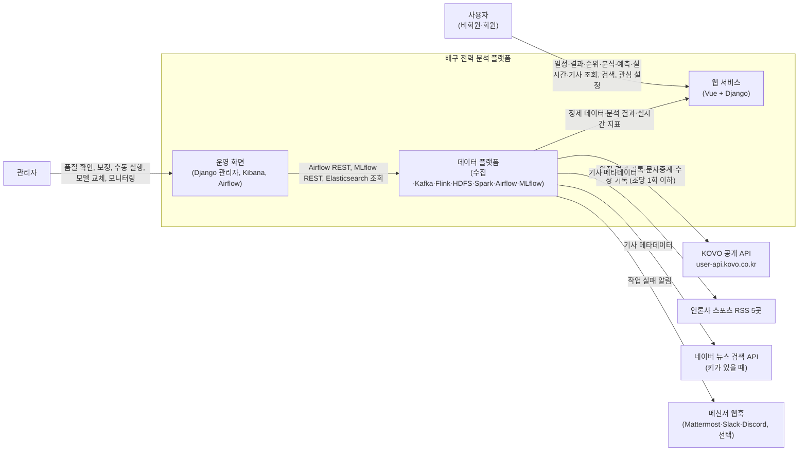
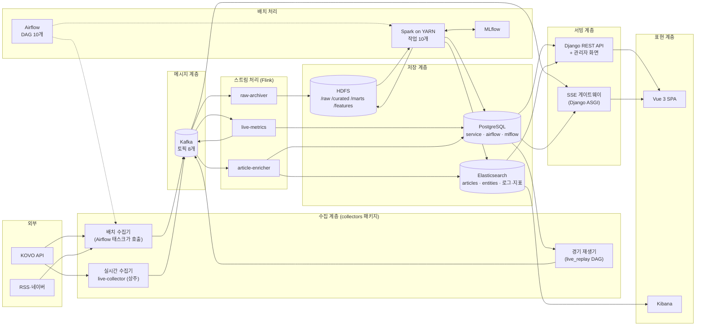
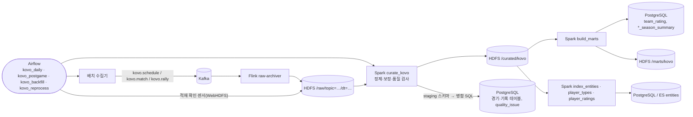
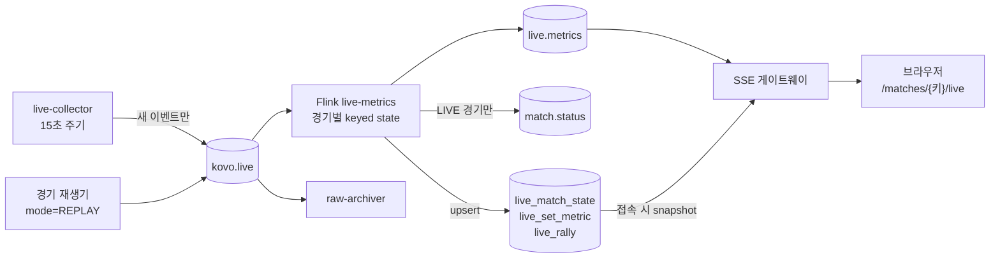
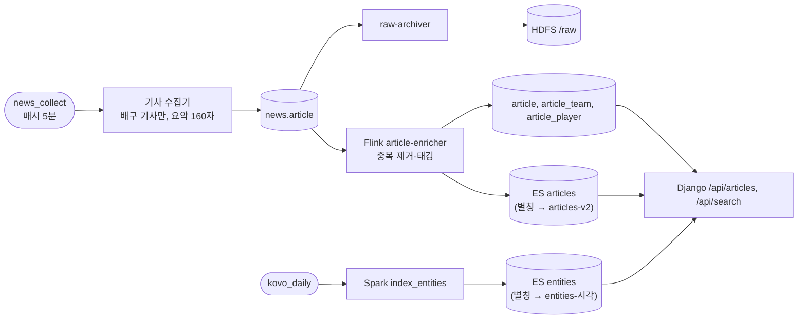
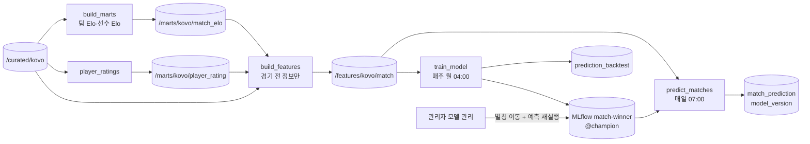
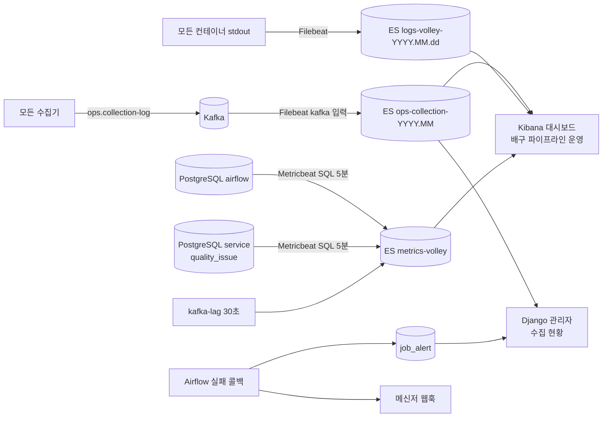

# 배구 전력 분석 플랫폼 아키텍처 설계서

| 항목 | 내용 |
|---|---|
| 문서 버전 | v1.0 |
| 작성일 | 2026-11-16 |
| 기준 | 요구사항 명세서 v1.0([01-requirements.md](01-requirements.md)), 1차 구현 결과물(저장소 `master`, 커밋 `d1094e7`) |
| 상태 | 재개발 기준선. 1차 구현에서 실제로 동작을 확인한 구성을 기준으로 쓰고, 운영 환경 목표와 다른 점은 [11장](#11-운영-환경-전환-시-바꿀-것)에 따로 적었다 |

| 버전 | 변경 내용 |
|---|---|
| v1.0 | 설계서 v0.1의 1장(아키텍처 설계)을 별도 문서로 분리하고, 1차 구현 결과로 전면 보정했다. 초안과 달라진 점: Nginx·Gunicorn 미사용(개발 구성), 메모리 상한 실측값, Kafka 토픽 8개(`kovo.player` 추가), 수집 이력의 저장 위치(DB 테이블 → Kafka·Elasticsearch), ML 라이브러리(scikit-learn·XGBoost → Spark MLlib), 보관 정책 미적용 항목 |

문서 체계: **요구사항 명세서**(무엇을) → **아키텍처 설계서**(이 문서: 어떤 구성 요소로, 어디에 배치해) → [상세 설계서](03-design.md)(각 모듈을 어떻게) → [ERD](04-erd.md)(서빙 DB 구조) → [화면 설계서](05-screen-spec.md)(화면) → [인터페이스 명세서](06-interface-spec.md)(주고받는 형식). 개발·시험·운영은 [개발 가이드](08-dev-guide.md), [테스트 계획서](07-test-plan.md), [운영 매뉴얼](09-operations.md), [개발 계획서(WBS)](10-wbs.md). 다이어그램은 Mermaid로 썼다(GitHub에서는 그림으로 보이고, VS Code는 "Markdown Preview Mermaid Support" 확장으로 본다).

## 목차

1. [아키텍처 목표와 제약](#1-아키텍처-목표와-제약)
2. [설계 원칙](#2-설계-원칙)
3. [시스템 컨텍스트](#3-시스템-컨텍스트)
4. [논리 아키텍처](#4-논리-아키텍처)
5. [데이터 흐름](#5-데이터-흐름)
6. [배포 아키텍처](#6-배포-아키텍처)
7. [저장소 아키텍처](#7-저장소-아키텍처)
8. [기술 스택과 버전](#8-기술-스택과-버전)
9. [횡단 관심사](#9-횡단-관심사)
10. [아키텍처 결정 기록](#10-아키텍처-결정-기록)
11. [운영 환경 전환 시 바꿀 것](#11-운영-환경-전환-시-바꿀-것)

---

## 1. 아키텍처 목표와 제약

| 구분 | 내용 | 근거 |
|---|---|---|
| 필수 기술 | Airflow, Hadoop(HDFS·YARN), Spark, Flink, Elasticsearch, Kibana를 모두 실제 데이터 흐름에 쓴다. 시연용 껍데기가 아니라 각 기술이 맡은 일이 있어야 한다 | 요구사항 2.8 |
| 배치 + 실시간 | 경기 기록은 하루 단위 확정 처리로 충분하지만, 진행 중 경기는 수집 후 30초 이내에 화면에 반영해야 한다 | NFR-13, NFR-14 |
| 재처리 | 가공 규칙이 바뀌어도 원천부터 다시 처리할 수 있어야 한다. 원천은 지우지 않는다 | PIPE-08, NFR-22 |
| 수집 예절 | KOVO 요청은 프로세스·컨테이너를 모두 합쳐 초당 1회 이하. 로그인·차단 우회 금지 | NFR-01, NFR-04 |
| 단일 PC | 개발·시연을 PC 한 대(Docker Desktop, WSL2)에서 한다. 서비스별 메모리 상한 합계 약 22GB | 요구사항 7장 |
| 서비스 가용성 | 수집·파이프라인이 멈춰도 웹은 마지막으로 성공한 데이터로 동작한다 | NFR-21 |
| 비공개 운영 화면 | Kafka·Airflow·Kibana 등 관리 화면은 외부에 열지 않는다 | NFR-34 |

## 2. 설계 원칙

| 원칙 | 내용 | 어기면 생기는 문제 |
|---|---|---|
| 람다 아키텍처 | 배치(Spark)와 실시간(Flink)을 나누고 서빙 DB(PostgreSQL)에서 합친다. 실시간 결과는 경기가 확정(`CONFIRMED`)되면 배치 결과로 대체된다 | 실시간 계산 오류가 공식 기록으로 굳는다 |
| 원천 우선 저장(ELT) | 수집기는 API 응답을 손대지 않고 봉투(envelope)에 담아 Kafka로 보내고, Flink `raw-archiver`가 HDFS에 그대로 쌓는다. 가공은 그다음이다 | 규칙을 고칠 때마다 KOVO에 다시 요청해야 한다 |
| 수집과 처리의 분리 | 수집기는 발행까지만 책임진다. 처리 쪽(Flink·Spark)이 멈춰도 수집은 계속되고, Kafka 7일 보관 안에서 따라잡는다 | 한쪽 장애가 전체를 멈춘다 |
| 서비스는 조회만 | Django는 서빙 DB와 Elasticsearch를 읽기만 한다. 무거운 계산(Elo, 백분위, 능력치, 예측)은 파이프라인이 미리 끝낸다. 웹이 쓰는 테이블은 회원·관심·운영 기록뿐이다 | 응답 시간 목표(NFR-11) 미달, 화면마다 계산이 달라짐 |
| 멱등성 | 같은 입력으로 다시 돌리면 결과(행, id, 색인)가 같다. 모든 적재는 자연 키 기준 upsert 또는 한 트랜잭션 전체 교체다 | 재시도·재처리 때 중복 행이 생긴다 |
| 스키마 단일 관리 | 서빙 DB 테이블 구조는 Django 마이그레이션만 만든다. Spark·Flink는 같은 테이블에 SQL로 쓰되 구조를 만들거나 바꾸지 않는다 | 두 곳에서 스키마가 어긋난다 |
| 바뀌지 않는 공개 키 | 화면 주소·API·메시지 키는 DB id가 아니라 KOVO 코드(`시즌-경기번호`, 팀·선수 코드)를 쓴다 | DB를 다시 만들면 링크가 깨진다 |
| 외부 비공개 | 모든 컨테이너 포트는 `127.0.0.1`에만 연다 | 관리 화면이 인터넷에 노출된다 |

## 3. 시스템 컨텍스트

외부 시스템과의 약속은 요구사항 5.1(수집 정책)을 따른다. LLM API는 AI 기능(ANL-12, WEB-15)을 만들 때 추가된다([reference/llm-options.md](reference/llm-options.md)).

## 4. 논리 아키텍처

### 4.1 계층과 구성 요소

### 4.2 구성 요소별 책임

| 구성 요소 | 책임 | 입력 | 출력 | 상세 설계 |
|---|---|---|---|---|
| 배치 수집기 | 시즌 목록, 일정·결과, 경기 상세(박스스코어), 문자중계, 선수 수상·주요 기록, 기사 메타데이터 수집. 응답 원본을 봉투에 담아 발행하고 실행마다 수집 이력을 남긴다 | KOVO API, RSS, 네이버 API | Kafka `kovo.*`, `news.article`, `ops.collection-log` | design 2장 |
| 실시간 수집기 | 10분 안에 시작하거나 진행 중인 경기를 15초마다 조회해 새 문자중계 이벤트만 발행 | KOVO `/stat/real-time`, PostgreSQL(경기 일정, 재시작 위치) | Kafka `kovo.live` | design 2.8 |
| 경기 재생기 | 끝난 경기의 문자중계를 실제 속도(또는 배속)로 다시 발행(`mode: REPLAY`) | PostgreSQL `rally_event`, `set_score` | Kafka `kovo.live` | design 2.9 |
| Flink `raw-archiver` | `kovo.*`·`news.*`·`ops.*` 토픽 전체를 수집일별 JSON 줄 파일로 HDFS에 보관 | Kafka | HDFS `/raw/` | design 3.2 |
| Flink `live-metrics` | 경기별 상태(점수·세트·서브권·연속 득점), 세트 지표, 실시간 승리 확률 계산. 실제 경기의 `match.status`를 `LIVE`·`FINISHED`로 바꿈 | Kafka `kovo.live`, PostgreSQL(팀 시즌 요약) | PostgreSQL `live_*`, Kafka `live.metrics` | design 3.3 |
| Flink `article-enricher` | 기사 중복 제거(URL, 정규화 제목, 7일), 팀·선수 태깅, 저장 | Kafka `news.article`, PostgreSQL(팀·선수 사전) | PostgreSQL `article*`, Elasticsearch `articles` | design 3.4 |
| Spark 작업 | 원천 정제·품질 검사·보정 적용, 분석 마트(Elo·시즌 요약), 검색 색인, 선수 유형, 능력치 카드, 수상 기록 정제, 예측 피처·학습·예측 | HDFS `/raw/`, `/curated/` 등 | HDFS `/curated/`·`/marts/`·`/features/`, PostgreSQL, Elasticsearch `entities`, MLflow | design 4장 |
| Airflow | 배치 수집·HDFS 적재 확인·Spark 실행·학습·예측의 순서와 일정, 재시도(3회), 최종 실패 알림 | DAG 정의 | 작업 실행, `job_alert` | design 5장 |
| MLflow | 실험 기록(`match-winner`, `player-types`), 모델 레지스트리와 `champion` 별칭 | Spark 학습 결과 | 모델 버전 | design 4.9 |
| Django REST API | REST API 25개 경로(조회, 회원·관심, 상태 확인), Django 관리자(품질·보정·수집 현황·수동 실행·모델 관리) | PostgreSQL, Elasticsearch, Airflow·MLflow REST | JSON, 관리 화면 | design 6장 |
| SSE 게이트웨이 | 경기별 브라우저 연결에 스냅숏을 보낸 뒤 `live.metrics` 갱신을 밀어 줌 | Kafka `live.metrics`, PostgreSQL | Server-Sent Events | design 6.5 |
| Vue SPA | 사용자 화면 14개(S01~S14) | REST API, SSE | 화면 | design 7장, screen-spec |
| 운영 모니터링 | 컨테이너 로그(Filebeat), Airflow·품질 지표(Metricbeat SQL), Kafka 컨슈머 랙(`kafka-lag`)을 Elasticsearch에 모아 Kibana 대시보드로 | 컨테이너 로그, DB, Kafka | ES `logs-volley-*`, `metrics-volley`, `ops-collection-*` | design 9.6 |

## 5. 데이터 흐름

### 5.1 배치 경로(경기 기록)

경기 하나의 수명: 일정 수집으로 `SCHEDULED` → (실시간 수집 시) `LIVE` → 결과가 나오면 `FINISHED` → 박스스코어·문자중계 적재와 품질 검사 통과 시 `CONFIRMED`. 열리지 않은 경기는 `CANCELLED`. 상태 전이 규칙은 [상세 설계서 10.5](03-design.md#105-상태-다이어그램-경기-상태).

### 5.2 스피드 경로(실시간 경기)

재생 기록으로 잰 지연은 수집 시각 → DB 저장 평균 약 3초(120배속에서도 최대 4.5초)이고 SSE 전달은 그 직후다(NFR-14 목표 30초).

### 5.3 기사·검색 경로

### 5.4 예측 경로(ML)

### 5.5 운영 관측 경로

## 6. 배포 아키텍처

### 6.1 실행 환경

- 호스트: Windows 11 + Docker Desktop(WSL2 백엔드). 리눅스 서버에서도 같은 `compose.yaml`로 실행된다.
- 전체를 한 번에 띄우려면 WSL2 메모리를 24GB 이상(`%USERPROFILE%\.wslconfig`의 `memory=24GB`)으로, 호스트 메모리는 32GB 이상을 권장한다.
- 서비스를 **프로필**로 묶어 필요한 것만 띄운다. 이미지 빌드는 `infra/*/Dockerfile`, 설정은 `.env`(예시 `.env.example`).

### 6.2 프로필과 서비스

| 프로필 | 서비스 | 메모리 상한 합 |
|---|---|---|
| (기본, 항상) | `postgres`, `kafka` + 1회성 `kafka-volume-perms`, `kovo-rate-perms`, `kafka-init` | 2.0GB |
| `app` | `django-api`, `django-sse`, `frontend` | 1.9GB |
| `batch` | `namenode`, `datanode`, `resourcemanager`, `nodemanager`, `airflow`, `mlflow` | 10.4GB |
| `stream` | `namenode`, `datanode`(batch와 공유), `flink-jobmanager`, `flink-taskmanager`, `flink-job-keeper`, `live-collector` | 5.7GB (HDFS 1.5GB 포함) |
| `search` | `elasticsearch`, `kibana`, `filebeat`, `metricbeat`, `kafka-lag` + 1회성 `kibana-setup` | 3.8GB |
| 전부 | 20개 상주 서비스 + 1회성 4개 | 약 22.2GB |

### 6.3 서비스 명세

| 서비스 | 이미지 | 포트(호스트, 모두 127.0.0.1) | 메모리 상한 | 주요 설정 |
|---|---|---|---|---|
| `postgres` | `postgres:16-alpine` | 5432 | 1GB | DB 3개: `service`(POSTGRES_DB), `airflow`, `mlflow`(`infra/postgres/init-databases.sh`가 첫 기동 때 생성). `TZ=Asia/Seoul` |
| `kafka` | `apache/kafka:3.9.0` | 29092(호스트용 리스너) | 1GB | KRaft 단일 노드(broker+controller), 힙 512MB, 보관 168시간, 토픽 자동 생성 끔. 컨테이너 간 `kafka:9092` |
| `kafka-init` | `apache/kafka:3.9.0` | - | - | `infra/kafka/create-topics.sh`: 토픽 8개 생성(이미 있으면 건너뜀) 후 종료 |
| `kafka-volume-perms`, `kovo-rate-perms` | kafka / airflow 이미지 | - | - | 새 볼륨 소유자 변경 후 종료(kafka uid 1000, airflow uid 50000) |
| `django-api` | `volley/backend:dev`(`backend/Dockerfile`, Python 3.11) | 8000 | 768MB | `python manage.py runserver 0.0.0.0:8000`, `./backend` 바인드 마운트 |
| `django-sse` | `volley/backend:dev` | 8001 | 384MB | `uvicorn config.asgi:application --port 8001`. `/api/live/{키}/stream`만 담당 |
| `frontend` | `node:22-alpine` | 5173 | 768MB | `npm ci && npm run dev`. Vite 프록시: `/api/live/{키}/stream` → django-sse, 나머지 `/api` → django-api. Windows 바인드 마운트라 파일 감시는 폴링 |
| `namenode` / `datanode` | `volley/hadoop:3.4.1`(`infra/hadoop`, Python 3.11 + Java 11) | 9870 | 각 768MB | HDFS `hdfs://namenode:9000`, WebHDFS 9870 |
| `resourcemanager` / `nodemanager` | `volley/hadoop:3.4.1` | 8088 | 768MB / 3.5GB | YARN. Spark executor가 nodemanager 컨테이너에서 돈다 |
| `airflow` | `volley/airflow:3.0.6`(`infra/airflow`, Python 3.11 + Java 11 + PySpark 3.5.5 + 수집기 의존성) | 8080 | 4GB | `airflow standalone`(웹·스케줄러·작업자 한 컨테이너), LocalExecutor, 병렬 6. Spark 드라이버도 여기서 돈다(client 모드). 볼륨: `airflow/dags`, `spark_jobs`, `collectors`, `kovo-rate` |
| `mlflow` | `volley/mlflow:3.1.1` | 5000 | 768MB | 백엔드 저장소 PostgreSQL `mlflow`, 아티팩트 볼륨 `mlflow-artifacts`(`--serve-artifacts`) |
| `flink-jobmanager` / `flink-taskmanager` | `volley/flink:1.20.1`(Java 17, PyFlink, Kafka·JDBC 커넥터, 하둡 클라이언트) | 8081 | 1.2GB / 2.3GB | 슬롯 4, 기본 병렬 1, 체크포인트 30초, 체크포인트 위치 HDFS `/flink/checkpoints` |
| `flink-job-keeper` | `volley/flink:1.20.1` | - | 512MB | 60초마다 `submit.sh`로 세 작업이 떠 있는지 확인하고, 없으면 최신 체크포인트에서 다시 제출 |
| `live-collector` | `volley/airflow:3.0.6` | - | 256MB | `python -m collectors live --every 15`. `kovo-rate` 볼륨 공유 |
| `elasticsearch` | `volley/elasticsearch:8.17.4`(nori 플러그인) | 9200 | 2GB | 단일 노드, 보안 끔(이 PC 전용), 힙 1GB |
| `kibana` | `kibana:8.17.4` | 5601 | 1GB | 대시보드 `volley-ops` |
| `kibana-setup` | `curlimages/curl` | - | - | 데이터 뷰·대시보드(`infra/kibana/dashboard.ndjson`) 가져오기 후 종료 |
| `filebeat` | `elastic/filebeat:8.17.4` | - | 256MB | 도커 컨테이너 로그 + Kafka `ops.collection-log` 입력 |
| `metricbeat` | `elastic/metricbeat:8.17.4` | - | 256MB | SQL 모듈로 Airflow DB·서비스 DB를 5분마다 조회 |
| `kafka-lag` | `volley/airflow:3.0.6` | - | 256MB | `python -m collectors kafka-lag --every 30` |

### 6.4 볼륨

| 볼륨 | 내용 | 비고 |
|---|---|---|
| `pg-data` | PostgreSQL 3개 DB | 백업·이전은 `scripts/migrate_export.ps1`·`migrate_restore.ps1` |
| `kafka-data` | Kafka 로그(7일) | |
| `hdfs-nn`, `hdfs-dn` | HDFS 메타데이터·블록(원천 영구 보관) | 재처리의 원천. 지우면 KOVO에서 다시 받아야 한다 |
| `airflow-logs` | Airflow 작업 로그 | |
| `mlflow-artifacts` | 모델 파일·그래프 | |
| `es-data` | Elasticsearch 색인 | `articles`는 PostgreSQL `article`로 재색인 가능, `entities`는 매일 재생성 |
| `kovo-rate` | KOVO 요청 간격 잠금 파일(`/run/kovo/rate.lock`) | airflow와 live-collector가 공유 |
| `frontend-node-modules` | Vue 의존성 | Windows 폴더와 분리 |

### 6.5 네트워크와 포트 정책

- 모든 서비스는 Compose 기본 네트워크 하나에 있고 서비스 이름으로 서로 찾는다(`postgres`, `kafka:9092`, `namenode:9000`, `elasticsearch:9200`, `mlflow:5000`, `airflow:8080`).
- 호스트 포트는 전부 `127.0.0.1:` 바인딩이라 같은 PC에서만 열린다(NFR-34). 사용자에게 공개할 때는 11장의 리버스 프록시를 앞에 둔다.

### 6.6 환경 변수(`.env`)

| 변수 | 쓰는 곳 | 설명 |
|---|---|---|
| `COMPOSE_PROJECT_NAME` | Compose | 컨테이너·볼륨 이름 앞부분(`volley`) |
| `POSTGRES_USER`, `POSTGRES_PASSWORD` | 모든 DB 접속 | |
| `SERVICE_DB`, `AIRFLOW_DB`, `MLFLOW_DB` | postgres, Django, Spark, Flink, Airflow, MLflow | DB 이름(`service`, `airflow`, `mlflow`) |
| `DJANGO_SECRET_KEY`, `DJANGO_DEBUG`, `DJANGO_ALLOWED_HOSTS` | Django | |
| `AUTH_THROTTLE_RATE` | Django | 가입·로그인 시도 제한(기본 `10/min`) |
| `CORS_ALLOWED_ORIGINS` | Django | 기본 `http://localhost:5173,http://127.0.0.1:5173` |
| `KAFKA_BOOTSTRAP_SERVERS` | 수집기, Django SSE, Airflow | 컨테이너 안 `kafka:9092`, 호스트 `localhost:29092` |
| `KOVO_API_BASE`, `KOVO_MIN_INTERVAL_SEC` | 수집기 | 기본 `https://user-api.kovo.co.kr`, `1.0` |
| `KOVO_RATE_LOCK_FILE` | 수집기(Compose가 지정) | `/run/kovo/rate.lock` |
| `NAVER_CLIENT_ID`, `NAVER_CLIENT_SECRET` | 기사 수집기 | 비우면 RSS만 |
| `ALERT_WEBHOOK_URL`, `AIRFLOW_UI_URL` | Airflow 실패 알림 | 비우면 관리자 화면에만 기록 |
| `ELASTICSEARCH_URL` | Django, Flink, Spark, 수집기 | `http://elasticsearch:9200` |
| `WEBHDFS_URL`, `MLFLOW_TRACKING_URI` | Airflow(Compose가 지정) | `http://namenode:9870/webhdfs/v1`, `http://mlflow:5000` |
| `AIRFLOW_API_URL`, `MLFLOW_TRACKING_URI` | Django 관리자 | Airflow·MLflow REST 주소. 지정하지 않으면 `http://airflow:8080`, `http://mlflow:5000` |

## 7. 저장소 아키텍처

### 7.1 Kafka 토픽

모든 토픽: 복제 1(브로커 1대), `compression.type=lz4`, `retention.ms=604800000`(7일), 자동 생성 끔. 메시지는 UTF-8 JSON. 생산자 설정은 `acks=all`, `enable.idempotence=true`, `linger.ms=50`.

| 토픽 | 파티션 | 메시지 키 | 생산자 | 소비자(그룹) |
|---|---|---|---|---|
| `kovo.schedule` | 1 | 시즌 목록: `season-list-{gcode}` / 일정: 시즌 코드(`023`) | SeasonCollector, ScheduleCollector | `raw-archiver` |
| `kovo.match` | 3 | `시즌-경기번호`(`023-6`) | MatchCollector | `raw-archiver` |
| `kovo.rally` | 3 | `시즌-경기번호` | RallyCollector | `raw-archiver` |
| `kovo.live` | 3 | `시즌-경기번호` | LiveCollector, MatchReplayer | `live-metrics`, `raw-archiver` |
| `kovo.player` | 1 | 선수 코드 | HonorCollector | `raw-archiver` |
| `news.article` | 1 | 정규화한 기사 URL | NewsCollector | `article-enricher`, `raw-archiver` |
| `live.metrics` | 3 | `시즌-경기번호` | Flink `live-metrics` | SSE 게이트웨이(그룹 오프셋을 쓰지 않고 끝에서부터 읽음) |
| `ops.collection-log` | 1 | 수집 작업 이름(`kovo.match` 등) | 모든 수집기(CollectionLogger) | `raw-archiver`, Filebeat(`filebeat-ops`) |

같은 키는 같은 파티션으로 가므로 한 경기의 이벤트 순서가 보장된다. 키 기반이므로 파티션 수는 처음 정한 뒤 바꾸지 않는다. 메시지 형식은 [상세 설계서 2.5](03-design.md#25-메시지-형식).

### 7.2 HDFS 경로

| 경로 | 형식 | 쓰는 쪽 | 보관 |
|---|---|---|---|
| `/raw/topic={토픽}/dt={yyyy-MM-dd}/part-*` | JSON 줄(메시지 1건 = 1줄, 봉투 그대로). `dt`는 Kafka 레코드 시각의 서울 날짜(=수집일) | Flink raw-archiver | 영구(재처리 원천) |
| `/curated/kovo/{table}/season_code={코드}/` | Parquet. table = season, competition, team, player, match, set_score, team_match_stat, player_match_stat, player_attack_stat, rally_event, quality_issue | Spark curate_kovo | 영구(처리한 시즌만 동적 덮어쓰기) |
| `/marts/kovo/{match_elo, team_rating, team_season_summary, player_season_summary, player_rating}/` | Parquet | build_marts, player_ratings | 실행마다 교체 |
| `/features/kovo/match/` | Parquet | build_features | 실행마다 교체 |
| `/flink/checkpoints/{raw-archiver, live-metrics, article-enricher}/` | Flink 체크포인트 | Flink | 작업 취소 시에도 보관(RETAIN_ON_CANCELLATION) |

### 7.3 PostgreSQL

| DB | 내용 | 스키마 관리 |
|---|---|---|
| `service` | 서빙 테이블 35개 + Django 기본 테이블 + DRF 토큰([ERD](04-erd.md)). Spark 적재 중에는 실행마다 임시 스키마 `staging_<YARN 애플리케이션 id>`가 생겼다 지워진다 | Django 마이그레이션 |
| `airflow` | Airflow 메타데이터 | Airflow |
| `mlflow` | MLflow 추적·레지스트리 메타데이터 | MLflow |

### 7.4 Elasticsearch

| 인덱스(별칭) | 실제 인덱스 | 쓰는 쪽 | 매핑 | 보관 |
|---|---|---|---|---|
| `articles` | `articles-v2` | Flink article-enricher(문서 id = sha1(url)) | `flink_jobs/es/articles.json`: `ko`(nori) + `bigram` 분석기 | 목표 2년(보관 정책 미적용) |
| `entities` | `entities-<시각>` | Spark index_entities(매일 새 인덱스 → 별칭 이동 → 옛 인덱스 삭제) | `spark_jobs/es/entities.json`: `search_as_you_type` + `bigram` | 매일 교체 |
| `ops-collection-*` | 월별 | Filebeat(`ops.collection-log`) | 동적 | 정책 미적용 |
| `logs-volley-*` | 일별 | Filebeat(컨테이너 로그, `log.level` 판정) | 템플릿 `logs-volley` | 목표 30일(정책 미적용) |
| `metrics-volley` | 데이터 스트림 | Metricbeat, kafka-lag | 템플릿 `metrics-volley` | 정책 미적용 |

### 7.5 MLflow

| 항목 | 값 |
|---|---|
| 실험 | `match-winner`(경기 예측, 부모 실행 + Hyperopt 시도마다 하위 실행 + 백테스트 지표), `player-types`(K-means k별 실루엣) |
| 등록 모델 | `match-winner`, 서비스 모델은 별칭 `champion` |
| 저장 | 메타데이터 PostgreSQL `mlflow`, 모델 파일 `mlflow-artifacts` 볼륨 |

## 8. 기술 스택과 버전

| 영역 | 기술 | 버전 | 비고 |
|---|---|---|---|
| 언어 | Python | 3.11 (Flink 이미지만 3.10) | Spark 드라이버(airflow)와 executor(hadoop) 버전이 같아야 한다 |
| | JavaScript(ES 모듈) | Node.js 22 | |
| 메시징 | Apache Kafka(KRaft), confluent-kafka | 3.9.0 / 2.10.1 | |
| 스트림 | Apache Flink(PyFlink), flink-sql-connector-kafka, flink-connector-jdbc | 1.20.1 / 3.3.0-1.20 | Java 17 |
| 데이터 레이크 | Hadoop HDFS·YARN | 3.4.1(lean) | Java 11 |
| 배치 | Apache Spark(PySpark), Spark MLlib | 3.5.5 | YARN client 모드 |
| 워크플로 | Apache Airflow(+ apache-spark provider) | 3.0.6 | LocalExecutor, `airflow standalone` |
| ML 관리 | MLflow, Hyperopt | 3.1.1 / 0.2.7 | 서버는 `mlflow`, Spark 쪽은 `mlflow-skinny` |
| DB | PostgreSQL, JDBC 드라이버 | 16 / 42.7.5 | psycopg2 2.9.10(파이프라인), psycopg 3.2.9(Django) |
| 검색·로그 | Elasticsearch(analysis-nori), Kibana, Filebeat, Metricbeat, elasticsearch-spark | 8.17.4 | 파이썬 클라이언트 8.17.2 |
| 백엔드 | Django, Django REST framework, django-cors-headers, Uvicorn | 5.2.4 / 3.16.0 / 4.7.0 / 0.35.0 | Gunicorn 23.0.0은 이미지에만 있고 개발 구성에서는 쓰지 않음 |
| 프론트엔드 | Vue, Vue Router, Pinia, axios, Vite | 3.5 / 4.5 / 3 / 1.8 / 6 | 차트 라이브러리 없이 SVG 컴포넌트로 직접 그림 |
| 글꼴 | Saira Condensed, Black Han Sans, Pretendard, JetBrains Mono | - | 모두 SIL OFL 1.1([FONT_LICENSES.md](reference/font-licenses.md)) |
| 수집 | requests | 2.32.4 | RSS는 표준 라이브러리 `xml.etree`로 파싱 |

## 9. 횡단 관심사

### 9.1 수집 정책 집행

- KOVO를 부르는 모든 코드는 `KovoClient` 한 곳을 거치고, 요청 직전에 제한기(`RateLimiter`)를 기다린다.
- 컨테이너 환경에서는 잠금 파일 기반 제한기(`FileRateLimiter`, `fcntl.flock`)가 `kovo-rate` 볼륨의 파일 하나로 Airflow 작업 프로세스들과 `live-collector`의 요청 간격을 합쳐서 1초 이상으로 지킨다.
- User-Agent에 비상업 학습 프로젝트임을 밝히고(`volley-insight-collector/0.1 (non-commercial student project)`), 구단 사이트 식별 헤더(`Origin`, `X-Site-Origin`) 같은 것은 보내지 않는다.
- 기사 본문은 수집 단계에서 잘라 Kafka·HDFS에도 남기지 않는다(요약 160자).

### 9.2 보안

| 항목 | 방식 |
|---|---|
| 비밀 값 | `.env`로만 주입, 저장소에는 `.env.example`만(NFR-33) |
| 사용자 인증 | DRF 토큰(`Authorization: Token …`), 비밀번호는 Django 기본 해시(PBKDF2)와 검증기 4종(NFR-31) |
| 무차별 대입 방지 | 가입·로그인 IP당 분당 10회(`ScopedRateThrottle`), 로그인 실패 문구 단일화 |
| 관리자 | Django 관리자는 `is_staff` 계정만, 모델 교체는 최고 관리자만(NFR-32) |
| 노출 | 모든 포트 `127.0.0.1` 바인딩, Elasticsearch 보안 기능은 끈 상태(이 PC 전용, NFR-34) |
| 개인정보 | 이메일·닉네임만 저장, 탈퇴 즉시 삭제(NFR-03) |
| 출력 이스케이프 | 검색 강조는 Elasticsearch `encoder: html`로 본문을 이스케이프한 뒤 `<mark>`만 넣는다 |
| 리다이렉트 | 로그인 뒤 `?next=`는 같은 사이트 경로만 허용 |

### 9.3 신뢰성과 복구

| 위험 | 대응 |
|---|---|
| 일시적 KOVO 오류 | 429·5xx·네트워크 오류는 2·4·8초 지수 백오프로 3회 재시도, 4xx는 재시도하지 않음 |
| Kafka 전달 실패 | 발행 전 브로커 접속 확인(`check`), 발행 후 `flush`로 전달 확인. 실패하면 수집 실행 전체를 실패로 기록 |
| HDFS 적재 누락 | Airflow 센서가 WebHDFS로 마감된 파일에서 이번 실행 `run_id`의 줄 수를 세어 확인한 뒤에만 정제(design 5.1) |
| Flink 작업 중단·PC 재시작 | `flink-job-keeper`가 1분마다 최신 완료 체크포인트에서 다시 제출. 같은 이름 작업이 이미 있으면 제출하지 않음(이중 제출 방지) |
| 작업 실패 | Airflow 재시도 3회(5분 간격, ML·기사 2회) 후 `job_alert` 기록 + 메신저 웹훅. 같은 단계의 미확인 알림이 6시간 안에 있으면 다시 보내지 않음 |
| 부분 적재 | Spark 적재는 실행 전용 staging 스키마 → advisory lock을 건 한 트랜잭션 병합. 사이트는 반쯤 바뀐 데이터를 보지 않음 |
| 검색 엔진 장애 | 검색 API는 503과 안내 문구, 나머지 화면은 영향 없음. 연결 오류 뒤에는 캐시된 클라이언트를 버리고 다시 만듦 |
| 메모리 부족 | 서비스별 `mem_limit`, Airflow 병렬 6으로 제한(작업자 32개가 메모리를 차지해 Spark 드라이버가 죽은 사례) |

### 9.4 시간 규칙

- 경기 날짜·시각의 업무 기준은 서울 시간(KST)이다. DB에는 `timestamptz`(UTC 저장)로 넣고 화면에서 서울 시간으로 보인다(`TIME_ZONE=Asia/Seoul`, `USE_TZ=True`).
- 봉투의 `fetched_at`은 UTC ISO 문자열, HDFS `dt` 파티션은 서울 날짜다.
- Airflow 스케줄은 `Asia/Seoul` 기준이다.

### 9.5 관측성

| 신호 | 수집 | 보는 곳 |
|---|---|---|
| 서비스 로그 | 모든 컨테이너 stdout → Filebeat(`log.level`을 ERROR·WARN 패턴으로 판정) | Kibana "최근 오류 로그", 서비스별 오류 수 |
| 수집 이력(COL-08) | 수집기 → `ops.collection-log` → Filebeat → `ops-collection-*` (HDFS에도 보관) | Kibana 수집 성공률·건수, Django "수집 현황" |
| Kafka 지연 | `kafka-lag`가 모든 그룹의 커밋 위치와 끝 위치를 30초마다 기록 | Kibana 컨슈머 랙 |
| Airflow 지연 | Metricbeat SQL(작업 대기 시간, DAG 시작 지연, 5분) | Kibana |
| 데이터 품질 | Metricbeat SQL(`quality_issue` 미해결 수, 5분) | Kibana, Django "품질 검사 결과" |
| 작업 실패 | Airflow 콜백 → `job_alert` | Django 관리 첫 화면 "미확인 작업 실패 N건", 메신저 |
| 상태 확인 | `GET /api/health`(DB 접속 포함) | 개발 점검 |

## 10. 아키텍처 결정 기록

| 번호 | 결정 | 대안 | 이유 |
|---|---|---|---|
| AD-01 | KOVO 공개 JSON API를 `requests`로 호출 | Selenium, HTML 파싱 | 사이트가 같은 API를 쓴다. 브라우저 자동화는 부하만 크다 |
| AD-02 | Kafka → Flink `raw-archiver` → HDFS로 원천 적재 | 수집기가 HDFS에 직접 쓰기, Kafka Connect | 수집기는 발행만 하게 해 단순화. Flink 체크포인트와 파일 싱크의 2단계 커밋으로 유실·반쪽 파일이 없다 |
| AD-03 | 실시간 전달은 SSE(Django ASGI + Uvicorn) | WebSocket, 폴링 | 서버 → 브라우저 한 방향이면 충분하고 일반 HTTP라 프록시·재연결이 단순하다 |
| AD-04 | Airflow LocalExecutor, standalone 한 컨테이너 | Celery + Redis | 단일 PC 자원 절약. 병렬 6이면 충분 |
| AD-05 | Spark는 YARN client 모드, 드라이버는 airflow 컨테이너 | cluster 모드 | 드라이버 로그를 Airflow 작업 로그에서 바로 본다. 대신 airflow 메모리 4GB |
| AD-06 | 서빙 DB 적재는 staging 스키마 + 병합 SQL + advisory lock | Spark JDBC로 직접 upsert | 트랜잭션 원자성, 동시 실행 안전, 자연 키 → id 변환을 SQL 한 곳에서 |
| AD-07 | 테이블 구조는 Django 마이그레이션이 소유, 쓰기는 Spark·Flink | 파이프라인이 DDL 관리 | 스키마 원천을 하나로. 저장 시각은 DB 기본값(`now()`) |
| AD-08 | 공개 키는 `시즌-경기번호`, 팀·선수 KOVO 코드 | DB id | DB를 다시 만들어도 주소가 같다. 경기 번호는 시즌 안에서 리그·성별을 통틀어 유일(검증) |
| AD-09 | 순위는 KOVO 순위 API 대신 경기 기록으로 계산 | `/stat/league/team-rank` 수집 | 정제된 경기 기록 하나로 모든 화면을 맞춘다. 단, 승점 감점 같은 공식 처분은 반영되지 않는다 |
| AD-10 | ML은 Spark MLlib(다항 로지스틱 회귀·랜덤 포레스트) + Hyperopt | scikit-learn, XGBoost | 데이터가 약 4,700경기라 단순 모델로 충분하고, 학습·예측을 같은 YARN 경로에서 돌린다 |
| AD-11 | 예측은 배치(매일 07:00)로 만들어 DB에 저장 | 모델 서빙 서버 | 경기 전날 1회 예측이면 충분. Django는 조회만 |
| AD-12 | 수집 이력은 DB 테이블 대신 Kafka `ops.collection-log` → ES·HDFS | `collection_log` 테이블 | 수집기가 DB에 의존하지 않게. Kibana 대시보드와 바로 연결 |
| AD-13 | 선수 소속 이력 테이블을 두지 않음 | `player_team_history` | 소속은 경기 기록(`player_match_stat.team_id`)으로 알 수 있고, 입단·이적 날짜는 API에 없다 |
| AD-14 | 관리자 기능은 Django 관리자 화면으로 | Vue 관리자 화면 + REST | 권한·양식·목록이 기본 제공되어 개발량이 적다 |
| AD-15 | 차트는 SVG 컴포넌트로 직접 구현 | Chart.js, ECharts | 디자인 토큰·접근성(요약 문장, 키보드)을 맞추기 쉽고 라이선스 걱정이 없다 |
| AD-16 | 재생 데이터 출처는 PostgreSQL `rally_event` | HDFS 원천 파일 | 원천에서 경기 하나를 찾으려면 모든 수집일 파일을 읽어야 한다 |

## 11. 운영 환경 전환 시 바꿀 것

1차 구현은 개발 구성이다. 외부에 공개하려면 아래를 바꾼다(요구사항 10장 미결정 8번 "배포 환경"과 함께 결정).

| 항목 | 지금(개발) | 운영 목표 |
|---|---|---|
| 웹 진입점 | Vite 개발 서버(5173)가 API 프록시 | Nginx(80/443)가 Vue 빌드 정적 파일 제공 + `/api` → Gunicorn, `/api/live/*/stream` → Uvicorn(`X-Accel-Buffering: no`) |
| Django | `runserver`, `DEBUG=true` | Gunicorn 워커 3개, `DEBUG=false`, `ALLOWED_HOSTS` 실제 도메인, HTTPS |
| 네트워크 | 기본 네트워크 하나, 포트 127.0.0.1 | `public`(nginx, django)과 `data`(나머지) 분리, nginx만 공개. 관리 화면은 SSH 터널 |
| Kafka | 브로커 1대, 복제 1 | 브로커 3대, `replication.factor=3`, `min.insync.replicas=2` |
| Elasticsearch | 보안 끔, 보관 정책 없음 | 보안 켬, ILM: `articles` 2년, `logs-volley-*` 30일 |
| 캐시 | 없음(측정상 불필요, p95 121ms) | 트래픽이 늘면 일정·순위 5분, 확정 경기 상세 1일 캐시 |
| 백업 | 수동 스크립트(`migrate_export.ps1`) | PostgreSQL 정기 덤프, HDFS 원천 스냅숏 |
