# 배구 전력 분석 플랫폼 상세 설계서

| 항목 | 내용 |
|---|---|
| 문서 버전 | v1.0 |
| 작성일 | 2026-11-16 (최초 v0.1 2026-11-02) |
| 기준 문서 | 요구사항 명세서 v1.0([01-requirements.md](01-requirements.md)), 아키텍처 설계서 v1.0([02-architecture.md](02-architecture.md)) |
| 기준 구현 | 저장소 `master`, 커밋 `d1094e7`(1차 구현). 이 문서의 규칙·상수는 그 코드에서 확인한 값이다 |
| 관련 문서 | [ERD](04-erd.md), [화면 설계서](05-screen-spec.md), [인터페이스 명세서](06-interface-spec.md)(외부 API 필드·메시지 형식), [테스트 계획서](07-test-plan.md), [개발 가이드](08-dev-guide.md) |
| 구성 | 1 공통 규약 / 2 수집 / 3 스트림 처리 / 4 배치 처리 / 5 워크플로 / 6 백엔드 / 7 프론트엔드 / 8 분석·예측 알고리즘 / 9 운영·모니터링 / 10 UML / 11 DFD / 12 테스트 / 13 미구현·개선 과제 |

| 버전 | 변경 내용 |
|---|---|
| v0.1 | 최초 작성(아키텍처, ERD 초안, DFD, UML)과 구현하며 붙인 구현 메모들 |
| v1.0 | 재개발 기준선으로 재구성. 아키텍처 장은 [02-architecture.md](02-architecture.md)로, ERD 장은 [04-erd.md](04-erd.md)로 옮겼다. 흩어져 있던 구현 메모를 모듈별 상세 설계(2~9장)로 정리하고, 실제와 달랐던 내용을 고쳤다: 주간 재학습의 champion 선정 방식(candidate 별칭 미사용), 학습 라이브러리(Spark MLlib), 존재하지 않던 `/api/matches/{id}/preview`(경기 상세에 포함), 빠져 있던 API 9개, Kafka 토픽 파티션, Airflow 재시도 횟수, 문자중계 코드 `ST`·`ET`의 뜻 |

다이어그램은 Mermaid로 썼다. 표기: `pipeline.py` 같은 파일 이름은 저장소 안의 경로를 줄여 쓴 것이다(전체 경로는 1.1절).

### 이전 판(v0.1) 절 번호 대응

코드 주석의 "설계서 1.8" 같은 참조는 v0.1 번호다. 새 위치는 아래와 같다.

| v0.1 | 내용 | v1.0 위치 |
|---|---|---|
| 1.1~1.4 | 설계 원칙, 시스템 컨텍스트, 컨테이너 구성, 구성 요소 책임 | architecture 2~4장 |
| 1.5, 1.6 | 배포 구성, 저장소별 데이터 배치 | architecture 6, 7장 |
| 1.7 | Kafka 토픽 | architecture 7.1, 이 문서 2.5 |
| 1.8 | Airflow DAG 설계 | 5장 |
| 1.9 | Flink 작업 설계 | 3장 |
| 1.10 | 백엔드·프론트엔드 모듈 구조 | 6.1, 7장 |
| 1.11 | 주요 REST API | 6.3 |
| 2.1~2.4 | ERD(경기·분석·기사·운영), 제약조건 | [04-erd.md](04-erd.md) |
| 2.5 | Elasticsearch 인덱스 | 3.4, 4.4, architecture 7.4 |
| 2.6 | 전력 분석 확장 | 4.3~4.6, 8장 |
| 3장 | DFD | 11장 |
| 4.1~4.4 | 유스케이스, 시퀀스 | 10.1~10.4 |
| 4.5, 4.6 | 상태 다이어그램(경기, 모델 별칭) | 10.5, 10.6 |
| 4.7 | 수집기 클래스 다이어그램 | 10.9 |
| 5장 | 요구사항 반영 필요 사항 | 요구사항 v0.7·v1.0에 반영 완료 |

---

## 1. 공통 설계 규약

### 1.1 저장소 구조(모노레포)

| 폴더 | 내용 |
|---|---|
| `collectors/` | 수집기 파이썬 패키지(`collectors/collectors/*.py`), 테스트(`tests/`), 실제 응답 표본(`samples/`), CLI `python -m collectors` |
| `airflow/dags/` | DAG 파일 10개. 공통 단계는 `kovo_tasks/pipeline.py`(Airflow를 import하지 않아 단위 테스트 가능), 실패 알림은 `kovo_tasks/alerts.py`. 테스트는 `airflow/tests/` |
| `spark_jobs/` | PySpark 작업 10개 + 점검 작업, 공용 적재 모듈 `pg_merge.py`, 병합 SQL `sql/*.sql`, ES 매핑 `es/entities.json`, 제출 스크립트 `submit.sh`, 테스트 |
| `flink_jobs/` | PyFlink 작업 3개 + 점검 작업, 순수 계산 모듈(`live_state.py`, `article_tags.py`), 체크포인트 찾기 `latest_checkpoint.py`, 제출 스크립트 `submit.sh`, ES 매핑 `es/articles.json`, 테스트 |
| `backend/` | Django 프로젝트 `config/`와 앱 7개(`accounts`, `league`, `matches`, `analytics`, `live`, `articles`, `ops`) |
| `frontend/` | Vue 3 + Vite 앱(`src/views`, `components`, `stores`, `api`, `composables`, `motion`, `constants`, `utils`) |
| `infra/` | 서비스별 Dockerfile·설정(hadoop, airflow, mlflow, flink, elasticsearch, filebeat, metricbeat, kibana, kafka, postgres) |
| `scripts/` | `resume.ps1`(재시작·상태 확인), `migrate_export.ps1`·`migrate_restore.ps1`(PC 이전), `measure_latency.py`(응답 시간) |
| `docs/` | 요구사항·아키텍처·상세 설계·ERD·화면 설계·기술 정리 |
| `design-system/` | 디자인 규칙(`volley-insight/MASTER.md`) |
| `ml/` | 비어 있음(README만). 학습·예측 코드는 Spark로 돌기 때문에 `spark_jobs/`에 있다. 재개발 때는 이 폴더를 없애거나 `spark_jobs/`의 ML 작업을 옮긴다 |

### 1.2 식별자와 코드 값

| 대상 | 규칙 | 예 |
|---|---|---|
| 시즌 코드 | KOVO 3자리 문자열. 항상 문자열로 다룬다(앞자리 0 유지) | `001` = 2004-05, `022` = 2025-26, `023` = 2026-27 |
| 경기 키 | `{시즌 코드}-{경기 번호}`. 정규식 `^\d{3}-\d+$`. 화면 주소, API 경로, Kafka 키, 보정 키에 쓴다 | `023-6` |
| 팀 코드 | KOVO 4자리. `1xxx` 남자부, `2xxx` 여자부 | `1001` 대한항공 |
| 선수 코드 | KOVO 7자리. `0000000`은 선수 없음 | `1000525` |
| 성별 | DB·API는 `M`/`F`. KOVO API 요청은 `1`(남)/`2`(여) | |
| 포지션 | `OH` 아웃사이드 히터, `OP` 아포짓, `MB` 미들 블로커, `S` 세터, `L` 리베로. 옛 코드 변환은 BR-09 | |
| 대회 | `gcode` `001` V-리그(`002` KOVO컵 미수집). `competition.type`: `REGULAR`, `POST`, `CUP` | |
| 리그 코드 | `201` 정규리그, `204` 준PO, `202` PO, `203` 챔프전. 제외: `200`, `801`, `901`, `903` | |
| 세트 스코어 클래스 | 홈 기준 `3:0`=0, `3:1`=1, `3:2`=2, `2:3`=3, `1:3`=4, `0:3`=5 | |
| 실시간 이벤트 순번 | `seq = 세트 번호 × 10000 + 세트 피드 안 위치(0부터)` | 2세트 57번째 = 20057 |

### 1.3 시간

- 업무 날짜·시각은 서울 시간(KST). 경기 시각은 KOVO의 `gdate`+`gstime`을 서울 시각으로 해석해 `timestamptz`로 저장한다.
- 봉투의 `fetched_at`, 수집 이력의 `started_at`·`finished_at`은 UTC ISO-8601(초 단위).
- HDFS `dt` 파티션은 Kafka 레코드 시각의 서울 날짜. Airflow 일정은 `Asia/Seoul`. Django `TIME_ZONE=Asia/Seoul`, `USE_TZ=True`.

### 1.4 멱등성과 재처리 규칙

| 단계 | 규칙 |
|---|---|
| 수집 | 다시 수집하면 같은 항목이 한 번 더 발행된다(허용). 각 실행은 새 `run_id`를 가진다 |
| 원천 | HDFS에는 모든 사본이 남는다. 장애 뒤 드물게 생기는 중복 줄도 허용 |
| 정제 | 항목마다 가장 최근 `fetched_at`(문자중계는 세트별 가장 최근 수집 실행) 하나만 쓴다. 처리한 시즌의 Parquet 폴더만 덮어쓴다 |
| 적재 | staging 스키마 → 한 트랜잭션 병합. 자연 키 upsert + 원천에서 사라진 자식 행 삭제(시즌·경기 범위 안). 같은 입력이면 id까지 같다 |
| 마트 | 매번 모든 시즌으로 다시 계산해 한 트랜잭션으로 전체 교체 |
| 스트림 | 실시간은 `seq`로, 기사는 URL·제목 키로 중복을 버린다. 저장은 upsert |

### 1.5 공통 오류 처리

- 외부 호출(KOVO, RSS, 네이버, Airflow, MLflow, Elasticsearch)은 시간 제한을 둔다(KOVO 10초, ES 3초 + 1회 재시도, Airflow·MLflow 10초).
- 파이프라인 단계는 실패하면 예외를 던져 Airflow 재시도·알림에 맡긴다. 수집 실패는 `ops.collection-log`에 `FAILED`로도 남긴다.
- 웹 API의 입력 오류는 400(`{"필드": "설명"}`), 없는 대상은 404, 외부 서비스 장애는 503과 한국어 안내(`detail`).

---

## 2. 수집 모듈 (collectors)

### 2.1 구성

클래스 관계는 [10.9 클래스 다이어그램](#109-클래스-다이어그램-수집기). 파일별 책임:

| 파일 | 책임 |
|---|---|
| `settings.py` | 환경 변수 읽기(`KAFKA_BOOTSTRAP_SERVERS`, `KOVO_API_BASE`, `KOVO_MIN_INTERVAL_SEC`, `KOVO_RATE_LOCK_FILE`, `NAVER_*`) |
| `kovo_client.py` | KOVO API 호출(재시도, User-Agent, 응답 검사) |
| `rate_limiter.py` | 요청 간격 제한(프로세스 내 / 파일 잠금 공유) |
| `publisher.py` | Kafka 발행기(`KafkaPublisher`), 시험용 `DryRunPublisher` |
| `envelope.py` | 봉투 만들기 |
| `collection_log.py` | 수집 이력(`ops.collection-log`) 기록 |
| `base.py` | 수집기 공통 실행 흐름(`BaseCollector.run`) |
| `kovo_collectors.py` | 시즌·일정·경기 상세·문자중계·수상 수집기와 대상 선정 함수 |
| `news.py` | 기사 수집기 |
| `live.py` | 실시간 수집기 |
| `replay.py` | 경기 재생기 |
| `kafka_lag.py` | 컨슈머 랙 기록기 |
| `__main__.py` | CLI |

### 2.2 KovoClient

| 항목 | 규칙 |
|---|---|
| 기본 주소 | `https://user-api.kovo.co.kr` |
| 요청 머리글 | `User-Agent: volley-insight-collector/0.1 (non-commercial student project)`, `Accept: application/json`, `Accept-Language: ko`. 다른 사이트인 척하는 머리글은 보내지 않는다 |
| 경로 검사 | `/`로 시작하지 않으면 `ValueError`(Git Bash가 경로를 Windows 경로로 바꾼 경우를 막음) |
| 파라미터 | 값이 `None`인 것은 빼고 보낸다 |
| 간격 | 재시도를 포함한 모든 요청 직전에 `limiter.wait()` |
| 재시도 | 네트워크 오류와 HTTP 429·500·502·503·504는 최대 3회, 대기 2·4·8초(지수 백오프). 그 밖의 HTTP 오류는 즉시 `KovoApiError(status)` |
| 성공 판정 | HTTP 200이고 본문 `result.status`가 200(없으면 200으로 봄). 아니면 `KovoApiError(status=result.status)` |
| 시간 제한 | 10초 |

| 메서드 | 경로 | 파라미터 |
|---|---|---|
| `season_list(gcode, season_code=None)` | `/stat/season-list` | `gcode`, `seasonCode` |
| `game_schedule(gcode, season, league, gender, page=0, size=200)` | `/stat/game-schedule` | `gcode`, `seasonCode`, `leagueCode`, `gender`, `page`, `size` |
| `game_detail(gcode, season, league, gnum)` | `/stat/game-schedule/{gnum}` | `gcode`, `seasonCode`, `leagueCode` |
| `real_time(gcode, season, gnum, hcode, acode, rset, page=0, size=500)` | `/stat/real-time` | `season`, `gcode`, `gnum`, `hcode`, `acode`, `rset`, `page`, `size` |
| `player_honor(code)` | `/players/{code}/honor` | 없음 |
| `get(path, params)` | 임의(점검용 `probe`) | |

### 2.3 요청 간격 제한

| 클래스 | 동작 | 쓰는 곳 |
|---|---|---|
| `RateLimiter(min_interval)` | 스레드 잠금 + 단조 시계. 직전 요청 뒤 `min_interval`이 지날 때까지 잔다 | 로컬 실행, 테스트, 기사 수집(출처마다 하나) |
| `FileRateLimiter(path, min_interval)` | 잠금 파일을 `fcntl.flock(LOCK_EX)`로 잡고, 파일에 적힌 마지막 요청 시각(벽시계)과 비교해 기다린 뒤 지금 시각을 적는다. 기다리는 동안 잠금을 쥐고 있어 다른 프로세스는 줄을 선다. POSIX 전용 | 컨테이너(airflow 작업들, live-collector) |
| `default_limiter(min_interval, lock_file)` | `lock_file`이 있고 POSIX면 파일 제한기, 아니면 프로세스 내 제한기 | `KovoClient` 기본값 |

### 2.4 Kafka 발행기와 수집 이력

**KafkaPublisher**: confluent-kafka `Producer({"bootstrap.servers", "acks": "all", "enable.idempotence": True, "compression.type": "lz4", "linger.ms": 50})`.
- `check(timeout=10)`: `list_topics`로 접속 확인. 실패하면 `PublishError`(KOVO에 요청하기 전에 멈춘다).
- `publish(topic, key, value)`: JSON(UTF-8, `ensure_ascii=False`, 공백 없는 구분자)으로 보내고 `poll(0)`. 전달 실패는 콜백이 모은다.
- `flush(timeout=30)`: 남은 메시지가 있거나 전달 실패가 있으면 `PublishError`.

**BaseCollector.run(**params)** 흐름:
1. 발행기 `check()`.
2. 새 `run_id = uuid4().hex`, 수집 이력 시작 이벤트 발행.
3. `collect()`가 내는 (엔드포인트, 요청 파라미터, 응답)마다 봉투를 만들어 `topic`으로, 키는 `key_of()`.
4. `flush()` 성공 → 이력 `SUCCESS`(보낸 메시지 수) → 다시 `flush()` → 보낸 수 반환.
5. 예외 → 이력 `FAILED`(수, `예외클래스: 메시지`) → `flush()` 시도 → 예외 다시 던짐.

**CollectionLogger**: 토픽 `ops.collection-log`, 키 = 작업 이름.
```json
{"run_id": "…", "job_name": "kovo.match", "target": "gcode=001 games=3 [023-5, 023-6, 023-7]", "status": "RUNNING", "started_at": "2026-11-03T03:39:50+00:00"}
{"run_id": "…", "job_name": "kovo.match", "target": "…", "status": "SUCCESS", "started_at": "…", "record_count": 3, "error_message": null, "finished_at": "…"}
```

### 2.5 메시지 형식

**봉투**(모든 `kovo.*` 토픽, `news.article`): 원본 응답은 `payload`에 손대지 않고 담는다.
```json
{
  "source": "kovo",
  "endpoint": "/stat/game-schedule",
  "params": {"gcode": "001", "seasonCode": "023", "leagueCode": "201", "gender": "1", "page": 0, "size": 200},
  "collector": "kovo.schedule",
  "run_id": "5f0c…",
  "fetched_at": "2026-11-03T03:39:50+00:00",
  "payload": {"result": {"status": 200}, "payload": {"content": ["…"], "page": {"totalPages": 1}}}
}
```

| 토픽 | `collector` | `endpoint` | 키 | `params` |
|---|---|---|---|---|
| `kovo.schedule` | `kovo.seasons` | `/stat/season-list` | `season-list-{gcode}` | `gcode` |
| `kovo.schedule` | `kovo.schedule` | `/stat/game-schedule` | 시즌 코드 | `gcode, seasonCode, leagueCode, gender, page, size` |
| `kovo.match` | `kovo.match` | `/stat/game-schedule/{gnum}` | 경기 키 | `gcode, seasonCode, leagueCode, gnum` |
| `kovo.rally` | `kovo.rally` | `/stat/real-time` | 경기 키 | `gcode, season, leagueCode, gnum, hcode, acode, rset, page, size` |
| `kovo.player` | `kovo.honors` | `/players/{code}/honor` | 선수 코드 | `playerCode` |
| `news.article` | `news_collect`(`source: news`) | 피드 URL(네이버는 API 주소) | 정규화 URL | `{"feed": 피드 이름}` |
| `kovo.live` | `kovo.live`(`source: kovo`) / `kovo.replay`(`source: replay`) | `/stat/real-time` | 경기 키 | 실시간 요청 파라미터 |

**`kovo.live` payload**: 응답 전체가 아니라 그 세트 피드에서 새로 생긴 이벤트만 싣는다.
```json
{"match": "023-7", "set": 2, "start": 57, "events": [{"rtcode": "1004", "rpcode": "1000525", "rpname": "…", "rbnum": 7, "raction": "AA", "raresult": "suc", "rgrade": 1, "rpage": 31, "rindex": 3}],
 "mode": "LIVE", "session": "live"}
```
`start`는 첫 이벤트의 세트 피드 위치(0부터). 재생기는 `source: "replay"`, `mode: "REPLAY"`, 재생마다 새 `session`.

**`news.article` payload**: 원본 응답이 아니라 정리한 기사 1건(본문을 싣지 않기 위해).
```json
{"url": "https://www.yna.co.kr/view/…", "title": "…", "summary": "160자 이내 …", "publisher": "연합뉴스",
 "published_at": "2026-11-04T09:12:00+09:00", "source": "RSS", "feed": "yonhap"}
```

**`live.metrics` 메시지**(Flink → SSE): 3.3절.

### 2.6 배치 수집기(KOVO)

| 수집기 | 이름(`collector`) | 토픽 | 수집 단위 | 대상 선정 |
|---|---|---|---|---|
| `SeasonCollector` | `kovo.seasons` | `kovo.schedule` | 요청 1번 | `gcode`(기본 `001`). 응답을 `last_body`에 남겨 현재 시즌 계산에 재사용 |
| `ScheduleCollector` | `kovo.schedule` | `kovo.schedule` | 리그 × 성별 × 페이지 | 리그를 안 주면 시즌 목록에서 그 시즌의 경기 리그(제외 리그 뺌). 성별 `1`,`2`. `page`는 `totalPages`까지. 본 항목을 `games`에 남긴다 |
| `MatchCollector` | `kovo.match` | `kovo.match` | 경기마다 1번 | 넘겨받은 끝난 경기 목록 |
| `RallyCollector` | `kovo.rally` | `kovo.rally` | 경기 × 세트 × 페이지(500건) | 시즌 `020` 미만 경기는 건너뜀. 받은 수 < 500이면 그 세트 끝. 세트당 10페이지 넘으면 오류. **1세트 첫 페이지가 비면 그 경기의 나머지 세트를 요청하지 않는다**(아직 미게시) |
| `HonorCollector` | `kovo.honors` | `kovo.player` | 선수마다 1번 | 넘겨받은 선수 코드. 404면 건너뛰고 `skipped`에 기록, 그 밖의 오류는 실행 실패 |

**끝난 경기 판정**(`is_finished`): 일정 항목의 `result`가 비어 있지 않고, `hspoint + aspoint >= 3`. 경기 정보 `Game(season, league, gnum, hcode, acode, sets)`를 만든다(`sets` = 치른 세트 수).

**대상 경기 고르기**(`pipeline.pick_targets`): 일정 항목 중 끝났고, 예정일이 `since` 이후이고, `CONFIRMED`가 아니고, (`only`가 있으면) 그 경기 번호인 것. 경기 번호 순.

### 2.7 기사 수집기

| 항목 | 규칙 |
|---|---|
| 출처 | RSS 5곳: 연합뉴스 `yna.co.kr/rss/sports.xml`, 뉴시스 `newsis.com/RSS/sports.xml`, 동아일보 `rss.donga.com/sports.xml`, 한국경제 `hankyung.com/feed/sports`, 한겨레 `hani.co.kr/rss/sports/`. 네이버 뉴스 검색 API(`openapi.naver.com/v1/search/news.json`, 검색어 "프로배구", "V리그 배구", 키가 있을 때만) |
| 요청 | 출처마다 초당 1회 이하, `User-Agent: volley-insight-news/0.1 (non-commercial student project)` |
| 파싱 | RSS는 표준 라이브러리 `xml.etree.ElementTree`. 날짜는 RFC 822(`parsedate_to_datetime`). 네이버는 JSON |
| 정리 | 제목·요약을 HTML 해제(두 번 이스케이프 포함) → 태그 제거 → 공백 하나로. 요약은 160자로 자르고 `…` |
| 배구 판정 | 제목+요약에 낱말 목록(배구, V리그, V-리그, 브이리그, KOVO, 팀 별칭 11개 등)이 있을 때. `배구` 뒤에 `조`가 오면 제외(BR-16) |
| URL 정규화 | 스킴 https, 도메인 소문자, `#` 제거, 추적 파라미터(`utm_*`, `fbclid`, `gclid`, `ref`, `from`) 제거(BR-14) |
| 언론사 이름 | RSS는 피드의 언론사, 네이버는 도메인 → 이름 표(40여 곳), 모르면 도메인 그대로 |
| 실패 | 피드 하나가 실패해도 계속하고 `failures`에 남긴다. 모든 출처가 실패할 때만 실행 실패 |

### 2.8 실시간 수집기 (LiveCollector)

| 항목 | 규칙 |
|---|---|
| 실행 | `python -m collectors live --every 15`(compose `live-collector`, 계속 실행) |
| 대상 경기 | 1분마다 DB에서: 상태 `SCHEDULED`·`LIVE`, `scheduled_at <= 지금 + 10분`, `scheduled_at >= 지금 − 4시간` |
| 주기 | 경기마다 15초에 한 번 현재 세트의 `/stat/real-time`(500건씩, 최대 4페이지) |
| 새 이벤트 | 그 세트에서 이미 보낸 위치 이후 이벤트만 발행(`start` = 첫 새 이벤트 위치). Kafka 전달이 확인된 뒤에만 위치를 넘긴다(실패하면 다음 주기에 같은 이벤트를 다시 보냄. 중복은 Flink가 `seq`로 버림) |
| 세트 진행 | 세트 피드에 `ET`가 있으면 그 세트의 승자(+1 이벤트 수가 많은 팀)를 기록하고 다음 세트로. 한 팀이 3세트를 이기면 끝 |
| 재시작 | `live_match_state`(mode `LIVE`)의 `last_event_seq`와 `set_scores`로 현재 세트와 위치를 복원 |
| 포기 | 시작 4시간이 지나도 종료를 못 보면 그만 둔다(공식 기록은 `kovo_postgame`이 수집) |
| 이력 | 경기마다 수집 이력 하나 |
| 요청 간격 | Airflow와 같은 잠금 파일 공유(NFR-01) |

### 2.9 경기 재생기 (MatchReplayer)

| 항목 | 규칙 |
|---|---|
| 실행 | `python -m collectors replay {경기 키} --speed 10 --from-set 1` 또는 DAG `live_replay` |
| 데이터 | PostgreSQL `rally_event`(Spark가 정제한 문자중계)를 KOVO 피드 모양(`rtcode`, `rpcode`, `rpname`, `rbnum`, `raction`, `raresult`, `rgrade`, `rpage`, `rindex`)으로 되돌린다 |
| 단위 | 랠리 묶음(`rally_no`) 하나 = 메시지 하나. `start`는 세트 안 이벤트 위치 |
| 속도 | 세트 랠리 간격 = 세트 소요 시간(`set_score.duration_min`, 없으면 25분) ÷ 그 세트 랠리 수 ÷ 배속. 세트 사이 180초 ÷ 배속 |
| 표시 | `source: replay`, `mode: REPLAY`, `session` = 새 uuid. 경기 상태·공식 기록은 바꾸지 않는다 |

### 2.10 컨슈머 랙 기록기 (kafka-lag)

30초마다 모든 컨슈머 그룹(커밋 위치가 있는 것)의 파티션별 (커밋 위치, 끝 위치, 지연 = 끝 − 커밋)을 Elasticsearch `metrics-volley`에 Metricbeat kafka 모듈과 같은 필드 이름으로 쓴다. Flink KafkaSource는 그룹 멤버로 참여하지 않고 위치만 커밋해서 Metricbeat에 나타나지 않기 때문에 만들었다.

### 2.11 명령줄(CLI)

| 명령 | 하는 일 |
|---|---|
| `probe [--path P -p k=v …] [--out 이름]` | 요청 1번, `samples/`에 저장하고 응답 구조 출력 |
| `seasons [--gcode 001] [--dry-run]` | 시즌 목록 발행 |
| `schedule --season 023 [--league 201] [--gender 1] [--dry-run] [--save-sample]` | 한 시즌 일정 발행 |
| `games --season 022 [--league] [--gender] [--gnum N …] [--limit N] [--only match\|rally] [--dry-run]` | 끝난 경기의 상세·문자중계 발행(요청 수·예상 시간 먼저 출력) |
| `news [--dry-run]` | 기사 발행 |
| `honors --player CODE … [--dry-run]` | 수상·주요 기록 발행 |
| `live [--every 15]` | 실시간 수집(계속) |
| `replay KEY [--speed 10] [--from-set 1]` | 경기 재생 |
| `kafka-lag [--every 30] [--once]` | 컨슈머 랙 기록 |

Git Bash에서는 `MSYS_NO_PATHCONV=1`을 붙인다. 호스트에서 실행할 때 `KAFKA_BOOTSTRAP_SERVERS=localhost:29092`.

---

## 3. 스트림 처리 (Flink)

### 3.1 공통

| 항목 | 설정 |
|---|---|
| 이미지 | `flink:1.20.1-java17` + PyFlink 1.20.1, `flink-sql-connector-kafka-3.3.0-1.20`, `flink-connector-jdbc-3.3.0-1.20`, PostgreSQL JDBC 42.7.5, 하둡 클라이언트(`HADOOP_CLASSPATH`), `elasticsearch` 8.17.2, `psycopg2-binary` |
| 클러스터 | jobmanager 1, taskmanager 1(슬롯 4), 기본 병렬 1 |
| 체크포인트 | 30초. 작업 코드 안에서 직접 설정한다(제출한 쪽 설정을 따르기 때문): `execution.checkpointing.interval=30 s`, `state.checkpoints.dir=hdfs://namenode:9000/flink/checkpoints/{작업 이름}`, `externalized-checkpoint-retention=RETAIN_ON_CANCELLATION` |
| 제출 | `submit.sh {파일} {작업 이름}`: ① `flink list`가 실패하면 아무것도 하지 않음 ② 같은 이름이 RUNNING·CREATED·RESTARTING·INITIALIZING·SCHEDULED면 제출하지 않음 ③ `latest_checkpoint.py`가 HDFS에서 가장 최근 **완료된** 체크포인트(`chk-N/_metadata`가 있는 것) 또는 세이브포인트를 찾으면 `flink run -s {경로}`, 없으면 그냥 제출 |
| 지킴이 | `flink-job-keeper`가 60초마다 세 작업에 대해 `submit.sh` 실행 |
| 의도적 정지 | `flink cancel`이 아니라 `flink stop`(세이브포인트) |

커밋된 Kafka 위치에서 새로 시작하면 쓰다 만 파일 내용이 버려진다(2026-11-03 실제 발생, HDFS 적재 확인 센서가 검출). 그래서 항상 체크포인트에서 복원한다.

### 3.2 raw-archiver

| 항목 | 내용 |
|---|---|
| API | Table API(SQL) |
| 입력 | Kafka `topic-pattern = (kovo\|news\|ops)\..*`(`live.metrics` 제외), 그룹 `raw-archiver`, 시작 `group-offsets`(없으면 earliest), 형식 `raw`(본문 문자열), 메타데이터 `topic`, `timestamp`, 파티션 탐색 60초 |
| 출력 | `filesystem` 싱크 `hdfs://namenode:9000/raw`, 파티션 `topic`, `dt`(`table.local-time-zone=Asia/Seoul`의 날짜), 형식 `raw`(줄 하나 = 메시지 하나) |
| 파일 마감 | 128MB 또는 연 지 5분(1분마다 확인). 쓰는 중 파일은 `.part-*.inprogress` 숨김, 다음 체크포인트 때 보인다. 파티션 커밋 정책 `success-file` |
| 오프셋 | 체크포인트 때 `raw-archiver` 그룹으로 커밋 |
| 주의 | 같은 작업이 두 개 돌면 모든 메시지가 두 번 저장된다(제출 스크립트가 방지) |

### 3.3 live-metrics

**흐름**: KafkaSource(`kovo.live`, 그룹 `live-metrics`, 시작: 커밋 위치, 없으면 latest) → `parse`(봉투 → 납작한 JSON, mode가 LIVE/REPLAY가 아니면 버림) → `key_by(경기 키)` → `KeyedProcessFunction`(경기 상태) → `MapFunction`(PostgreSQL 저장, 메시지 만들기) → Flink SQL Kafka 싱크 `live.metrics`(`key.fields = k`로 키 지정. DataStream Kafka 싱크는 키를 따로 지정할 수 없어서).

**경기 상태**(keyed `ValueState`, JSON 문자열, TTL 12시간): 팀 코드(home/away), mode, session, status, 현재 세트, 세트 진행 중 여부, 세트 점수, 세트 스코어, 끝난 세트 점수 목록, 서브권, 연속 득점(팀, 수), 마지막 처리 `seq`, 세트×팀 지표, 마지막 득점, 승리 확률, 두 팀 랠리 비율.
- 경기 끝에 상태를 바로 지우지 않는 이유: 늦게 온 중복 메시지가 상태를 처음부터 다시 만들지 않게.
- `session`이 다른 메시지가 오면(같은 경기의 새 재생) 상태를 새로 만들고, 그 경기의 `live_*` 행을 지운다(`reset: true`).
- 처음 상태를 만들 때 두 팀의 랠리 비율을 PostgreSQL `team_season_summary`에서 읽는다(8.9). DB를 읽지 못하면 확률만 비우고(점수 중계는 계속) 진행한다.

**이벤트 처리 규칙**(`live_state.apply_event`): 이벤트마다 `seq = 세트 × 10000 + (start + i)`. `seq <= last_seq`이거나 경기가 이미 `FINISHED`면 버린다.

| 이벤트 | 처리 |
|---|---|
| `ET` | 지금 세트가 그 세트면 세트를 닫는다: 점수가 높은 팀의 세트 수 +1, 끝난 세트 점수 추가, 서브권 초기화. 한 팀이 3세트면 `status = FINISHED` |
| 새 세트 번호의 첫 이벤트 | 앞 세트가 열려 있으면(ET를 놓친 경우) 먼저 닫고, 새 세트를 연다(점수 0:0, 서브권·연속 득점·랠리 범실 초기화) |
| `ST` | 세트 열기만 |
| 팀 코드가 경기 팀이 아님 | 무시 |
| 서브(`VV`·`VS`) | 서브권 = 그 팀. `suc` → `serve_aces +1`, `er*` → `serve_errors +1` |
| 공격(`AA AC AT AE AQ AW AZ`) | `attack_attempts +1`, `suc`면 `attack_success +1` |
| 블로킹(`BB`) | `suc`면 `block_points +1` |
| 결과 `er*` | 그 팀 `errors +1`, 이번 랠리(`rpage`) 범실 목록에 추가. 직전 득점이 같은 랠리의 `OPP_ERROR`인데 원인 선수가 비어 있으면 이 선수로 채워 그 득점을 다시 보낸다(범실이 득점 이벤트 뒤에 나오는 경우) |
| `rgrade > 0` | 그 팀 득점: 점수 +1, 세트 지표 `points +1`, 연속 득점 갱신, 득점 항목 생성, 서브권 = 그 팀(랠리를 이긴 팀이 다음 서브) |

득점 종류(`kind`)는 +1 이벤트의 동작 코드로 정한다: 공격 코드면 `ATTACK`, `BB`면 `BLOCK`, 서브 코드면 `ACE`, `OP`(상대 범실 득점)면 `OPP_ERROR`(원인 선수 = 그 랠리의 마지막 범실 이벤트 선수), 그 밖은 `OTHER`. 메시지 하나를 다 반영한 뒤 세트·경기 승리 확률을 다시 계산한다(8.9). 경기가 끝나면 경기 승리 확률은 1 또는 0, 세트 확률은 비운다.

**저장**(한 트랜잭션, upsert):
- `live_match_state`(경기당 한 행, `status = FINISHED`가 되면 `finished_at`), `live_set_metric`(세트×팀), `live_rally`(득점마다, 키 경기·세트·`point_no`).
- 실제 경기(`mode = LIVE`)만 `match.status`를 바꾼다: 진행 중 → `LIVE`, 끝 → `FINISHED`(둘 다 현재 상태가 `SCHEDULED`·`LIVE`일 때만) + `home_sets`·`away_sets`. 재생은 `match`를 건드리지 않는다.

**`live.metrics` 메시지**(키 = 경기 키):
```json
{"type": "update", "reset": false,
 "state": {"match": "023-7", "mode": "LIVE", "session": "live", "status": "LIVE", "home": "1001", "away": "1004",
           "current_set": 2, "set_open": true, "home_points": 12, "away_points": 10, "home_sets": 1, "away_sets": 0,
           "set_scores": [[25, 21]], "serving": "1001", "home_run": 2, "away_run": 0,
           "home_set_win_prob": 0.68, "home_win_prob": 0.81, "last_play": {"…": "…"}, "last_event_seq": 20057,
           "metrics": [{"set": 1, "side": "home", "team": "1001", "points": 25, "attack_attempts": 40, "attack_success": 19,
                        "serve_aces": 2, "serve_errors": 5, "block_points": 3, "errors": 7, "attack_success_rate": 47.5}]},
 "points": [{"set": 2, "point_no": 22, "rally_no": 23, "seq": 20057, "home_score": 12, "away_score": 10,
             "winner": "1001", "server": "1004", "kind": "ATTACK", "player_code": "1000525", "player_name": "…",
             "action": "AA", "result": "suc"}],
 "fetched_at": "…", "processed_at": "…"}
```
`points`는 이번 메시지에서 새로 생기거나 바뀐 득점만(`point_no` = 홈+원정 점수). 새로 반영한 이벤트가 없으면 메시지를 내지 않는다. `fetched_at`(수집 시각)과 `processed_at`(처리 시각)으로 지연을 잰다. DB의 `live_rally` 행과 SSE `snapshot`의 득점 항목도 같은 모양이다(`live/queries.point_dict`).

### 3.4 article-enricher

| 단계 | 규칙 |
|---|---|
| 입력 | KafkaSource `news.article`, 그룹 `article-enricher`, 시작: 커밋 위치(없으면 earliest) |
| 중복 1 | `key_by(url)` → 상태(TTL 7일)에 본 적 있으면 버림 |
| 중복 2 | `key_by(title_key)` → 같은 정규화 제목을 7일 안에 봤으면 버림. `title_key`: 유니코드 정규화 → 앞쪽 `[말머리]`들 제거 → `(종합)`·`(속보)`·`(N보)`·`(상보)`·`(영상)`·`(포토)` 제거 → 한글·영문·숫자만 남기고 소문자. 10자 미만이면 키 없음(제목 중복 판정 안 함). Airflow `news_collect`의 저장 확인도 같은 규칙(`pipeline.title_key`, 테스트가 둘이 같은지 지킨다) |
| 태깅 | `article_tags.py`(BR-15). 사전 = 팀(현재 이름 + `TEAM_ALIASES`) + 최근 약 두 시즌 출전 선수(가장 최근 팀). 1시간마다 PostgreSQL에서 다시 읽음. 이름은 단어 시작(`(?<![가-힣A-Za-z0-9])`)에서만, 긴 이름 먼저. 두 글자 이름은 그 선수의 팀이 같은 글에 나올 때만, `NAME_STOPWORDS`("노란", "피치", "이든")는 제외 |
| 저장 | PostgreSQL: `article` upsert(키 `url`), 태그 행 다시 쓰기. Elasticsearch: 별칭 `articles`(실제 `articles-v2`)에 문서 id `sha1(url)`로 색인(제목·요약·언론사·출처·발행·수집 시각, 팀 코드·이름, 선수 코드·이름) |
| 로그 | 저장한 기사마다 `stored …` 한 줄(Kibana 기사 저장 패널) |
| 매핑 변경 | 새 인덱스(`articles-v3`)를 만들고 재색인한 뒤 별칭만 옮긴다 |

**`articles` 매핑**(`flink_jobs/es/articles.json`): `ko` 분석기 = `nori_tokenizer`(decompound `mixed`) + `nori_part_of_speech` + `nori_readingform` + `lowercase`. `bigram` 분석기 = 2글자 n-gram + `cjk_width` + `lowercase`("IBK기업은행"처럼 영문·한글이 붙은 낱말도 "기업은행"으로 찾기 위해). `title`·`summary`는 `ko` + `.bigram` 하위 필드, 나머지 keyword/date, `dynamic: strict`.

---

## 4. 배치 처리 (Spark)

### 4.1 공통

**제출 설정**(DAG `pipeline.SPARK_CONF`와 `spark_jobs/submit.sh`가 같은 값): `--master yarn --deploy-mode client`, `spark.driver.host=airflow`, `spark.driver.bindAddress=0.0.0.0`, 드라이버 1GB, 실행기 1개 × 2코어 × 1.5GB, AM 512MB, `spark.sql.shuffle.partitions=8`, `PYSPARK_PYTHON=/usr/local/bin/python3`(executor·AM), `--jars postgresql.jar, elasticsearch-spark.jar`, `--py-files pg_merge.py`.

**경로 환경 변수**: `RAW_PATH`(기본 `hdfs://namenode:9000/raw`), `CURATED_PATH`(`…/curated/kovo`), `MARTS_PATH`(`…/marts/kovo`), `FEATURES_PATH`(`…/features/kovo`).

**DB 적재**(`pg_merge.load_and_merge(spark, tables, sql_path, lock_name)`):
1. 스키마 `staging_<YARN 애플리케이션 id>` 생성(자동 커밋 연결).
2. DataFrame마다 JDBC로 `{스키마}.{이름}`에 덮어쓰기(`rewriteBatchedInserts=true`, 5000행씩).
3. SQL 파일의 `staging.`을 그 스키마 이름으로 바꿔 **한 트랜잭션**에서 실행. 먼저 `pg_advisory_xact_lock(hashtext(lock_name))`으로 같은 종류의 병합을 직렬화. 마지막 SELECT 결과(요약)를 돌려준다.
4. 성공·실패와 관계없이 스키마 삭제.

| 병합 SQL | 작업 | 방식 |
|---|---|---|
| `merge_kovo.sql` | curate_kovo | upsert + 원천에서 사라진 행 삭제(이번 시즌·경기 범위), 파생 값 갱신, 품질 문제 상태 갱신 |
| `merge_marts.sql` | build_marts | `team_rating`, `team_season_summary`, `player_season_summary` 전체 교체 |
| `merge_player_types.sql` | player_types | `player_style` → `player_type` 순으로 지우고 다시 넣음 |
| `merge_player_ratings.sql` | player_ratings | `player_rating`, `player_rating_career` 전체 교체 |
| `merge_honors.sql` | curate_honors | `player_honor` 전체 교체(우리 DB에 없는 선수 기록은 버림) |
| `merge_predictions.sql` | predict_matches | `model_version` upsert, 예측 upsert·정리, 채점 |
| `merge_backtest.sql` | train_model | `model_version` 없으면 생성, 그 버전의 백테스트 행 교체 |

Django의 `on_delete=CASCADE`는 DB 규칙이 아니므로(Django가 처리) 병합 SQL은 자식 행부터 지운다. 저장 시각은 DB 기본값(`now()`), upsert할 때 `updated_at = now()`.

| 작업 | 입력 | 출력 | 실행 |
|---|---|---|---|
| `curate_kovo.py [--seasons 022,023] [--no-load]`(시즌을 안 주면 수집된 모든 시즌, `--no-load`는 HDFS에만 쓰고 DB 적재 생략) | `/raw/topic=kovo.{schedule,match,rally}` | `/curated/kovo/*`, 경기·기록 테이블, `quality_issue` | kovo_daily·postgame·backfill·reprocess |
| `build_marts.py` | `/curated/kovo/*`, `/marts/kovo/player_rating` | `/marts/kovo/*`, `team_rating`, `*_season_summary` | 정제 다음 |
| `index_entities.py` | `/curated/kovo/{team,player,player_match_stat,match}` | ES `entities` | kovo_daily |
| `player_types.py` | `/curated/kovo/*` 정규리그 | `player_type`, `player_style`, MLflow `player-types` | kovo_daily |
| `player_ratings.py` | `/curated/kovo/*` 정규리그 | `player_rating`, `player_rating_career`, `/marts/kovo/player_rating` | kovo_daily(유형 다음) |
| `curate_honors.py` | `/raw/topic=kovo.player` | `player_honor` | kovo_honors |
| `build_features.py` | `/curated`, `/marts/kovo/{match_elo,player_rating}` | `/features/kovo/match` | ml 두 DAG |
| `train_model.py [--evals N]`(기본 24, 주간 DAG는 30) | `/features/kovo/match` | MLflow `match-winner`, `prediction_backtest` | ml_weekly_retrain |
| `predict_matches.py` | `/features/kovo/match`, MLflow `@champion` | `model_version`, `match_prediction` | ml_daily_predict |
| `smoke_pi.py` | 없음 | HDFS `/tmp/dev-smoke/pi` | dev_smoke_spark_yarn |

### 4.2 curate_kovo (정제·보정·품질 검사)

**읽기**: 토픽 폴더의 JSON 줄을 **명시적 스키마**로 읽고(모르는 필드는 무시, 바뀐 필드는 바로 드러남), `endpoint` 정규식으로 응답 종류를 가른다(한 토픽에 시즌 목록과 일정이 섞여 있음). 시즌 필터는 봉투 `params`의 시즌 코드.

**최신 사본**: 일정·경기 상세는 경기 키별 `fetched_at` 최대 1행. 문자중계는 (경기, 세트)마다 가장 최근 `run_id`의 페이지들만(실행마다 페이지 크기가 다를 수 있어 섞지 않음).

**원본 → 테이블**:

| 원본 | 테이블 | 변환 |
|---|---|---|
| 시즌 목록 | `season`, `competition` | 시즌 이름·연도(`ryear` → `2025-2026`). 대회 종류: `gcode 002` → `CUP`, 리그 `202·203·204` → `POST`, 나머지 `REGULAR`. 시즌 기간 = 그 시즌 경기 날짜의 처음·끝 |
| 일정(`/stat/game-schedule`) | `team` | (시즌, 팀)마다 가장 최근 이름(`hsname`/`asname`), 정식 이름, 그 시즌 가장 많이 쓴 홈 경기장·도시. 성별 `1`→`M`, `2`→`F` |
| | `match` | `gdate`+`gstime` → 서울 시각, 장소·도시·중계사(`gtv`)·관중·심판(`referee`, `subreferee`), 라운드, 세트 스코어(`hspoint`, `aspoint`), 경기 시간(`sptime` "1:52" → 분). 끝나지 않은 경기는 세트 수 0, 시간·관중 NULL |
| | `set_score` | `hs{n}point`, `as{n}point`, `s{n}Ptime`(n=1~5)을 세트마다 한 행으로. 실제로 치른 세트만 |
| 경기 상세(`/stat/game-schedule/{gnum}`) | `player` | 코드, 이름, 성별, 포지션(BR-09), 키(`height`) |
| | `player_match_stat` | 박스스코어 20개(아래 대응), 득점(`point`), 등번호(`bnum`), 포지션, 주장(`ynCaptain`), 출전 세트(`ynS1~5`: `-2`면 0, 아니면 1을 이어 붙인 5글자) |
| | `player_attack_stat` | 접두사 `oa` OPEN, `ta` TIME_DIFF, `ma` MOVING, `ba` BACK, `sa` QUICK, `csa` QUICK_OPEN × 접미사 `t` 시도, `s` 성공, `f` 피블로킹, `e` 범실 |
| | `team_match_stat` | 박스스코어 20개, 득점(`point`), 상대 범실 득점 = 득점 − 공격 성공 − 블로킹 성공 − 서브 에이스 |
| 문자중계(`/stat/real-time`) | `rally_event` | 세트 안 순서(`event_no`, 1부터: `rpage`, `rindex` 순), `rally_no`(`rpage`), `seq`(`rindex`), 팀, 선수(코드가 `0000000`이면 NULL), 등번호, 동작, 결과, 등급, 그 이벤트 직후 누적 점수(+1 이벤트를 팀별 누적, BR-03) |

박스스코어 필드 대응(KOVO → 컬럼): `att` attack_attempts, `ats` attack_success, `atf` attack_blocked, `ate` attack_errors, `st` serve_attempts, `ss` serve_aces, `sf` serve_errors, `bt` block_attempts, `bs` block_success, `blkvb` block_effective, `blkas` block_assist, `rt` receive_attempts, `rs` receive_excellent, `rf` receive_errors, `dt` dig_attempts, `ds` dig_success, `sett` set_attempts, `sets` set_success, `err` errors, `warning` warnings. 공격 종류 여섯의 시도 합 = `att`(검증).

**보정 적용**(ADM-03): PostgreSQL `data_correction`의 켜진 보정을 읽어(테이블이 없으면 보정 없이 진행) 대상 테이블의 키가 맞는 행의 필드를 덮어쓴다. 값은 문자열로 저장돼 있어 컬럼 자료형으로 변환하고, 텍스트가 아닌 컬럼에 빈 값이면 NULL. 키 형식: 선수·팀 = 코드, 경기 = `023-5`, 세트 = `023-5/3`, 선수·팀 경기 기록 = `023-5/{코드}`. 팀 기록을 고치면 상대 범실 득점을 다시 계산한다.

**품질 검사**(PIPE-10, 문제 키 = 시즌·경기·세트(0 = 경기 전체)·규칙·대상 코드):

| 규칙 | 심각도 | 판정 |
|---|---|---|
| `SET_COUNT_MISMATCH` | ERROR | 세트 점수로 센 승리 세트 수 ≠ 경기 세트 스코어 |
| `INVALID_SET_SCORE` | ERROR | 이긴 팀 점수가 목표(5세트 15, 나머지 25)이고 2점 차 이상, 또는 목표를 넘었으면 정확히 2점 차, 가 아님 |
| `RALLY_SCORE_MISMATCH` | ERROR | 문자중계 마지막 누적 점수 ≠ 공식 세트 점수(문자중계 시즌만) |
| `MISSING_RALLY` | ERROR | 시즌 `020`부터, 끝난 경기의 세트에 문자중계가 없음 |
| `MISSING_BOX_SCORE` | ERROR | 끝난 경기에 선수 기록이 없음 |
| `STAT_RANGE` | ERROR | 성공(+범실)이 시도보다 많음(공격, 서브, 블로킹, 리시브, 디그, 세트, 공격 종류별) |
| `MISSING_VALUE` | ERROR | 팀 코드·경기 날짜·선수 코드 누락 |
| `BOX_SCORE_MISMATCH` | WARNING | 팀 박스스코어 ≠ 그 팀 선수 기록의 합 |
| `POINTS_MISMATCH` | WARNING | 팀 득점 ≠ 그 팀 세트 점수의 합 |
| `PLAYER_POINTS_MISMATCH` | WARNING | 선수 득점 ≠ 공격 성공 + 블로킹 성공 + 서브 에이스(시즌 `005`부터. 그 전은 KOVO 득점 정의가 달라 행의 1/3이 어긋남) |
| `PLAYER_NAME_MISSING` | WARNING | 문자중계에만 나온 선수(이름 없음) |

같은 키에 한 규칙이 여러 번 걸리면 설명을 `; `로 잇는다.

**경기 상태**(BR-02): 끝나지 않았고 예정일 + 2일이 지났으면 `CANCELLED`, 끝나지 않았으면 `SCHEDULED`, 끝났고 ERROR 문제가 없으면 `CONFIRMED`, 있으면 `FINISHED`.

**문자중계에만 나온 선수**: 박스스코어 줄이 없는 교체 선수 등은 이름 없이 `player` 행을 만든다(관리자가 보정으로 이름을 채움).

**출력**: HDFS `/curated/kovo/{테이블}/season_code=…/`(Parquet, `partitionOverwriteMode=dynamic`) → staging → `merge_kovo.sql`(잠금 이름 `merge_kovo`. 모든 작업의 잠금 이름 = 병합 SQL 파일 이름).

**`merge_kovo.sql` 규칙**:
- 시즌·대회: 코드로 upsert.
- 팀·선수: staging의 시즌별 행 중 가장 최근 것으로 upsert하되, 들어오는 `last_seen_on`이 기존 이상일 때만 이름 등을 갱신(BR-10).
- 경기: (대회, 경기 번호)로 upsert. 기존 상태가 `LIVE`·`FINISHED`이고 새 상태가 `SCHEDULED`면 상태·세트 수를 유지(BR-02).
- 세트·박스스코어·공격 종류: upsert 후 이번에 올라온 경기에서 사라진 행 삭제(공격 행 → 선수 행 순).
- 문자중계: 이번에 올라온 경기는 통째로 지우고 다시 넣는다.
- 파생: `team.is_active` = 데이터의 가장 최근 시즌에 경기한 팀. `player.position` = 가장 최근 박스스코어의 포지션.
- 품질 문제: 이번 시즌의 문제를 upsert(`last_seen_at` 갱신, `RESOLVED`였으면 `OPEN`으로), 이번에 안 보인 그 시즌 문제는 `RESOLVED`(+`resolved_at`). `ACKNOWLEDGED`는 문제가 남아 있는 동안 유지.
- 마지막 SELECT: 시즌·상태별 경기 수(드라이버 로그).

처리 시간: 2개 시즌 약 2분 20초.

### 4.3 build_marts (분석 마트)

매 실행 모든 시즌을 처음부터 계산한다(Elo가 전체 이력에 의존, 몇 초면 끝남).

| 출력 | 내용 | 규칙 |
|---|---|---|
| `team_rating` | 끝난 경기마다 두 팀의 경기 후 Elo, 변화량, 경기 전 승리 확률 | 8.1 |
| `team_season_summary` | (팀, 대회)마다 경기·승·패·승점·세트·점수 합, 정규리그 순위, 비율 지표 8개, 사이드아웃·브레이크율, 마지막 Elo, 상황별 효율 | 8.3, 8.4, BR-04~05 |
| `player_season_summary` | (선수, 대회, 팀)마다 포지션, 경기·세트·득점, 순위 자격, 비율 지표 8개, 백분위 JSON | 8.3, 8.5 |
| HDFS `/marts/kovo/match_elo` | 모든 경기(예정 포함)의 경기 전 팀 Elo(`home_elo`, `away_elo`, `elo_home_win_prob`)와 선수 Elo 팀 전력(`home_pelo`, `away_pelo`, `pelo_home_win_prob`) | 8.1, 8.2 |
| HDFS `/marts/kovo/{team_rating,team_season_summary,player_season_summary}` | 위 표의 Parquet 사본 | |

대상 경기 = 상태 `FINISHED`·`CONFIRMED`. 대회 = V-리그(`gcode 001`)의 그 시즌 리그. 선수 Elo는 `/marts/kovo/player_rating`(앞 실행의 능력치 카드)을 읽는다.

### 4.4 index_entities (검색 색인)

1. `/curated/kovo`에서 팀·선수의 최신 이름, 현재 팀, 포지션, 성별, 최근 1년·통산 경기 수를 계산.
2. `entities-<시각>` 인덱스를 `spark_jobs/es/entities.json` 매핑으로 만들고 elasticsearch-hadoop으로 쓴다(팀·선수마다 문서 하나).
3. 건수를 확인한 뒤 별칭 `entities`를 새 인덱스로 옮기고 이전 인덱스를 지운다(무중단 교체).

| 필드 | 내용 |
|---|---|
| `type` | `team` / `player` |
| `code`, `name` | KOVO 코드, 이름 |
| `suggest` | `search_as_you_type`(입력 중 검색), `suggest_bigram`(2글자 n-gram)으로 복사 |
| `team_code`, `team_name`, `gender`, `position`, `active`, `last_seen_on` | 화면 표시·필터 |
| `weight` | 자동완성 순서: 활동 팀 > 최근 1년 경기 많은 선수 > 통산 경기 수 |

### 4.5 player_types (선수 유형)

규칙은 8.7. 출력: `player_type`(성별 × 그룹), `player_style`(선수-시즌), MLflow 실험 `player-types`(k마다 실루엣). 그룹 번호는 실행마다 바뀔 수 있어 전체 교체한다.

### 4.6 player_ratings (능력치 카드)

규칙은 8.6. 출력: `player_rating`(선수-시즌), `player_rating_career`(선수-포지션), `/marts/kovo/player_rating`(시즌, 선수, 포지션, 종합: 예측의 `squad` 피처와 선수 Elo 되돌림 목표). 새 경기가 들어오면 기준 집단이 바뀌므로 모든 시즌을 다시 매긴다.

### 4.7 curate_honors (수상 기록)

1. `/raw/topic=kovo.player`에서 선수마다 가장 최근 응답 하나.
2. `awards` → `AWARD`, `tripleCrowns` → `TRIPLE_CROWN`, `standardRecords` → `RECORD`의 문장을 한 줄씩 행으로(`seq` = KOVO 목록 순서, 오래된 것부터).
3. 문장 앞의 "2025~2026 V-리그"(또는 "2014 …")에서 시즌을 떼어 `season_years`("2025-2026")로, 나머지를 `title`로. 원문은 `text`에 그대로(숫자·이름을 새로 만들지 않음).
4. `merge_honors.sql`로 전체 교체. 매주 현역만 다시 받아도 HDFS에는 모든 선수의 마지막 응답이 있어 표 전체가 다시 만들어진다.

### 4.8 build_features (예측 피처)

경기마다 한 행, **그 경기 시작보다 엄격히 이전** 정보만(as-of 조인: 팀별 "경기를 마친 뒤 상태" 기록에서 이번 경기 시작 전 마지막 행을 붙인다). 끝난 경기에는 정답(`set_score` 0~5, `home_win`)이 있고 예정 경기에는 없다.

| 피처(홈 − 원정) | 계산 |
|---|---|
| `elo_diff`, `elo_prob` | 경기 전 팀 Elo 차이, Elo 홈 승리 확률(`match_elo`) |
| `pelo_diff`, `pelo_prob` | 경기 전 선수 Elo 팀 전력 차이와 확률(`match_elo`) |
| `form_win`, `form_setdiff`, `form_pointdiff` | 최근 5경기 승률, 평균 세트 득실, 세트당 점수 득실 |
| `pointdiff` | 이번 시즌 지금까지 세트당 점수 득실 |
| `attack`, `receive` | 이번 시즌 누적 공격 성공률 %, 리시브 효율 % |
| `block`, `ace`, `error` | 이번 시즌 누적 세트당 블로킹, 서브 에이스, 범실 |
| `rest` | 직전 경기 후 쉰 날(최대 14) |
| `squad` | 이번 시즌 앞선 경기에서 이 팀으로 뛴 선수들의 종합 능력치를, 각자 **앞 두 시즌 중 가장 최근 카드**로 이번 시즌 출전 세트 가중 평균(이번 시즌 카드는 쓰지 않음) |
| `squad_known` | 그 세트 중 앞 시즌 카드가 있는 선수의 비율 |
| `h2h_rate`, `h2h_n` | 최근 2년(730일) 이 상대에게 홈 팀이 이긴 비율(평활), 맞대결 수(차이가 아니라 그대로) |
| `postseason`, `men` | 포스트시즌 여부, 남자부 여부 |

시즌 첫 경기처럼 값이 없으면 NULL(모델 단계에서 그대로 둔다).

### 4.9 train_model (학습·등록·백테스트)

규칙은 8.8. 요약:
1. 끝난 경기만. 시간 순 분할: 시험 = 끝난 경기 100개 이상인 가장 최근 시즌, 검증 = 그 앞 두 시즌, 학습 = 나머지.
2. Hyperopt(TPE, `--evals`회, 주간 DAG는 30)로 검증 Log Loss 최소 설정 탐색. 시도마다 MLflow 하위 실행.
3. 현재 `champion`의 설정(그 실행의 params)과 새 설정을 학습+검증 시즌으로 각각 학습해 시험 시즌에서 채점. 더 나은 쪽(같으면 새 설정).
4. 이긴 설정으로 모든 시즌을 다시 학습해 `match-winner` 새 버전으로 등록하고 별칭 `champion`을 붙인다. 시험 지표와 Elo 기준선은 run metrics·태그에.
5. 백테스트: 이긴 설정으로 최근 4시즌을 각각 그 이전 시즌들로만 학습해 예측 → MLflow(`backtest_{시즌}_*`)와 `prediction_backtest`(`merge_backtest.sql`).

### 4.10 predict_matches (예측·채점)

1. MLflow `models:/match-winner@champion` 로드, 그 버전 정보(학습·시험 시즌, 지표)를 `model_version`에 upsert하고 다른 버전의 `champion` 별칭 표시는 지운다.
2. 피처의 예정 경기 전부를 예측: 6클래스 확률 → `set_score_probs`(`{"3:0": p, …}`), `home_win_prob` = 앞 세 칸 합, 예상 세트 스코어 = 확률 최대 칸.
3. `merge_predictions.sql`(BR-11):
   - 아직 시작 안 했고 7일 안에 열리는 경기만 upsert(같은 경기·버전이면 갱신). 끝난 경기의 경기 전 예측은 그대로.
   - 시작 안 한 경기에서 현재 champion이 아닌 버전의 예측은 지운다. 7일보다 먼 경기의 예측도 지운다.
   - 지난 실행 이후 결과가 나온 경기의 `is_correct` = (홈 승리 확률 ≥ 0.5) == 홈 승.
   - 요약: 예정 경기 예측 수, 채점 수, 적중 수.

---

## 5. 워크플로 (Airflow)

### 5.1 공통

| 항목 | 설정 |
|---|---|
| 실행 | `airflow standalone`, LocalExecutor, `AIRFLOW__CORE__PARALLELISM=6`, 예제 끔, 시간대 `Asia/Seoul`, 단순 인증(모두 관리자, 이 PC 전용) |
| DAG 공통 | `start_date` 2026-11-01(서울), `catchup=False`, `max_active_runs=1`, `default_args = alerts.default_args(retries=3, 5분)`(ML·기사 2회, 재생 0회), `on_failure_callback = alerts.on_dag_failure` |
| 작업 코드 | DAG 파일은 `kovo_tasks/pipeline.py` 함수를 `@task`로 감싸기만 한다(로직 단위 테스트 가능) |
| Spark 제출 | `pipeline.run_spark_job(script, *args)`가 `spark-submit`을 4.1절 설정으로 실행(작업 이름 = 파일 이름). 종료 코드가 0이 아니면 실패 |
| 연결 | `AIRFLOW_CONN_SPARK_YARN`(점검 DAG용), 하둡 설정 `/opt/hadoop-conf` |

**HDFS 적재 확인**(`raw_arrived(batches)`): 수집 단계는 실행마다 배치 `{topic, run_id, count, published_at}`을 XCom으로 넘긴다. 센서(1분 간격, reschedule 모드, 제한 30~60분)가 토픽마다 발행일(서울 날짜)부터 오늘까지의 `/raw/topic={토픽}/dt=…/`에서 **마감된 파일**(`.`·`_`로 시작하는 숨김 파일 제외, 발행 시각 2분 전 이후 바뀐 것)을 WebHDFS로 스트리밍해 `"run_id":"{run_id}"`가 들어간 줄을 센다. 배치마다 `count`개 이상 보이면 통과. 보낸 메시지가 0개인 배치는 바로 통과.

**실패 알림**(`alerts.py`, PIPE-09):
- 작업 콜백(`on_task_failure`): 재시도를 모두 쓴 실패에서만. 서비스 DB `job_alert`에 DAG·작업·실행·`map_index`·시도·오류 첫 2,000자·Airflow 로그 링크를 넣는다.
- 같은 (DAG, 작업)의 `OPEN` 알림이 6시간 안에 있으면 `delivery = REPEAT`로 기록만 한다(20분마다 도는 `kovo_postgame`이 채널을 도배하지 않게).
- `ALERT_WEBHOOK_URL`이 있으면 메신저로: Discord는 `{"content": …}`, Mattermost·Slack은 `{"text": …}`. 결과 `SENT` / `NO_WEBHOOK` / `FAILED`.
- DAG 콜백(`on_dag_failure`): 그 실행에 작업 알림이 없을 때만 실행 전체로 한 줄(작업 프로세스가 메모리 부족 등으로 강제 종료돼 작업 콜백이 못 돈 경우).
- 서비스 DB가 꺼져 있으면 메신저로만. 콜백은 예외를 던지지 않는다(원래 실패 원인을 가리지 않게).

### 5.2 DAG 목록

| DAG | 일정(서울) | 파라미터 | 재시도 | 관련 요구사항 |
|---|---|---|---|---|
| `kovo_daily` | 매일 06:00 | - | 3 | COL-01, 02, PIPE-04, 05, 10 |
| `kovo_postgame` | 14:00~23:40, 20분마다(`*/20 14-23 * * *`) | - | 3 | COL-03, 10, NFR-13 |
| `kovo_backfill` | 수동 | `seasons`(`021`, `001-021`, `019,020`), `limit`, `skip_confirmed`(기본 true) | 3 | COL-04, PIPE-08 |
| `kovo_reprocess` | 수동 | `games`(`023-9, 023-10`), `dates`(`2026-11-05` 또는 `2026-11-01~2026-11-05`, 최대 31일), `seasons`, `recollect`(기본 true) | 3(계획 단계 0) | PIPE-08, ADM-02 |
| `kovo_honors` | 매주 월 05:00 | `scope`: `current`(최근 400일 출전) / `all` | 3 | COL-04 |
| `news_collect` | 매시 5분 | - | 2 | COL-07, PIPE-07 |
| `ml_weekly_retrain` | 매주 월 04:00 | - | 2 | ANL-03, 09, 10 |
| `ml_daily_predict` | 매일 07:00 | - | 2 | ANL-03, 10 |
| `live_replay` | 수동 | `match`(`^\d{3}-\d+$`), `speed`(1~600, 기본 10) | 0 | PIPE-11 |
| `dev_smoke_spark_yarn` | 수동 | - | 0 | 환경 점검 |

### 5.3 DAG별 작업 흐름

**kovo_daily**
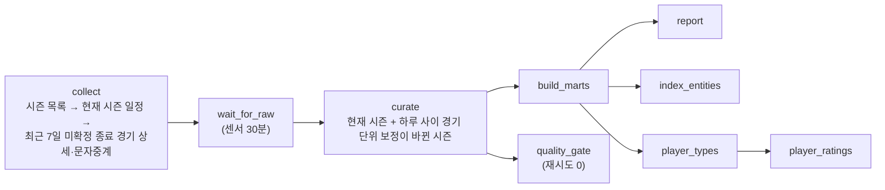
- 현재 시즌 = 시즌 목록에서 경기 리그가 하나라도 있는 가장 최근 시즌.
- `quality_gate`: 최근 7일 경기에 `OPEN` ERROR 문제가 있거나, 정규리그 경기가 시작 6시간 뒤에도 결과가 없으면 `AirflowFailException`. 경고와 `ACKNOWLEDGED`는 실패시키지 않는다.
- 유형 → 능력치는 차례로(Spark 드라이버마다 airflow 컨테이너 메모리가 필요).

**kovo_postgame**: `find_games_to_watch`(어제 이후 예정, 이미 시작, `CONFIRMED` 아님. 없으면 Skip → KOVO 요청 0) → `collect_finished`(그 시즌 일정 다시 받아 끝난 것만 상세·문자중계. 없으면 Skip) → `wait_for_raw` → `curate`(해당 시즌) → `build_marts` → `report`. 문자중계가 아직 없으면 경기가 `FINISHED`로 남고 다음 실행이 다시 수집한다.

**kovo_backfill**: `plan`(시즌 목록 풀기) + `season_list`(1회) → 시즌마다 동적 작업 그룹 `one_season`(`collect` → `wait_for_raw`(60분) → `curate`). `collect`·`curate`는 `max_active_tis_per_dag=1`(KOVO 간격·Spark 메모리)이라 N시즌 정제 중에 N+1시즌 수집이 겹칠 수 있다. 끝에 `build_marts`(`trigger_rule=all_done`).

**kovo_reprocess**: `plan`(입력 검사, 날짜 → DB에서 그날 경기, 대상 없으면 실패, 재수집 50경기 초과면 실패) → `collect`(`recollect`면 그 시즌 일정 + 대상 경기 다시 수집, 확정 경기 포함. KOVO 일정상 안 끝난 경기는 건너뛰고 로그) → `wait_for_raw` → `curate`(영향받은 시즌 전체, 원천부터) → `build_marts` → `report`(대상 경기 최종 상태).

**kovo_honors**: `collect`(대상 선수 → 선수마다 1요청) → `wait_for_raw` → `curate`(`curate_honors.py`).

**news_collect**: `collect` → `wait_for_raw`(HDFS) 와 `wait_for_index`(30초 간격 15분: 수집한 URL이 PostgreSQL `article`과 ES `articles`에 모두 있는가. 같은 제목으로 합쳐진 기사는 먼저 저장된 기사로 셈).

**ml_weekly_retrain**: `build_features` → `train`(`--evals 30`).

**ml_daily_predict**: `wait_for_curation`(센서 2분 간격 3시간, 재시도 0: Airflow REST로 `kovo_daily`·`kovo_reprocess`에 queued·running 실행이 없으면 통과) → `build_features`(`trigger_rule=all_done`: 기다림이 실패해도 진행) → `predict`.

**live_replay**: `replay`(최대 4시간) → `wait_for_live`(15초 간격 10분: `live_match_state.session`이 이번 재생이고 `FINISHED`).

---

## 6. 백엔드 (Django)

### 6.1 앱 구성

| 앱 | 담당 | 모델 | 주요 모듈 |
|---|---|---|---|
| `accounts` | 회원가입·로그인(토큰), 내 정보, 관심 팀·선수, 홈 "내 관심" 피드 | User, FavoriteTeam, FavoritePlayer | `views.py`, `feed.py` |
| `league` | 시즌·팀·선수 목록·상세, 순위 | Season, Competition, Team, Player, PlayerHonor, (추상) PipelineModel, Gender | `views.py`, `queries.py`, `standings.py` |
| `matches` | 경기 목록·상세·문자중계 | Match, SetScore, TeamMatchStat, PlayerMatchStat, PlayerAttackStat, RallyEvent, (추상) BoxScore | `views.py`, `serializers.py` |
| `analytics` | 마트 조회, 예측 검증, 능력치 순위, 폼, 모델 관리 | TeamRating, TeamSeasonSummary, PlayerSeasonSummary, ModelVersion, MatchPrediction, PredictionBacktest, PlayerType, PlayerStyle, PlayerRating, PlayerCareerRating, ModelChange | `queries.py`, `form.py`, `verification.py`, `registry.py`, `admin.py` |
| `live` | 실시간 조회, SSE | LiveMatchState, LiveSetMetric, LiveRally | `views.py`, `queries.py`, `hub.py` |
| `articles` | 기사 목록, 통합 검색, 자동완성 | Article, ArticleTeam, ArticlePlayer | `views.py`, `search.py` |
| `ops` | 상태 확인, 품질 문제, 보정, 수집 현황, 수동 실행 | QualityIssue, Correction, JobAlert, ManualRun | `admin.py`, `corrections.py`, `jobs.py`, `forms.py`, `views.py`(health) |

### 6.2 공통

| 항목 | 설정 |
|---|---|
| 설정 | 비밀·환경 값은 모두 환경 변수(`config/settings.py`). DB 연결 재사용 60초 |
| 인증 | DRF `TokenAuthentication`(Vue) + `SessionAuthentication`(관리자). 기본 권한 `AllowAny` |
| 페이지네이션 | 기본 `PageNumberPagination` 20개. 경기 목록 50개(`page_size` 최대 300), 기사 20개(최대 50) |
| 속도 제한 | 가입·로그인만 `ScopedRateThrottle`(`auth`, 기본 `10/min`, IP 기준) |
| CORS | 개발 서버 주소만(같은 출처 프록시를 쓰므로 보통 필요 없음) |
| 출처 표시 | 조회 응답에 `"source": {"name": "KOVO 한국배구연맹", "url": "https://www.kovo.co.kr"}`(WEB-14) |
| 시즌 기본값 | `season` 파라미터가 없으면 경기가 있는 가장 최근 시즌(`resolve_season`). 없는 시즌이면 404 |
| 성별 파라미터 | `M`/`F`. 필수인 API에서 없으면 400 |
| 끝난 경기 | 상태 `FINISHED`·`CONFIRMED` |
| 로그 | 콘솔(컨테이너 로그 → Filebeat) |

### 6.3 REST API 명세

공통: 응답은 JSON. 경기 키 경로는 `^\d{3}-\d+$`. 목록 응답의 페이지 형식은 `{count, next, previous, results}`.

#### 6.3.1 상태·회원

| 메서드·경로 | 권한 | 요청 | 응답 | 오류 |
|---|---|---|---|---|
| `GET /api/health` | 누구나 | - | `{status: "ok"\|"degraded", database: "ok"\|"error: …"}` | DB 실패 503 |
| `POST /api/auth/signup` | 누구나(제한) | `{email, password, nickname}`(닉네임 2~20자) | 201 `{token, user, favorites}` | 400 이메일 중복·형식, 비밀번호 규칙. 429 |
| `POST /api/auth/login` | 누구나(제한) | `{email, password}` | `{token, user, favorites}` | 400 "이메일 또는 비밀번호가 맞지 않습니다."(하나로). 429 |
| `POST /api/auth/logout` | 로그인 | - | 204(그 사용자의 토큰 삭제 = 모든 기기 로그아웃) | 401 |
| `GET /api/me` | 로그인 | - | `{user, favorites}` | 401 |
| `DELETE /api/me` | 로그인 | `{password}` | 204(계정·관심·토큰 삭제) | 400 비밀번호 틀림 |
| `GET /api/me/favorites` | 로그인 | - | `{teams: [{code,name,gender}], players: [...]}`(등록 순) | |
| `POST /api/me/favorites` | 로그인 | `{kind: "team"\|"player", code}` | 201 바뀐 목록(이미 있으면 그대로) | 400 10개 초과·잘못된 kind, 404 대상 없음 |
| `DELETE /api/me/favorites/{team\|player}/{code}` | 로그인 | - | 바뀐 목록 | 400 잘못된 kind |
| `GET /api/me/feed` | 로그인 | - | 관심 팀(순위, 최근 5경기, 다음 경기(예측 포함), 지난 경기), 관심 선수(최근 경기, 시즌 기록, 폼). 비율은 시도가 적으면(경기 5회, 시즌 15회 미만) 숨김 | |

`user` = `{email, nickname(비면 이메일 앞부분), is_staff, date_joined}`. 이메일은 소문자로 저장·조회한다. 관리자 계정은 `username`이 이메일과 달라도 로그인된다(이메일로 `username`을 찾아 인증). 가입·로그인은 세션 인증을 끈다(오래된 관리자 세션 쿠키가 토큰 로그인을 막지 않게).

#### 6.3.2 리그

| 메서드·경로 | 파라미터 | 응답 주요 필드 |
|---|---|---|
| `GET /api/seasons` | - | `[{code, name, years, start_date, end_date, competitions: [{league_code, type, name}]}]` 경기가 있는 시즌만, 최신부터 |
| `GET /api/teams` | `season`, `gender` | `[{code, name, full_name, gender}]` 그 시즌에 경기한 팀 |
| `GET /api/standings` | `season`, `gender`(필수), `league`(기본 201) | `{season, gender, league_code, rule, rows: [{rank, team, games, wins, losses, points, sets_won, sets_lost, set_ratio, points_won, points_lost, point_ratio, form(최근 5개 W/L)}], source}` |
| `GET /api/standings/players` | `season`, `gender`(필수), `category`(`points\|attack\|serve\|block\|dig\|set\|receive`, 기본 points), `limit`(기본 20, 최대 100) | `{season, gender, category, label, unit, rows: [{rank, player, team, games, sets_played, value, (attack/receive는 근거 성공·시도)}], qualification, source}` |
| `GET /api/teams/{code}` | `season` | `team`, `season`, `seasons`, `record`(순위표 한 줄), `stats`(team·league 비율 지표 + 사이드아웃·브레이크·상황별), `profile`(레이더 축 8개: 값·리그 점수 0~100·순위), `form`(폼이 바뀐 선수), `rating`(`history`, 10경기 미만이면 `previous` = 지난 시즌 마지막 10경기, `league` = 팀별 현재 Elo), `roster`, `recent`(5), `upcoming`(3), `source` |
| `GET /api/players/{code}` | `season` | `player`, `team`(가장 최근), `back_number`, `season`, `seasons`, `career`(정규리그 시즌별), `matches`(그 시즌 경기별), `profile`(백분위), `style`(유형·유사 선수), `ratings`(`seasons`: 시즌 카드 + 포지션 내 순위 + 이전 시즌 대비, `careers`: 포지션별 통산 카드 + 역대 순위 + 최고 시즌), `honors`(`awards`, `triple_crowns`, `records` 최근부터, 없으면 null), `form`, `source` |

#### 6.3.3 경기

| 메서드·경로 | 파라미터 | 응답 주요 필드 |
|---|---|---|
| `GET /api/matches` | `season`, `gender`, `team`, `league`, `month`(YYYY-MM), `date`(YYYY-MM-DD), `status`(`finished`\|`scheduled`), `order`(`desc`), `page`, `page_size` | 페이지 목록. 행: `key, season, season_years, league_code, competition, round, gender, scheduled_at, venue, broadcasters, status, home, away, home_sets, away_sets, sets([[홈,원정]…]), prediction({home_win_prob, pred_sets, is_correct} 최신 1건)`. `season` 없이 `date`나 `status`만 주면 시즌을 가리지 않는다. `scheduled`는 `SCHEDULED`·`LIVE`이면서 시작 3시간 전 이후(진행 중 포함) |
| `GET /api/matches/{key}` | - | 목록 행 + `city, duration_min, spectators, referee_main, referee_sub, set_details, team_stats{home,away}(박스스코어+비율), players{home,away}, rally_sets, live({mode,status,updated_at}\|null), data_notes({issues:[{rule,label,sets}], corrected}), preview{prediction(+모델 버전·시험 성적·실전 적중), head_to_head(전체·팀별 승수·최근 5), home, away(최근 5경기·Elo·시즌 지표)}, source` |
| `GET /api/matches/{key}/rallies` | `set`(기본 1) | `{key, set_no, home, away, events: [{event_no, rally_no, team, player, back_number, action, result, grade, home_score, away_score}], source}` |

`data_notes.issues`는 그 경기의 미해결·확인함 ERROR 문제(화면 "기록 일부 누락" 안내), `corrected`는 그 경기에 걸린 켜진 보정 수.

#### 6.3.4 분석

| 메서드·경로 | 파라미터 | 응답 주요 필드 |
|---|---|---|
| `GET /api/predictions` | `gender` | `model`(`version, is_champion, champion_version, train_seasons, test_season`), `backtest`(`seasons: [{season, model, elo, train_seasons}]`, `overall: {model, elo}`, `calibration`: 확신도 구간 50~55·55~60·60~65·65~70·70~80·80~100%의 예측 확률 평균·실제 적중률·경기 수), `live`(`overall`, `by_version`, `recent`: 이번 시즌 경기 전 예측의 경기·날짜·팀·확률·예상 세트·적중), `source`. 지표 묶음은 `{n, accuracy, log_loss, brier}` |
| `GET /api/ratings` | `season`, `gender`(필수), `position`(`OH\|OP\|MB\|S\|L`, 기본 OH), `all=1`, `scope=career` | `{scope, season, gender, position, position_name, abilities: [{key, label, weight}], rows: [{rank(자격 선수끼리 1·1·3식, 아니면 null), player, overall, sets, qualified, scores: {능력치 키: 점수}, team, provisional, (통산: seasons, qualified_seasons, first, last, best{season, overall})}], scale, source}` |

#### 6.3.5 실시간

| 메서드·경로 | 응답 |
|---|---|
| `GET /api/live` | `{results: [{match(목록 행), state}], source}`: 진행 중 경기(실시간·재생, 30분 넘게 갱신이 없으면 수집이 멈춘 것으로 보고 뺌)와 2시간 안에 끝난 경기. 진행 중 → 실제 경기 → 시작 시각 순 |
| `GET /api/live/{key}` | `{type: "snapshot", match, state(없으면 null), points(지금까지의 모든 득점)}` |
| `GET /api/live/{key}/stream` | SSE(6.5). `django-sse`(ASGI)만 처리, WSGI로 오면 503 |

`state`와 `points` 항목의 모양은 `live.metrics` 메시지(3.3)와 같다.

#### 6.3.6 기사·검색

| 메서드·경로 | 파라미터 | 응답 | 오류 |
|---|---|---|---|
| `GET /api/articles` | `team`, `player`, `page`, `page_size` | 페이지 목록. 행: `url, title, summary, publisher, published_at, source, teams[{code,name}], players[…]`. 발행 최신순 | |
| `GET /api/search` | `q`(공백 정리, 50자까지), `page` | `{q, teams, players(첫 페이지만, 각 10), articles: {total, page, results(10개, highlight{title, summary})}}` | 400 빈 검색어, 503 검색 엔진 장애 |
| `GET /api/search/suggest` | `q` | `{q, results: [entity 8개]}`(빈 검색어면 `{results: []}`) | 503 |

검색 질의(`articles/search.py`):
- 팀·선수: `function_score`(`bool_prefix` multi_match on `suggest`, `suggest._2gram`, `suggest._3gram` + `suggest_bigram` match `operator: and`) × `weight`.
- 기사: `title`(boost 3), `title.bigram`(75%, boost 2), `summary`, `summary.bigram`(75%, boost 0.5) + 발행 시각 감쇠 함수. 강조는 `encoder: html`, `<mark>`, 조각 0(전체).
- 클라이언트: 프로세스당 하나 캐시, 시간 제한 3초·재시도 1회. 연결 오류가 나면 캐시를 버리고 다시 만든다.

### 6.4 도메인 로직

#### 6.4.1 순위(`league/standings.py`, `queries.py`)
- 입력: 시즌·성별·리그의 끝난 경기(날짜순), 경기마다 세트 점수 합(랠리 점수).
- 팀 순위: BR-04·BR-05. 득실률 = 얻은 것/잃은 것(소수 셋째 자리), 분모 0이면 `null`(화면 "MAX", 정렬은 무한대).
- 선수 순위: 시즌·성별 선수 합계 + 팀이 치른 세트 수. 자격 BR-07. 값이 0 이하이면 제외(리시브 효율은 음수 허용). 동점은 같은 순위, 이름순.

| 부문 | 값 | 단위 | 추가 자격 |
|---|---|---|---|
| `points` | 득점 | 점 | 출전 조건 없음 |
| `attack` | 공격 성공률 | % | 팀 세트당 공격 시도 2 |
| `serve` | 세트당 서브 에이스 | 개 | |
| `block` | 세트당 블로킹 | 개 | |
| `dig` | 세트당 디그 | 개 | |
| `set` | 세트당 세트 성공 | 개 | |
| `receive` | 리시브 효율 | % | 팀 세트당 리시브 1 |

#### 6.4.2 비율 지표(`league/queries.rates`)
API 표시용(백분율 소수 첫째, 세트당 둘째 자리): `attack_pct`, `attack_efficiency`, `serve_aces_per_set`, `serve_errors_per_set`, `blocks_per_set`, `receive_efficiency`, `digs_per_set`, `sets_per_set`, `errors_per_set`. 공식은 BR-08. 리그 평균은 팀 평균의 평균이 아니라 모든 팀의 합 / 모든 팀의 세트 합.

#### 6.4.3 팀 강약점 프로필(`analytics/queries.team_profile`)
축 8개(공격 성공률, 리시브 효율, 블로킹, 서브 에이스, 디그, 범실(낮을수록 좋음), 사이드아웃, 브레이크). 축마다 리그 팀 사이 점수 = (나보다 못한 팀 수 + 동점 팀 수 / 2) / (팀 수 − 1) × 100. 50 = 리그 가운데.

#### 6.4.4 기타
- 상대 전적(`head_to_head`): 이 경기 시작 전 두 팀의 모든 맞대결(대회 무관) 수, 팀별 승수, 최근 5경기.
- 프리뷰 팀 비교(`team_form`): 경기 시작 전 최근 5경기 결과, 그때의 Elo, 시즌 누적 지표·승패.
- 예측 신뢰 근거(`latest_prediction`): 최신 예측 + 그 모델 버전의 시험 적중률·Log Loss·Elo 기준선 + 실전 적중 기록.
- 선수 폼(`analytics/form.py`): 8.10. 팀 화면 `form`은 팀 선수 중 상승·하락 지표가 있는 선수를 변화가 큰 순으로.
- 예측 검증(`analytics/verification.py`): 지표 = 적중률, Log Loss(확률을 [1e-6, 1−1e-6]로 자름), Brier.

### 6.5 SSE 게이트웨이

| 항목 | 설계 |
|---|---|
| 실행 | `django-sse` 컨테이너: `uvicorn config.asgi:application --port 8001`. 같은 코드의 `stream` 뷰만 이쪽으로 라우팅(Vite 프록시 규칙 `^/api/live/[^/]+/stream$`) |
| Hub | 프로세스마다 Kafka 컨슈머 스레드 하나(첫 구독 때 시작). `live.metrics` 모든 파티션을 끝에서부터 읽는다(그룹 id는 호스트·pid별로 매번 다름, 오프셋 미사용). 메시지 키(경기 키)로 구독자 큐를 찾아 `loop.call_soon_threadsafe`로 넣는다 |
| 큐 | 스트림마다 `asyncio.Queue(50)`. 가득 차면 가장 오래된 것을 버린다(갱신마다 전체 상태가 들어 있어 최신 것만 있으면 됨) |
| 스트림 순서 | ① 구독 먼저(스냅숏을 읽는 사이 온 갱신을 놓치지 않게) ② `retry: 3000` ③ `event: snapshot`(DB 현재 상태 + 모든 득점) ④ 갱신마다 `event: update`(메시지 그대로) ⑤ 15초 동안 없으면 `: ping` |
| 머리글 | `Content-Type: text/event-stream; charset=utf-8`, `Cache-Control: no-cache`, `X-Accel-Buffering: no` |
| 종료 | 연결이 끊기면 `finally`에서 구독 해제 |

### 6.6 관리자 화면 (Django admin)

화면 구성은 [화면 설계서 5장](05-screen-spec.md#5-관리자-화면)(A01~A06). 모든 화면은 `is_staff` 계정만.

| 화면 | 모델/위치 | 동작 | 외부 연동 |
|---|---|---|---|
| A01 첫 화면 | `ops/templates/admin/ops/index.html` | 맨 위 "확인하지 않은 작업 실패 N건"(`JobAlert` OPEN 수) | - |
| A02 품질 검사 결과 | `QualityIssue` | 목록·필터(상태, 심각도, 규칙, 시즌), 동작 "확인함으로 표시"(`ACKNOWLEDGED`, 확인한 사람 기록)·"다시 열기", 메모. 고칠 수 있는 문제는 보정 화면으로 링크 | - |
| A03 데이터 보정 | `Correction`, `ops/corrections.py` | 대상별 고칠 수 있는 항목(아래 표). 저장 전 검사: 키 형식, 실제 행 존재, 값 형식(숫자·날짜·포지션 코드). 저장하면 서비스 행에 바로 반영하고 처음 보정 때의 원래 값을 `source_value`에 남긴다. 끄면 원래 값으로 되돌린다. 삭제 대신 끈다 | - |
| A04 수집 현황 | `JobAlert`(목록 템플릿 확장), `ops/jobs.py` | ① DAG별 최근 12회 실행 점·일정·일시 중지 여부·7일 실패 수 ② 수집기 실행 결과(최근 7일): 수집기별 성공·실패·끝나지 않은 실행, 보낸 메시지 수 ③ 작업 실패 내역, 동작 "확인함" | Airflow `GET /api/v2/dags`, `/dags/{id}/dagRuns`. ES `ops-collection-*` |
| A05 수동 실행 | `ManualRun`, `ops/forms.py` | 양식 4종: 예약 작업 지금 실행 / 재처리(`kovo_reprocess`) / 과거 시즌(`kovo_backfill`) / 경기 재생(`live_replay`, 끝난 경기인지 확인). 입력 검사 후 실행하고 기록(DAG, 설정, 메모, 요청자, Airflow 실행 id·링크). 일시 중지된 DAG는 거절 | Airflow `GET /api/v2/dags/{id}`, `POST /api/v2/dags/{id}/dagRuns` |
| A06 모델 관리 | `ModelChange`, `analytics/registry.py` | `match-winner` 등록 버전 표(학습·시험 시즌, 시험 정확도·Log Loss, 같은 경기 Elo 기준선, 실전 적중, champion 표시). 최고 관리자가 버전·사유를 골라 champion 이동 → `model_change` 기록 → `ml_daily_predict` 즉시 실행(실행 id 저장) | MLflow `GET /api/2.0/mlflow/registered-models/get`, `model-versions/search`, `POST registered-models/alias`. Airflow dagRuns |
| 데이터 조회 | 각 앱 admin | 시즌·대회·팀·선수·경기·기록·문자중계·기사·회원 목록. 파이프라인이 쓰는 데이터는 읽기 전용(고칠 때는 A03) | - |

| 보정 대상 | 키 | 고칠 수 있는 항목 |
|---|---|---|
| 선수 `player` | 선수 코드 | name, position, height_cm, birth_date, nationality, status |
| 팀 `team` | 팀 코드 | name, full_name, home_city, home_arena |
| 경기 `match` | `023-5` | home_sets, away_sets, venue, city, broadcasters, duration_min, spectators, referee_main, referee_sub |
| 세트 점수 `set_score` | `023-5/3` | home_points, away_points, duration_min |
| 선수 경기 기록 `player_match_stat` | `023-5/{선수 코드}` | points, back_number, position, 박스스코어 20개 |
| 팀 경기 기록 `team_match_stat` | `023-5/{팀 코드}` | points, 박스스코어 20개 |

Airflow·MLflow·Elasticsearch가 꺼져 있으면(batch·search 프로필) 그 부분만 "연결하지 못했습니다" 오류를 보이고 나머지는 동작한다. 경기 단위 보정이 바뀐 시즌은 다음 날 `kovo_daily`가 다시 정제해 마트에 반영한다.

---

## 7. 프론트엔드 (Vue)

### 7.1 구조

| 폴더 | 내용 |
|---|---|
| `src/main.js`, `App.vue` | 앱 생성(Pinia, Router, 모션 지시자), 공통 머리글(로고, 주 메뉴 5개: 홈·일정·결과·순위·기사·예측 검증, 검색창, 로그인/닉네임)·바닥글(출처 문구) |
| `src/views/` | 화면 14개: Home, Schedule, MatchDetail, MatchLive, Standings, Team, Player, Ratings, Predictions, News, Search, Auth(로그인·가입), Account, NotFound |
| `src/components/` | 공용 부품 24개(7.6) |
| `src/stores/` | `auth`, `filters`(7.3) |
| `src/api/client.js` | axios 인스턴스와 API 함수, SSE 주소 |
| `src/composables/useLiveStream.js` | SSE 수신 |
| `src/motion/` | 숫자 굴리기(`AnimatedNumber`, `RollingNumber`), 지시자(`v-glider` 미끄러지는 표시 등), `motion.css`. "동작 줄이기"를 켜면 끈다 |
| `src/constants/` | `volley.js`(성별·포지션·상태·문자중계 코드 이름표), `ratings.js` |
| `src/utils/format.js` | 날짜·숫자·확률 표시 |
| `src/tokens.css`, `base.css` | 디자인 토큰(색·글꼴·간격·팀 컬러 `--team-{코드}`)과 기본 규칙 |

디자인 규칙은 [design-system MASTER.md](reference/design-system-MASTER.md)와 [화면 설계서 3장](05-screen-spec.md#3-공통-사항).

### 7.2 라우트

| 경로 | 이름 | 화면 | 비고 |
|---|---|---|---|
| `/` | home | HomeView | 처음부터 불러옴. 나머지는 지연 로딩 |
| `/schedule` | schedule | ScheduleView | `?season&gender&team&month&view=calendar` |
| `/standings` | standings | StandingsView | |
| `/news` | news | NewsView | `?team` |
| `/predictions` | predictions | PredictionsView | |
| `/ratings` | ratings | RatingsView | `?scope=career` |
| `/search` | search | SearchView | `?q` |
| `/login`, `/signup` | login, signup | AuthView(`mode`) | `guestOnly`: 로그인 상태면 `?next`로 |
| `/me` | me | AccountView | `requiresAuth`: 아니면 `/login?next=/me` |
| `/matches/:key(\d{3}-\d+)` | match | MatchDetailView | prop `matchKey` |
| `/matches/:key(\d{3}-\d+)/live` | match-live | MatchLiveView | |
| `/teams/:code` | team | TeamView | `?season` |
| `/players/:code` | player | PlayerView | `?season&card=career` |
| `/:pathMatch(.*)*` | not-found | NotFoundView | |

이동 전 가드: `auth.init()`(토큰이 있으면 `/api/me`로 회원 정보 복원) 후 권한 검사. `safeNext(next)`는 `/`로 시작하고 `//`·`/\`가 아닌 경로만 허용. 스크롤: 뒤로 가기면 이전 위치, 아니면 맨 위.

### 7.3 상태 관리(Pinia)

| 스토어 | 상태 | 동작 |
|---|---|---|
| `auth` | 토큰(`localStorage`), 회원, 관심 목록, 초기화 여부 | `init`, `signup`, `login`, `logout`, `deleteAccount`, `addFavorite`, `removeFavorite`, `isFavorite` |
| `filters` | 시즌 목록, 선택 시즌, 선택 성별(기본 `M`) | 시즌 목록을 한 번 불러오고, 선택은 `localStorage`에 기억(실패해도 무시) |

실시간 상태는 스토어에 두지 않고 화면 안에서 SSE로 받는다.

### 7.4 API 클라이언트

- axios `baseURL: '/api'`(개발 서버가 프록시).
- 요청 가로채기: 토큰이 있으면 `Authorization: Token …`.
- 응답 가로채기: 401이고 토큰을 보냈던 요청이면(서버가 모르는 토큰이면 공개 API도 401) 토큰을 버리고 토큰 없이 한 번 다시 요청(`anonymous` 표시로 반복 방지).
- `liveStreamUrl(key)` = `/api/live/{key}/stream`.

### 7.5 실시간 스트림(`useLiveStream`)

`EventSource`로 연결해 `snapshot`이면 상태·득점 전체를 바꾸고, `update`면 상태를 바꾸고 득점을 (세트, `point_no`) 기준으로 합친다(같은 키면 새 것으로). `reset: true`면 득점 목록을 비운다. 연결 상태 `connecting | open | reconnecting | closed | unsupported`와 마지막 수집 시각을 노출한다. 끊기면 브라우저가 3초 뒤 다시 연결하고, 다시 연결할 때마다 새 스냅숏부터 받으므로 빠지는 것이 없다. 화면을 떠나면 닫는다. 홈의 "진행 중 경기"는 SSE 대신 `GET /api/live`를 20초마다 다시 부른다.

### 7.6 공용 컴포넌트

| 컴포넌트 | 쓰임 |
|---|---|
| `AsyncState` | 불러오는 중(뼈대)·비었음·오류(다시 시도) 공통 처리. 필터를 바꾸는 동안 이전 내용을 흐리게 유지 |
| `MatchCard`, `LiveCard` | 경기 카드(세트 수·세트 점수·예측 적중 / 장소·승리 확률), 진행 중 경기 타일 |
| `MatchPreview`, `WinProbBar`, `CompareBars` | 프리뷰(세트 스코어 확률 막대·신뢰 근거·상대 전적), 승리 확률 막대, 팀 비교 좌우 막대 |
| `ScoreFlow` | 세트별 점수 차 계단 차트와 리드 변경·최다 연속 득점·최대 점수 차 |
| `ScheduleCalendar`, `FilterBar` | 달력 보기(방향키 이동), 시즌·성별·팀 필터 |
| `SortableTable` | 열 정렬(▲▼, 행 미끄러짐), 숫자 고정폭 오른쪽 정렬 |
| `RatingChart` | 전력 지수 추이(끌어서 확대, +/−/전체, 지난 시즌 점선) |
| `RadarChart`, `LeagueCompare`, `PercentileBars` | 강약점 레이더, 리그 평균 비교, 백분위 막대 |
| `PlayerRatingCard`, `ScoreRing` | 능력치 카드(시즌·통산 띠, 탭·화살표 키), 종합 점수 링 |
| `PlayerStyle`, `PlayerForm`, `PlayerHonors` | 선수 유형·유사 선수, 최근 폼, 수상·주요 기록 |
| `ArticleList`, `RelatedArticles` | 기사 목록(원문 새 창), 관련 기사 |
| `SearchBox` | 머리글 검색창(0.2초 지연 자동완성, 방향키, 엔터 → 검색 화면) |
| `FavoriteButton`, `FavoriteFeed` | 관심 ☆ 버튼(비로그인은 로그인으로), 홈 "내 관심" |

---

## 8. 분석·예측 알고리즘 명세

재개발 때 같은 결과를 내야 하는 계산 규칙이다. 근거 실험 수치는 1차 구현 기록이다.

### 8.1 팀 Elo (ANL-01, `build_marts.elo`)

- 대상: 끝난 경기 전부(정규·포스트, 남녀) 시간순. 처음 보는 팀 1500.
- 새 시즌 첫 경기 전: `R ← 1500 + (R − 1500) × 0.5`.
- 홈 이점 `H = −400 × log10(1/h − 1)`, `h` = 전체 끝난 경기의 홈 승률(53.8% → 약 26점). 팀 Elo와 선수 Elo가 같은 값을 쓴다.
- 경기 전 홈 승리 확률 `P = 1 / (1 + 10^((R_away − R_home − H) / 400))`.
- `K = 28 × (1 + 0.25 × (|홈 세트 − 원정 세트| − 1))` → 세트 차 1·2·3에 28, 35, 42.
- `Δ = K × (홈 승 ? 1 : 0 − P)`. 홈 `+Δ`, 원정 `−Δ`.
- `team_rating` 행: (시즌, 경기, 팀, 날짜, 경기 후 점수, 변화량, 그 팀의 경기 전 승리 확률). 예정 경기는 현재 점수로 경기 전 확률만 `match_elo`에.
- 근거(2026-11-12 재조정): 2011-12~2018-19로 고르고 2019-20~2025-26(1,726경기)으로 시험. 예전 K 24·2/3 유지 대비 log loss 0.6414 → 0.6387. 경기 전 Elo 적중률 약 62%가 예측 모델의 기준선이다.

### 8.2 선수 Elo (ANL-14, `build_marts.player_elo`)

- 선수마다 점수. 처음 보는 선수 1500.
- 새 시즌 첫 출전 전: 목표 = 앞 두 시즌 중 가장 최근 능력치 카드 종합으로 `1500 + 12 × (종합 − 60)`(카드가 없으면 1500), `R ← 목표 + (R − 목표) × 0.5`.
- 예상 출전 명단: 팀마다 선수별 출전 비중을 지수 이동 평균(최근 경기 비중 0.7)으로 유지. 비중 = 그 경기 출전 세트 / 경기 세트 수. 0.02 미만이면 명단에서 뺀다. **이번 경기의 실제 출전은 쓰지 않는다.**
- 경기 전 팀 전력 = 예상 명단 점수의 비중 가중 평균. 확률은 8.1과 같은 식(같은 `H`).
- 경기 뒤: 팀 변화량 `Δ_team = 36 × (세트 차 보정, 8.1과 같음) × (결과 − P)`. 뛴 선수마다 `Δ_team × (자기 출전 세트 / 경기 세트 수)`. 이적하면 점수가 선수를 따라간다.
- 출력: `match_elo`의 `home_pelo`, `away_pelo`, `pelo_home_win_prob`(예정 경기 포함). 화면에는 쓰지 않는다.
- 근거: 같은 7시즌에서 경기 전 확률 log loss 팀 Elo 0.6387(재조정) → 선수 Elo 0.6297, 7시즌 모두 우세. 모델 입력은 `elo_*` 대신 `pelo_*`(0.6277 → 0.6251, 정확도 64.4% → 65.1%).

### 8.3 지표와 시즌 요약 (ANL-02, 05)

- 공식: BR-08. 마트는 백분율 소수 둘째, 세트당 셋째 자리(`numeric`).
- 비율 지표 8개: `attack_success_rate`, `attack_efficiency`, `receive_efficiency`, `block_per_set`, `serve_per_set`(에이스), `dig_per_set`, `set_per_set`, `error_per_set`.
- 팀 세트 = 그 경기 세트 수. 선수 세트 = `played_sets`의 1의 개수.
- 팀 순위(`rank`): 정규리그 대회에서만, BR-05 순서.
- 선수 순위 자격(`qualified`): 같은 시즌·대회에서 팀 세트의 1/3 이상(BR-07).

### 8.4 사이드아웃·브레이크·상황별 효율 (ANL-11)

문자중계 시즌(`020`부터)의 랠리(`rally_no` 1~199)만.
- 랠리의 서버 = 그 랠리 첫 서브 이벤트(`VV`·`VS`)의 팀, 승자 = +1 이벤트의 팀.
- 팀마다: `break_rate = 100 × (서브한 랠리 중 이긴 수) / 서브한 랠리 수`, `sideout_rate = 100 × (상대가 서브한 랠리 중 이긴 수) / 받은 랠리 수`.
- 리시브 후 첫 공격: 랠리에서 그 팀의 첫 리시브(`RR`) 결과, 그 뒤 같은 팀의 첫 공격(`A*`)이 `suc`인가. 리시브가 `exc`면 `attack_after_good_receive`, 아니면 `attack_after_poor_receive`(성공률 %).
- 접전: 랠리 시작 점수(직전 랠리 끝 점수)가 양 팀 모두 20 이상(5세트 10 이상)인 랠리 수(`clutch_rallies`)와 승률(`clutch_win_rate`).

### 8.5 선수 백분위 (ANL-05)

같은 시즌·대회·성별·포지션의 순위 자격 선수 안에서 지표마다 `round(100 × percent_rank)`. `error_per_set`은 낮을수록 높은 백분위. 자격이 없으면 빈 JSON.

### 8.6 포지션별 능력치 카드 (ANL-13, `player_ratings.py`)

**대상**: 정규리그, 끝난 경기. 선수-시즌 포지션 = 그 시즌 박스스코어에서 가장 많이 나온 포지션(최빈값). 카드는 10세트 이상. 30세트 미만이거나 순위 자격이 없으면 `provisional`.

**기준 집단**: 같은 성별·포지션에서 그 시즌과 앞 두 시즌의 순위 자격 선수. 8명 미만이면 점수를 내지 않는다.

**수치**: 비율은 축소 추정 `(분자 + 기준평균 × k) / (분모 + k)`. 기준평균은 기준 집단의 합으로 낸 값(방향 `zero`는 0).

| 수치 | 분자 / 분모 | k | 비고 |
|---|---|---|---|
| `rec_exc` | 리시브 정확 / 리시브 시도 | 60 | |
| `attack_eff` | (성공 − 피블로킹 − 범실) / 공격 시도 | 80 | |
| `serve_net` | (에이스 − 범실) / 서브 시도 | 60 | 문자중계 없는 시즌 OH 서브 |
| `serve_pressure` | (에이스 + 상대 리시브가 `exc`가 아닌 서브) / 서브 | 80 | 문자중계 시즌 |
| `quick_rate` | 속공 성공 / 속공 시도 | 40 | |
| `block_touch_rate` | 유효 블로킹 / 블로킹 시도 | 60 | |
| `set_rate` | 세트 성공 / 세트 시도 | 100 | 문자중계 없는 시즌 세터(참고값 표시) |
| `setter_added` | 그 세터 토스로 낸 득점률 − 같은 공격수가 다른 세터 공을 받았을 때 득점률(공격수 쪽은 세트 20개 가상치로 그 공격수 시즌 득점률 쪽으로 당김) / 문자중계 토스 수 | 300 | 방향 `zero` |
| `dig_rate` | 디그 성공 / 디그 시도 | 40 | |
| `points_ps`, `block_ps`, `ace_ps`, `dig_ps`, `set_att_ps` | 득점·블로킹·에이스·디그·토스 시도 / 출전 세트 | 10 | |
| `points_ps_team` | 팀 동료 보정 득점 / 세트 | 10 | OH. `내 값 + 1.0 × (같은 팀 동료 합친 값 − 리그 값)` |
| `rec_exc_team` | 팀 동료 보정 리시브 정확 / 시도 | 60 | OH. `내 값 − 0.5 × (동료 − 리그)` |

**점수**: 수치마다 기준 집단 안 z → 능력치 = 속한 수치 z의 평균을 기준 집단 안에서 다시 표준화 → `점수 = clamp(round(60 + 12 × z), 1, 99)`. 능력치의 대안 목록 중 선수에게 값이 있는 첫 번째를 쓴다(문자중계 버전 우선).

**포지션별 능력치와 가중치(%)**

| 포지션 | 능력치(수치) : 가중치 |
|---|---|
| OH | 리시브(`rec_exc_team`) 25, 득점력(`points_ps_team`) 20, 블로킹(`block_ps`) 15, 서브(`serve_pressure` → `serve_net`) 15, 공격(`attack_eff`) 20, 수비(`dig_ps`) 5 |
| OP | 득점력(`points_ps`) 25, 공격(`attack_eff`) 30, 블로킹 20, 서브(`serve_pressure` → `ace_ps`) 15, 수비 10 |
| MB | 블로킹 35, 견제(`block_touch_rate`) 10, 속공(`quick_rate`) 35, 서브 20 |
| S | 토스(`setter_added` → `set_rate`) 50, 서브 25, 블로킹 25 |
| L | 리시브(`rec_exc`) 60, 디그(`dig_ps`+`dig_rate`) 40, 연결(`set_att_ps`) 0(보여 주기만) |

**종합** = 카드에 보이는 능력치 점수의 가중 평균(평균 60, 표준편차 약 8). 카드의 근거 기록(`stats`)은 축소·보정 전 실제 값을 보여 준다. 화면 등급 이름은 쓰지 않는다.

**통산 카드**(선수 × 포지션): 능력치마다 시즌 점수를 출전 세트로 가중 평균(시즌 점수가 그 시기 기준이라 시대가 달라도 같은 눈금), 종합은 같은 가중 평균, 근거 기록은 시즌 합계로 다시 계산(일부 시즌에만 있는 수치는 기간 "2023–24부터" 등을 붙임). 최고 시즌 = 자격 시즌 중 종합 최고(없으면 아무 시즌). 역대 순위 자격 = 그 포지션 자격 시즌 3번 이상.

**포지션 내 순위**: 나보다 종합이 높은 자격 선수 수 + 1(동점 같은 순위).

**근거**(2026-11-09·12): 이적 선수의 시즌 간 상관(그 수치가 선수를 따라다니는가)으로 수치를 고르고, 팀 자격 선수 종합(세트 가중)과 팀 승률의 상관(234 팀-시즌)으로 가중치를 조정(0.713 → 0.738, 팀 동료 보정 뒤 0.742). 시험했지만 채택하지 않은 안은 `player_ratings.py` 머리말에 있다.

### 8.7 선수 유형 (ANL-06, `player_types.py`)

- 대상: 정규리그 선수-시즌, 팀 세트 1/3 이상 + 10세트 이상. 학습은 30세트 이상만, 나머지는 가장 가까운 그룹에 배정하고 `provisional`.
- 특징 13개: 세트당 득점, 공격 시도, 오픈(퀵오픈 포함), 속공, 후위 공격, 서브 에이스, 블로킹, 리시브 시도, 디그, 세트, 범실 + 공격 성공률, 리시브 효율(시도 20개 가상치로 리그 평균 쪽으로 당김).
- 성별마다 표준화 → Spark MLlib K-means(seed 7) k = 4~9 → 실루엣이 최고값의 90% 이상인 k 중 가장 큰 k. 모든 k를 MLflow `player-types`에 기록.
- 이름: 주 포지션 + 같은 포지션의 다른 그룹과 다른 점(그 포지션 최다 득점 그룹이면 "주포형", 두드러진 점이 없으면 "보조형"·"균형형"). `traits` = 그룹을 가르는 특징(z 큰 순).
- 유사 선수: 표준화 특징의 거리로 같은 시즌 5명·역대 5명. 유사도 = 같은 성별 모든 선수 쌍 중 그보다 먼 쌍의 비율(0~100).

### 8.8 경기 예측 모델 (ANL-03, 09, 10)

| 항목 | 내용 |
|---|---|
| 정답 | 홈 기준 세트 스코어 6클래스(1.2절). 홈 승리 확률 = P(3:0)+P(3:1)+P(3:2) |
| 입력 | `pelo_diff, pelo_prob, form_win, form_setdiff, form_pointdiff, pointdiff, attack, receive, block, ace, error, rest, h2h_rate, h2h_n, postseason, men, squad, squad_known`(18개). `elo_*`는 기준선 계산에만 |
| 모델 후보 | `lr`: VectorAssembler(`handleInvalid=keep`) → StandardScaler(평균·표준편차) → LogisticRegression(multinomial, maxIter 200, `regParam` ∈ loguniform[1e-4, 1], `elasticNetParam` ∈ uniform[0, 1]) / `rf`: RandomForestClassifier(seed 7, 나무 {50, 100, 200}, 깊이 3~8, 잎 최소 {5, 10, 20, 40}) |
| 분할 | 1.2절과 4.9절(시간순, 무작위 분할 금지) |
| 평가 | 적중률(홈 승 확률 ≥ 0.5), Log Loss(이진, 확률 [1e-6, 1−1e-6]), Brier. 기준선 = 같은 시험 시즌 경기 전 팀 Elo 확률 |
| champion 규칙 | 4.9절 3·4단계 |
| 백테스트 | 최근 4시즌, 시즌마다 그 이전 시즌만으로 학습 |
| 실적 | 챔피언 v11(2026-11-13): 2025-26 시험 63.2%, Log Loss 0.6422(Elo 62.8%, 0.6593) |

### 8.9 실시간 승리 확률 (ANL-07, `live_state.py`)

- 팀 랠리 비율(`live_metrics.team_rates`): 정규리그 `team_season_summary`의 `sideout_rate`, `break_rate`(÷100). 이번 시즌 기록이 있으면 경기 수 `n`에 대해 `w = n / (n + 5)`로 `w × 이번 시즌 + (1 − w) × 이전`을 쓴다. 이전 = 가장 최근 지난 시즌 기록, 없으면 성별 기본값(남 사이드아웃 0.692·브레이크 0.308, 여 0.609·0.390, 2025-26 정규리그 평균). 이번 시즌 기록이 없으면 이전 값 그대로.
- 랠리 확률: `p_hs = P(홈이 랠리 승 | 홈 서브) = (홈 브레이크 + 1 − 원정 사이드아웃) / 2`, `p_as = P(홈이 랠리 승 | 원정 서브) = (홈 사이드아웃 + 1 − 원정 브레이크) / 2`, 각각 [0.1, 0.9]로 자른다.
- 세트 승리 확률: 상태(홈 점수, 원정 점수, 서브권)의 재귀(메모이제이션). 목표 25점(5세트 15점), 2점 차. 듀스 구간(양 팀 목표−1 점 이상)은 무한히 이어질 수 있어 4개 상태(동점·홈 서브, 동점·원정 서브, 홈 1점 앞섬, 원정 1점 앞섬)의 연립방정식을 크래머 공식으로 푼다. 랠리를 이긴 팀이 다음 서브. 서브권을 모르면(세트 시작 전) 두 경우의 평균.
- 경기 승리 확률: 세트 스코어 재귀(3세트 선승). 진행 중 세트는 위 세트 확률, 이후 세트는 0:0(서브권 모름)에서의 세트 확률. 세트 사이(진행 세트 없음)에는 다음 세트 0:0부터.
- 같은 경기 안 계산은 확률을 소수 넷째 자리로 반올림해 캐시를 재사용한다.

### 8.10 선수 폼 (ANL-08, `analytics/form.py`)

- 같은 시즌의 출전 경기를 시간순으로. 최근 5경기 vs 그 전 경기(3경기 이상 필요).
- 세트당 득점: 경기별 (득점 / 출전 세트) 값의 두 집단 평균 차 / 표준오차(두 집단 평균 차의 t 검정과 같은 방식).
- 공격 성공률: 두 기간 합친 성공률 차 / 이항 표준오차. 각 기간 시도 15회 이상.
- 리시브 효율: 리시브 하나를 +1(정확)·−1(실패)·0으로 본 평균 차 / 표준오차. 각 기간 15회 이상.
- 판정: |차이|가 최소 변화(세트당 득점 0.5점, 공격 성공률·리시브 효율 5%p)보다 작으면 `flat`, 아니면 z ≥ 1.64 → `up`, z ≤ −1.64 → `down`, 그 외 `flat`. 값이 모자라면 판정하지 않는다(`null`).

---

## 9. 운영·모니터링 설계

### 9.1 로그
- 모든 서비스는 stdout으로 로그를 낸다. Filebeat가 `/var/lib/docker/containers/*/*.log`를 읽어 도커 메타데이터와 `compose_service`를 붙이고, 줄 내용으로 `log.level`을 정한다: `ERROR|FATAL|CRITICAL|Traceback|Exception` → error, `WARN(ING)` → warning, 그 밖 info.
- 인덱스 `logs-volley-YYYY.MM.dd`(템플릿 `logs-volley`).

### 9.2 수집 이력
Filebeat kafka 입력(`ops.collection-log`, 그룹 `filebeat-ops`, 처음부터) → JSON을 `collection.*`으로 풀고 시각 필드를 `@timestamp`로 → `ops-collection-YYYY.MM`.

### 9.3 지표(Metricbeat SQL 모듈, 5분)
- Airflow DB: 최근 5분 안에 끝난 작업의 대기 시간(`queue_delay_sec`), DAG 실행의 시작 지연(`start_delay_sec`), DAG 소요 시간.
- 서비스 DB: `quality_issue`의 규칙별 미해결 수, 미해결 ERROR 수.
- 출력: 데이터 스트림 `metrics-volley`(숫자는 `float8`로 변환해 조회).

### 9.4 컨슈머 랙
2.10절. 30초마다 `metrics-volley`.

### 9.5 작업 실패 알림
5.1절. 관리자 A01·A04, 메신저.

### 9.6 Kibana 대시보드
`infra/kibana/build_dashboard.py`가 데이터 뷰와 대시보드 "배구 파이프라인 운영"(id `volley-ops`)을 `dashboard.ndjson`으로 만들고, `kibana-setup`이 가져온다. 수정은 스크립트 → 다시 생성 → `kibana-setup` 재실행.

| 패널 | 출처 |
|---|---|
| 수집 성공률, 실패 수, 수집 건수 추이, 최근 수집 실패 | `ops-collection-*` |
| Kafka 컨슈머 랙(raw-archiver, article-enricher, live-metrics, filebeat-ops) | `metrics-volley`(kafka-lag) |
| Airflow DAG 소요·시작 지연, 작업 대기 | `metrics-volley`(Metricbeat) |
| 서비스별 오류 수, 최근 오류 로그 | `logs-volley-*` |
| 언론사별 기사 저장 | `articles` |
| 검사별 미해결 품질 문제, 미해결 오류 수 | `metrics-volley`(Metricbeat) |

### 9.7 운영 스크립트

| 스크립트 | 하는 일 |
|---|---|
| `scripts/resume.ps1 [-Backfill] [-Seasons 001-021]` | Docker 확인 → 전체 프로필 기동 → Airflow 대기 → Flink 작업·체크포인트 확인 → 최근 DAG 실행 → 시즌·상태별 경기 수 → 기사·검색 색인 → 실시간 경기 → (선택) 끝나지 않은 백필 다시 실행 |
| `scripts/migrate_export.ps1 [-Out 폴더]` | 다른 PC로 옮길 데이터 모으기(.env, PostgreSQL 3개 DB 덤프, HDFS, MLflow, 기사 색인). 비밀값·회원 이메일이 들어 있으므로 공개하지 않는다 |
| `scripts/migrate_restore.ps1 -From 폴더` | 새 PC에서 복원(postgres 외 정지 → `pg_restore --clean` → HDFS → MLflow → 색인) |
| `scripts/measure_latency.py [--runs 30] [--base http://127.0.0.1:8000]` | 화면이 부르는 API의 p95 측정(NFR-11·12) |

---

## 10. UML

### 10.1 유스케이스 다이어그램

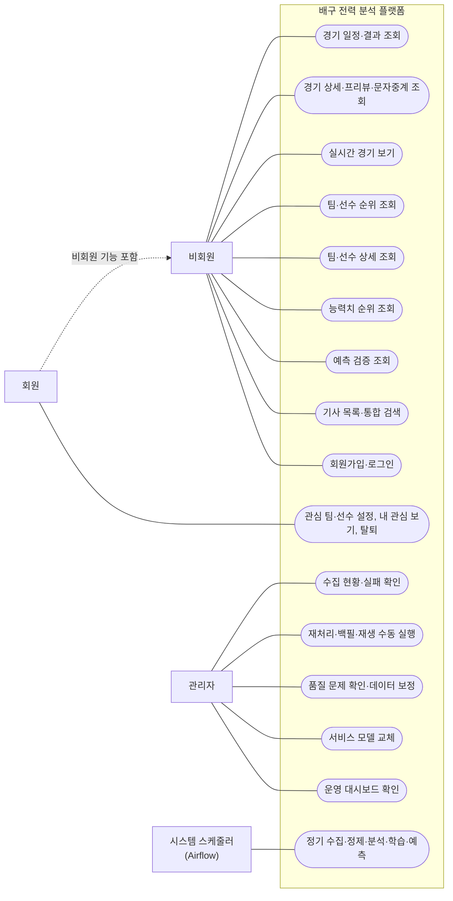

### 10.2 시퀀스 다이어그램: 경기 종료 후 기록 반영 (NFR-13)

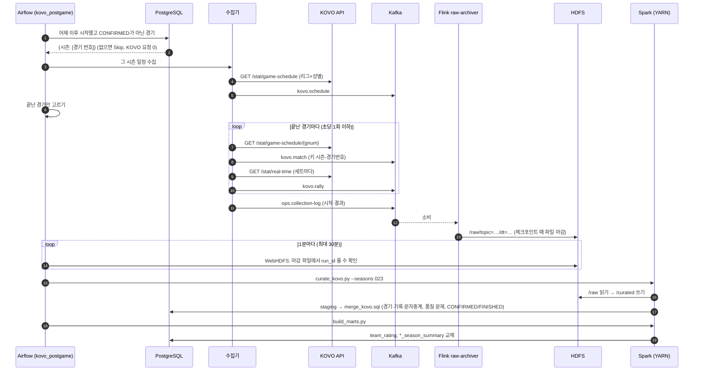

### 10.3 시퀀스 다이어그램: 실시간 경기 (NFR-14)

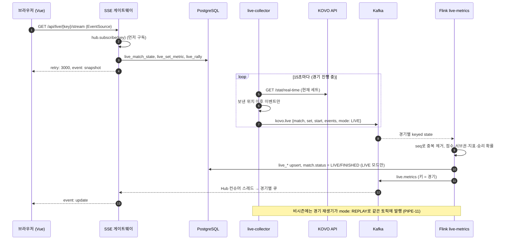

### 10.4 시퀀스 다이어그램: 주간 재학습과 매일 예측

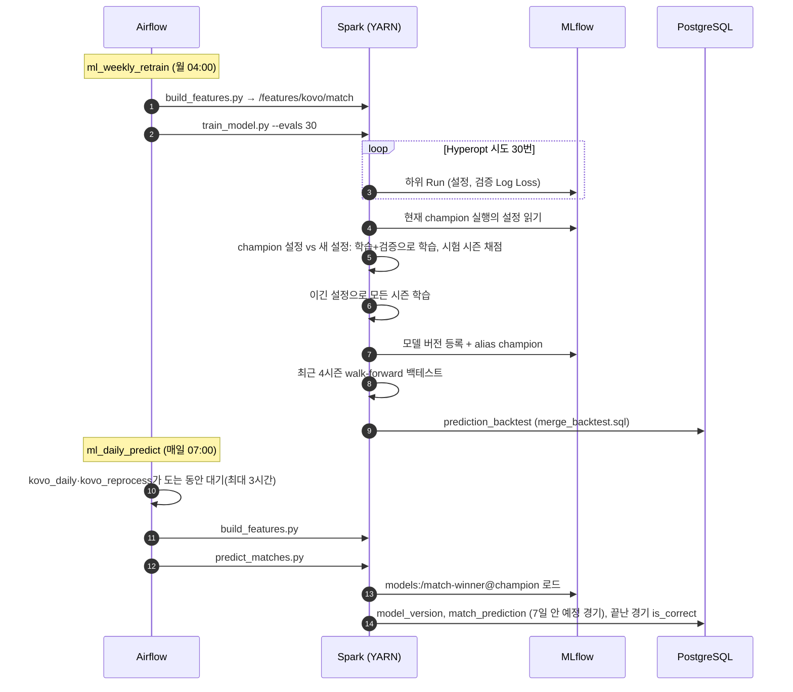

### 10.5 상태 다이어그램: 경기 상태

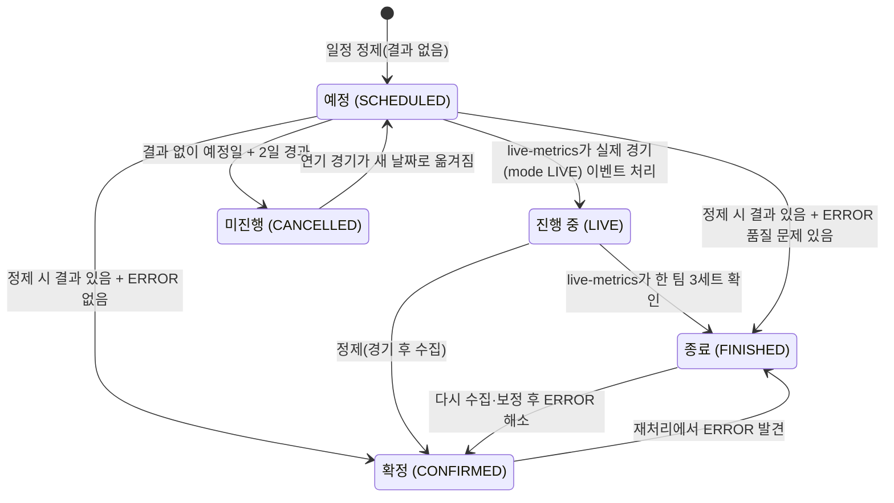

배치 병합은 `LIVE`·`FINISHED`를 `SCHEDULED`로 되돌리지 않는다. 재생은 상태를 바꾸지 않는다. 원천 자체에 기록이 없는 경기는 `FINISHED`에 머물고 관리자가 품질 문제를 "확인함"으로 둔다.

### 10.6 상태 다이어그램: 서비스 모델(champion)

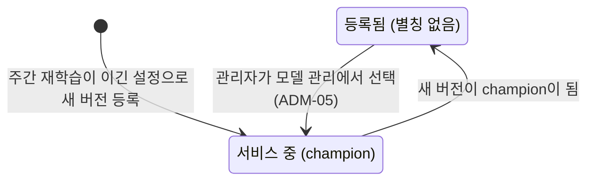

`candidate` 별칭은 쓰지 않는다. 비교는 별칭이 아니라 "같은 데이터로 다시 학습해 같은 시험 시즌으로 채점"으로 한다(8.8). champion이 바뀌면 다음 예측 실행이 예정 경기의 예전 버전 예측을 지우고 새로 만든다.

### 10.7 상태 다이어그램: 품질 문제와 작업 실패

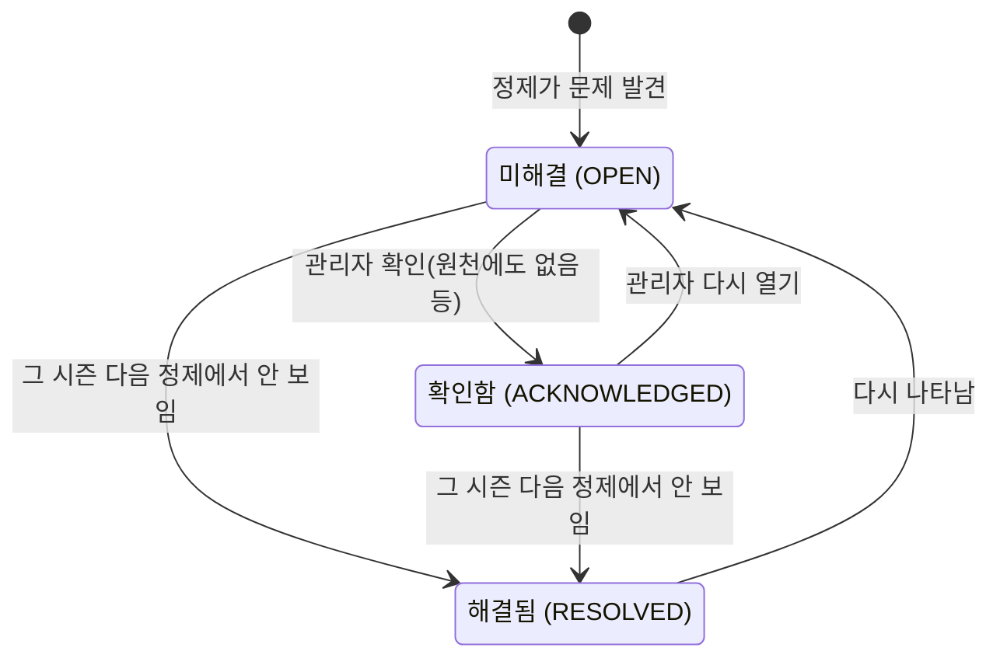

작업 실패(`job_alert`)는 `OPEN` → `ACKNOWLEDGED`(관리자) 두 상태다.

### 10.8 시퀀스 다이어그램: 관리자 수동 실행과 모델 교체

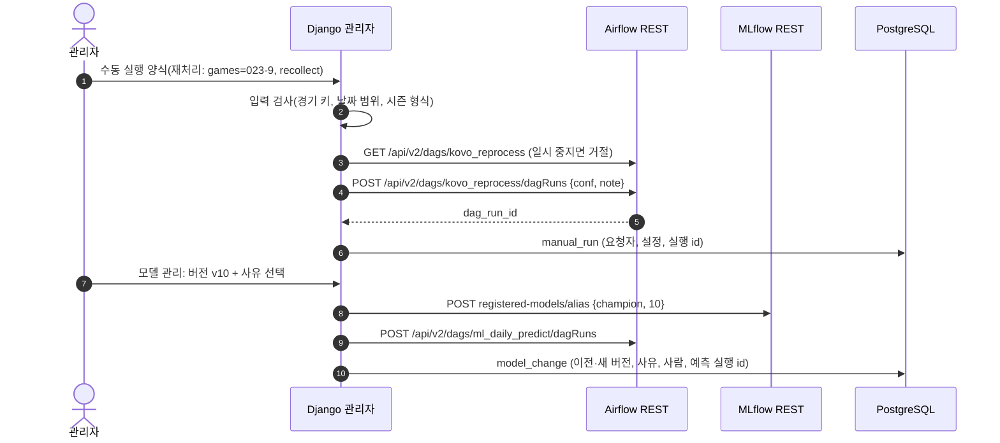

### 10.9 클래스 다이어그램: 수집기

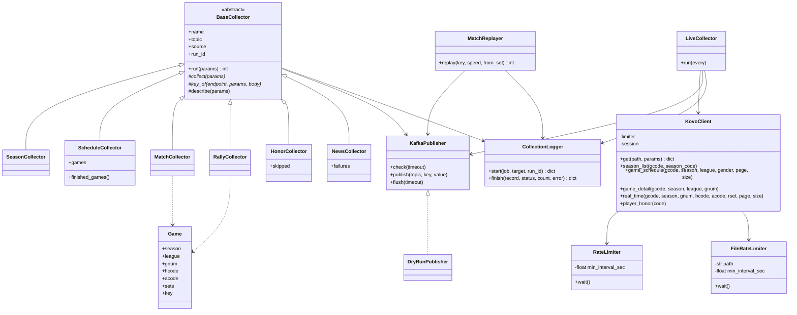

설계 포인트: 모든 KOVO 요청은 `KovoClient` 하나를 거친다(NFR-01). 수집기는 발행까지만 책임지고 저장·가공은 Flink·Spark가 맡는다. 클라이언트·발행기는 생성자로 주입해 테스트에서 가짜로 바꾼다(`collectors/tests/fakes.py`).

---

## 11. DFD (데이터 흐름도)

표기: 사각형은 외부 개체, 원은 처리, 원통은 저장소. D1 Kafka, D2 HDFS, D3 PostgreSQL, D4 Elasticsearch, D5 MLflow.

### 11.1 레벨 0 (컨텍스트)

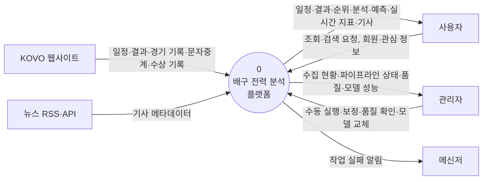

### 11.2 레벨 1

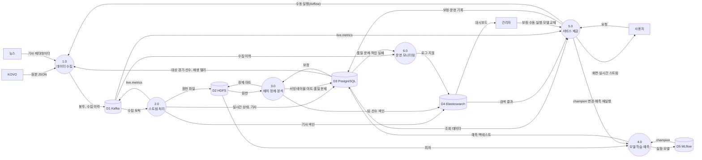

| 처리 | 설명 | 구현 |
|---|---|---|
| 1.0 데이터 수집 | KOVO·뉴스를 요청 간격 안에서 수집해 Kafka에 발행 | 2장 |
| 2.0 스트림 처리 | 원천 보관, 실시간 지표, 기사 정제·태깅 | 3장 |
| 3.0 배치 정제·분석 | 원천 → 정제 → 마트, 품질 검사, 색인, 유형·능력치 | 4.2~4.7 |
| 4.0 모델 학습·예측 | 피처, 학습, 등록, 예측, 채점 | 4.8~4.10 |
| 5.0 서비스 제공 | 조회·검색·SSE API, 회원, 관리자 | 6장, 7장 |
| 6.0 운영 모니터링 | 로그·지표·수집 이력·실패 알림 | 9장 |

### 11.3 레벨 2: 2.0 스트림 처리(실시간 경기)

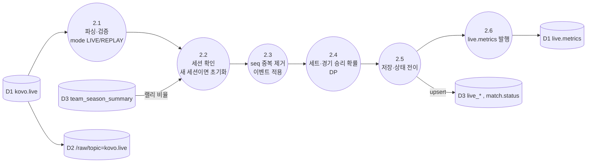

### 11.4 레벨 2: 3.0 배치 정제·분석

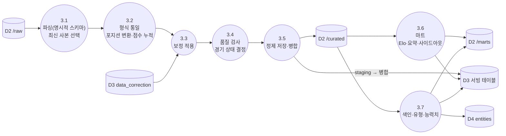

---

## 12. 테스트 설계

외부 서비스 없이 도는 단위 테스트가 원칙이다(NFR-51). 가짜 KOVO·HDFS·Kafka·DB를 생성자 주입으로 끼운다.

| 영역 | 위치 | 대상 | 실행 |
|---|---|---|---|
| 수집기 | `collectors/tests/` | 클라이언트 재시도·응답 검사, 제한기(가짜 시계), 수집기 페이지·대상 규칙, 기사 필터·정규화, 실시간 세트 진행·재시작, 실제 응답 표본 회귀(`samples/`), 랙 계산 | `cd collectors && python -m pytest` |
| DAG 보조 | `airflow/tests/` | 대상 고르기, 파라미터 풀기, HDFS 적재 확인, 품질 관문, 알림 중복 억제·웹훅 형식 | `python -m pytest airflow/tests` |
| Spark 순수 함수 | `spark_jobs/tests/` | 보정 키·계획, 수상 문장 파싱, 선수 Elo, 능력치(축소·점수·가중), 선수 유형 이름·선택 | `python -m pytest spark_jobs/tests` |
| Flink 계산 | `flink_jobs/tests/` | 실시간 상태(녹화된 경기 재생 → 공식 점수·박스스코어와 비교), 기사 태깅·제목 키 | `python -m pytest flink_jobs/tests` |
| Django | `backend/*/tests.py`, `ops/test_jobs.py` | API 응답·권한·오류, 순위 규칙, 회원·관심, 보정 검사·반영, 수집 현황·수동 실행(가짜 Airflow) | `docker compose exec django-api python manage.py test` |
| 성능 | `scripts/measure_latency.py` | NFR-11·12 | 수동 |
| 통합 | `dev_smoke_spark_yarn`, Flink `smoke_job.py`, `live_replay` | Spark on YARN → HDFS, Flink + Kafka, 실시간 경로 전체 | 수동 |

1차 구현 테스트 함수 약 180개. 재생 검증: 지난 경기를 재생해 실시간 지표가 공식 박스스코어(공격 시도·성공, 서브 에이스·범실, 블로킹, 범실)와 일치함을 확인했다.

---

## 13. 미구현·개선 과제

재개발 때 결정하거나 처리할 항목이다(요구사항 10장과 함께 본다).

| 구분 | 항목 | 내용 |
|---|---|---|
| 미구현 | ANL-12, WEB-15 | AI 프리뷰·질의응답. `ai_preview` 테이블과 숫자 검증 로직 필요([reference/llm-options.md](reference/llm-options.md)) |
| 미구현 | 선수 프로필 | `player.birth_date`·`nationality`·`status`는 컬럼만 있음 |
| 미구현 | KOVO컵 | 수집·화면 없음(모델은 `CUP` 지원) |
| 미구현 | 보관 정책 | Elasticsearch ILM(기사 2년, 로그 30일) |
| 미구현 | 운영 구성 | Nginx·Gunicorn·HTTPS·네트워크 분리([architecture 11장](02-architecture.md#11-운영-환경-전환-시-바꿀-것)) |
| 미검증 | 실제 생중계 | 실시간 경로는 재생으로만 검증 |
| 정리 | `ml/` 폴더 | 비어 있음. 없애거나 ML 코드를 옮긴다 |
| 정리 | 문서 참조 | 코드 주석의 "설계서 1.8" 같은 v0.1 절 번호를 이 문서 번호로 바꾼다(앞의 대응표) |
| 개선 | 캐시 | 지금은 불필요(p95 121ms). 트래픽이 늘면 일정·순위 5분, 확정 경기 1일 |
| 개선 | 순위 | 승자승과 승점 감점 같은 공식 처분 반영(필요하면 KOVO 순위 API와 대조) |
