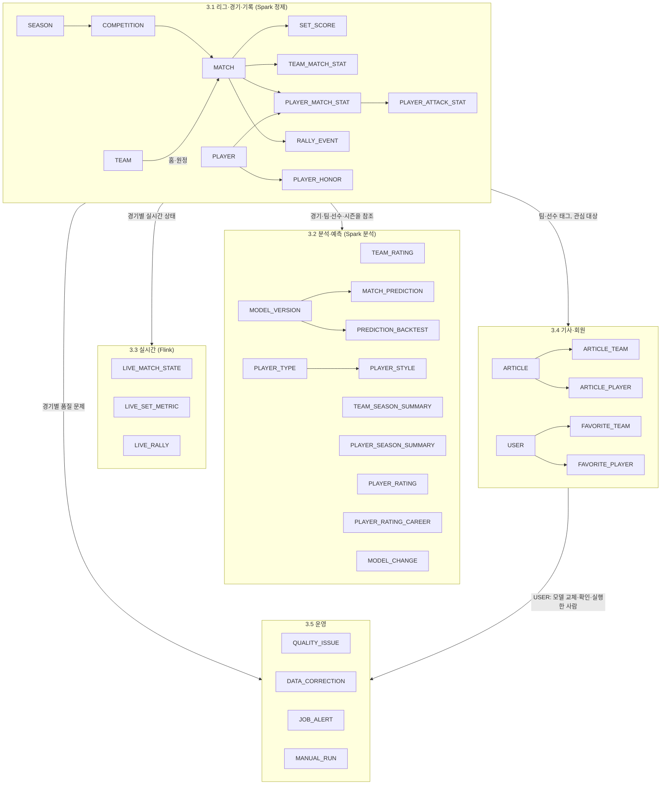
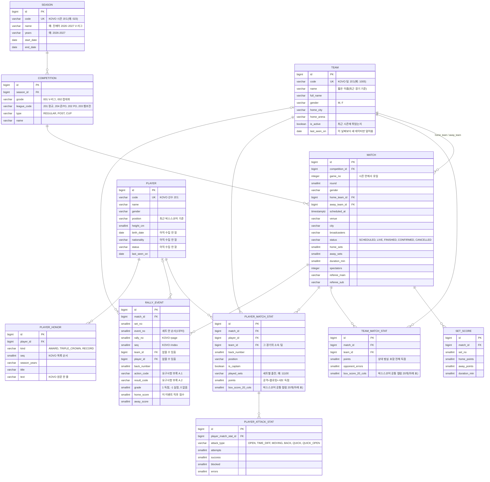
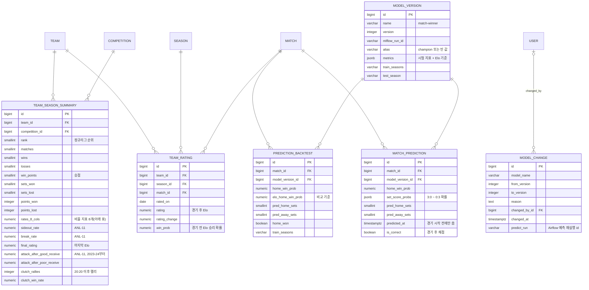
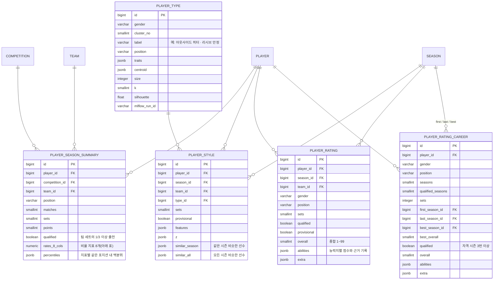
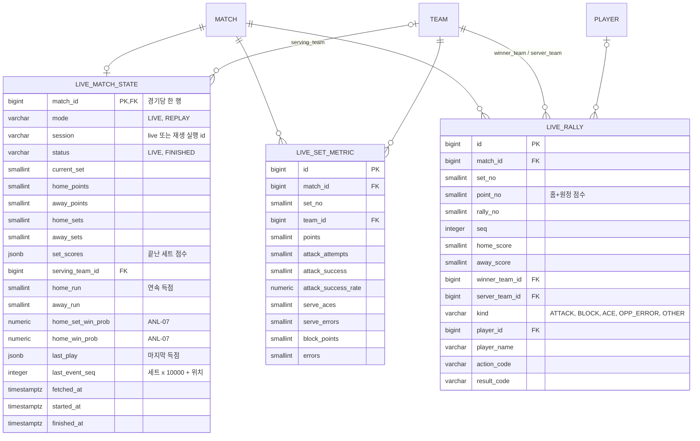
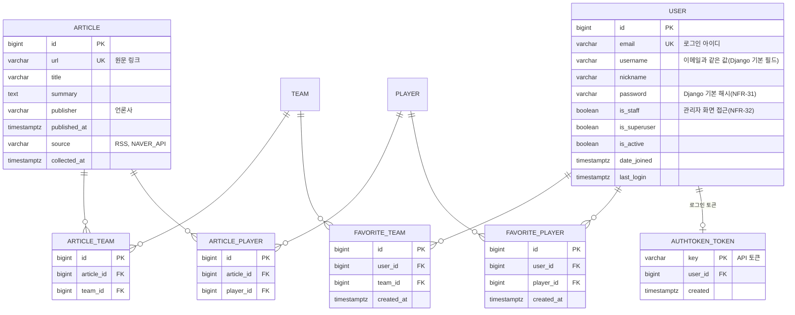
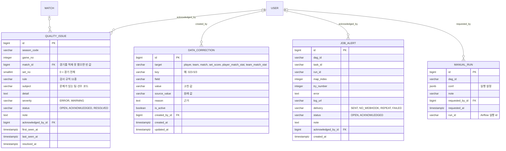

# ERD (현재 구현 기준)

| 항목 | 내용 |
|---|---|
| 문서 버전 | v1.1 |
| 작성일 | 2026-11-16 |
| 기준 | 실제 코드 `backend/*/models.py`와 마이그레이션(커밋 `d1094e7`). 마이그레이션에 손으로 쓴 SQL은 없으므로 모델이 곧 스키마다 |
| 대상 | 서비스 DB(PostgreSQL `service`)의 테이블 35개(리그·경기·기록 11, 분석·예측 11, 실시간 3, 기사·회원 6, 운영 4) + 로그인 토큰 테이블. Django 자체 테이블(`django_*`, `auth_group*`, `auth_permission`, `user_groups`, `user_user_permissions`)은 뺐다. 5장에 PostgreSQL 밖의 저장소를 적었다 |
| 관련 문서 | [요구사항 명세서](01-requirements.md), [아키텍처 설계서](02-architecture.md), [상세 설계서](03-design.md), [화면 설계서](05-screen-spec.md), [인터페이스 명세서](06-interface-spec.md). Word: `배구_전력분석_ERD_v1.1.docx`(`scripts/docs`로 생성) |

| 버전 | 변경 내용 |
|---|---|
| v1.0 | 실제 구현 기준으로 작성(설계서 v0.1 2장 초안을 대체) |
| v1.1 | 재개발용 보완: [4장 테이블 정의서](#4-테이블-정의서컬럼-사전)(모든 컬럼의 자료형·NULL·DB 기본값·키·삭제 규칙) 추가, 공통 규칙에 "DB 기본값과 앱 기본값의 차이"·"파이프라인이 쓰는 테이블의 규칙" 추가, `user.username` 유일 제약 등 빠진 제약 보완, 장 번호 조정(4→5, 5→6) |

다이어그램 원본은 이 문서의 Mermaid 코드다. 인쇄·Word용 그림 파일은 [images/diagrams](images/diagrams/)(`erd-*.png`, 2배 해상도, v1.0 기준).

## 목차

1. [공통 규칙](#1-공통-규칙)
2. [전체 관계도](#2-전체-관계도)
3. [도메인별 ERD와 테이블 정의](#3-도메인별-erd와-테이블-정의)
   - 3.1 [리그·경기·기록](#31-리그경기기록)
   - 3.2 [분석·예측](#32-분석예측)
   - 3.3 [실시간](#33-실시간)
   - 3.4 [기사·회원](#34-기사회원)
   - 3.5 [운영](#35-운영)
4. [테이블 정의서(컬럼 사전)](#4-테이블-정의서컬럼-사전)
5. [PostgreSQL 밖의 저장소](#5-postgresql-밖의-저장소)
6. [초안(설계서 v0.1 2장) 대비 바뀐 점](#6-초안설계서-v01-2장-대비-바뀐-점)

---

## 1. 공통 규칙

| 항목 | 규칙 |
|---|---|
| 기본 키 | 모든 테이블이 `id bigint`(자동 증가, identity). 예외: `live_match_state`는 `match_id`가 기본 키(경기당 한 행), `authtoken_token`은 `key varchar(40)` |
| 자연 키 | 시즌·팀·선수는 KOVO 코드(`code`)가 유일 키. 경기는 (대회, 경기 번호)로 유일하고, 화면·API에서는 `시즌 코드-경기 번호`(예: `023-22`)로 부른다. DB를 다시 만들어도 바뀌지 않는 값으로 찾기 위해서다 |
| 공통 컬럼 | 파이프라인이 쓰는 테이블(`PipelineModel`을 상속한 테이블, 아래 표에서 ●)은 `created_at`, `updated_at`(timestamptz, DB 기본값 `now()`)을 가진다. 병합 SQL이 upsert할 때마다 `updated_at`을 바꾼다 |
| 쓰는 쪽 | 대부분의 테이블은 Django가 아니라 **Spark·Flink가 SQL로 직접 쓴다**. 웹 앱(Django)은 읽기만 한다. 웹 앱이 쓰는 테이블은 회원·관심·운영 테이블뿐이다 |
| 스키마 관리 | 테이블 구조는 Django 마이그레이션 하나로만 관리한다. Spark는 같은 구조의 임시 스키마(`staging_*`)에 적재한 뒤 잠금(advisory lock)을 걸고 병합한다 |
| 삭제 규칙 | 경기·시즌을 지우면 딸린 기록이 함께 지워진다(CASCADE). 팀·선수는 기록이 남아 있으면 지울 수 없다(PROTECT). 회원이 탈퇴하면 관심 목록은 지워지고, 운영 기록의 "처리한 사람"은 비운다(SET_NULL) |
| 코드 값 | 성별 `M` 남자부 / `F` 여자부. 포지션 `OH` 아웃사이드 히터, `OP` 아포짓, `MB` 미들 블로커, `S` 세터, `L` 리베로 |
| DB 기본값과 앱 기본값 | Django의 `default=`는 **ORM으로 저장할 때만** 쓰이고 DB 컬럼 기본값이 아니다. DB에 기본값이 있는 컬럼은 `db_default`로 정한 것뿐이다(4장 "기본값" 열에서 `DB:`로 표시). Spark·Flink·Airflow처럼 SQL로 직접 쓰는 쪽은 앱 기본값 컬럼(`앱:` 표시)에도 값을 반드시 넣어야 한다 |
| 빈 문자열 | `blank=True`인 문자열 컬럼은 NULL이 아니라 빈 문자열(`''`)로 둔다(NOT NULL) |
| 외래 키 색인 | 모든 외래 키 컬럼에는 Django가 색인을 자동으로 만든다(아래 표에는 따로 적지 않음) |
| 0 이상 검사 | `smallint≥0`, `integer≥0` 표기는 Django `Positive*Field`로, DB에 `CHECK (컬럼 >= 0)` 제약이 생긴다 |
| 삭제 규칙의 위치 | CASCADE·SET_NULL은 Django가 처리하는 규칙이고 DB 외래 키는 그냥 제약이다. 그래서 SQL로 지울 때(Spark 병합 SQL)는 자식 행부터 지운다 |

자료형 표기: `varchar(n)` 글자, `smallint`·`integer` 정수, `numeric(p,s)` 소수, `jsonb` JSON, `timestamptz` 날짜·시각(UTC 저장), `date` 날짜, `boolean` 참·거짓, `float8` 배정밀도 실수, `bigint` 64비트 정수(기본 키·외래 키).

## 2. 전체 관계도

도메인(묶음)과 테이블 사이의 큰 관계만 그렸다. 화살표는 "부모 → 자식"(1 대 다)이다. 컬럼과 정확한 관계 기호는 3장의 도메인별 그림에 있다.

| 도메인 | 테이블 | 쓰는 쪽 |
|---|---|---|
| 리그·경기·기록 | season, competition, team, player, player_honor, match, set_score, team_match_stat, player_match_stat, player_attack_stat, rally_event | Spark `curate_kovo.py`, `curate_honors.py` |
| 분석·예측 | team_rating, team_season_summary, player_season_summary, model_version, match_prediction, prediction_backtest, player_type, player_style, player_rating, player_rating_career | Spark `build_marts.py`, `predict_matches.py`, `train_model.py`, `player_types.py`, `player_ratings.py` |
| | model_change | Django 관리자(모델 관리) |
| 실시간 | live_match_state, live_set_metric, live_rally | Flink `live-metrics` |
| 기사·회원 | article, article_team, article_player | Flink `article-enricher` |
| | user, favorite_team, favorite_player, authtoken_token | Django(회원 API) |
| 운영 | quality_issue | Spark `curate_kovo.py`(관리자는 상태만 바꿈) |
| | data_correction, manual_run | Django 관리자 |
| | job_alert | Airflow 실패 콜백(관리자는 확인만 함) |

## 3. 도메인별 ERD와 테이블 정의

### 3.1 리그·경기·기록

KOVO에서 수집한 원천을 Spark가 정제해 채운다. 경기 상태는 `SCHEDULED`(예정) → `LIVE`(진행 중) → `FINISHED`(결과 있음) → `CONFIRMED`(박스스코어·문자중계 적재와 품질 검사 통과) 순서로 바뀐다. 시리즈가 일찍 끝나 열리지 않은 경기는 `CANCELLED`가 된다.

| 테이블 | ● | 설명 | 유일 키 · 색인 | 외래 키 삭제 규칙 |
|---|---|---|---|---|
| `season` | ● | 시즌. 최신 시즌부터 정렬 | UK `code` | |
| `competition` | ● | 시즌 안의 대회(정규리그, 포스트시즌 라운드, 컵대회) | UK (`season`, `gcode`, `league_code`) | season CASCADE |
| `team` | ● | 팀. 후원사가 바뀌면 이름이 바뀌므로, 백필이 옛 이름으로 덮어쓰지 않게 `last_seen_on`보다 새 데이터만 반영 | UK `code` | |
| `player` | ● | 선수. 생년·국적·상태는 컬럼만 있고 아직 수집하지 않음(관리자 보정으로 채울 수 있음) | UK `code` | |
| `player_honor` | ● | 수상·트리플크라운·기준 기록 달성(COL-04). 실행마다 선수별로 전체 교체 | UK (`player`, `kind`, `seq`) | player CASCADE |
| `match` | ● | 경기 | UK (`competition`, `game_no`) · IX `scheduled_at`, (`home_team`, `scheduled_at`), (`away_team`, `scheduled_at`), `status` | competition CASCADE, 팀 PROTECT |
| `set_score` | ● | 세트 점수와 세트 시간 | UK (`match`, `set_no`) | match CASCADE |
| `team_match_stat` | ● | 경기 × 팀 기록 | UK (`match`, `team`) · IX `team` | match CASCADE, team PROTECT |
| `player_match_stat` | ● | 경기 × 선수 기록. 선수의 소속 이력은 이 테이블의 `team_id`로 알 수 있다 | UK (`match`, `player`) · IX (`player`, `match`) | match CASCADE, player·team PROTECT |
| `player_attack_stat` | ● | 선수 기록의 공격 종류별 세부(오픈, 시간차, 이동, 후위, 속공, 퀵오픈) | UK (`player_match_stat`, `attack_type`) | CASCADE |
| `rally_event` | ● | 문자중계 이벤트 하나(서브, 리시브, 공격, 득점, 교체 등). 점수는 Spark가 누적 계산 | UK (`match`, `set_no`, `event_no`) · IX (`match`, `set_no`), `player` | match CASCADE, 팀·선수 PROTECT |

**박스스코어 공통 컬럼 20개** (`team_match_stat`, `player_match_stat`이 함께 씀, 모두 `smallint`, 기본값 0)

| 묶음 | 컬럼 (KOVO 필드) |
|---|---|
| 공격 | `attack_attempts`(att) 시도, `attack_success`(ats) 성공, `attack_blocked`(atf) 상대 블로킹에 막힘, `attack_errors`(ate) 범실 |
| 서브 | `serve_attempts`(st) 시도, `serve_aces`(ss) 에이스, `serve_errors`(sf) 범실 |
| 블로킹 | `block_attempts`(bt) 시도, `block_success`(bs) 성공, `block_effective`(blkvb) 유효, `block_assist`(blkas) 어시스트 |
| 리시브 | `receive_attempts`(rt) 시도, `receive_excellent`(rs) 정확, `receive_errors`(rf) 실패 |
| 디그 | `dig_attempts`(dt) 시도, `dig_success`(ds) 성공 |
| 세트(토스) | `set_attempts`(sett) 시도, `set_success`(sets) 성공 |
| 기타 | `errors`(err) 범실 합계, `warnings`(warning) 경고 |

### 3.2 분석·예측

Spark 분석 작업의 결과(데이터 마트)다. 웹 앱은 읽기만 한다. `model_change`만 관리자 화면이 쓴다.

그림은 팀·예측 모델(3.2a)과 선수 분석(3.2b) 두 장으로 나눴다.

**3.2a 팀·예측 모델**

**3.2b 선수 분석**

| 테이블 | ● | 설명 (요구사항) | 유일 키 · 색인 | 쓰는 작업 |
|---|---|---|---|---|
| `team_rating` | ● | 경기마다 팀 Elo. 시즌 첫 경기 전에 1500 쪽으로 절반 되돌림 (ANL-01) | UK (`team`, `match`) · IX (`team`, `rated_on`) | `build_marts.py` |
| `team_season_summary` | ● | 팀 × 대회 요약: 승패·승점·세트·점수, 순위, 지표, 사이드아웃·브레이크율, 상황별 효율 (ANL-02, 11) | UK (`team`, `competition`) · IX (`competition`, `rank`) | `build_marts.py` |
| `player_season_summary` | ● | 선수 × 대회 × 팀 요약과 포지션 내 백분위 (ANL-05) | UK (`player`, `competition`, `team`) · IX `competition` | `build_marts.py` |
| `model_version` | ● | MLflow 모델 버전을 서비스 DB에 옮겨 적은 것(화면이 MLflow 없이 읽도록) (ANL-09) | UK (`name`, `version`) | `predict_matches.py`, `train_model.py` |
| `match_prediction` | ● | 경기 전 예측. 경기 시작 전까지만 쓰고, 결과가 나오면 `is_correct`만 채운다 (ANL-03, 10) | UK (`match`, `model_version`) · IX (`match`, `-predicted_at`) | `predict_matches.py` |
| `prediction_backtest` | ● | 각 시즌을 그 이전 시즌들로만 학습한 모델로 예측한 결과 (ANL-10) | UK (`match`, `model_version`) | `train_model.py` |
| `player_type` | ● | 성별마다 K-means 유형 그룹. 실행마다 전체 교체 (ANL-06) | UK (`gender`, `cluster_no`) | `player_types.py` |
| `player_style` | ● | 선수 × 시즌의 유형과 비슷한 선수 (ANL-06, WEB-07) | UK (`player`, `season`) | `player_types.py` |
| `player_rating` | ● | 시즌 능력치 카드. 60 = 같은 성별·포지션 평균, 12점 = 표준편차 1 | UK (`player`, `season`) · IX (`season`, `gender`, `position`) | `player_ratings.py` |
| `player_rating_career` | ● | 포지션별 통산 카드 | UK (`player`, `position`) · IX (`gender`, `position`) | `player_ratings.py` |
| `model_change` | | 관리자가 서비스 모델(`champion`)을 바꾼 기록: 누가, 왜 (ADM-05) | | Django 관리자 |

**비율 지표 8개** (`team_season_summary`, `player_season_summary`가 함께 씀, `numeric`, 시도가 없으면 NULL): `attack_success_rate` 공격 성공률, `attack_efficiency` 공격 효율, `receive_efficiency` 리시브 효율, `block_per_set`·`serve_per_set`·`dig_per_set`·`set_per_set`·`error_per_set` 세트당 블로킹·서브·디그·세트·범실.

### 3.3 실시간

Flink `live-metrics`만 upsert로 쓰고, 웹 앱과 SSE 게이트웨이는 읽기만 한다. 실제 경기(`mode = LIVE`)와 끝난 경기의 재생(`REPLAY`)을 `mode`로 구별한다. 경기가 `CONFIRMED`가 되면 경기 화면은 공식 기록(`rally_event`, `team_match_stat`)을 쓰고, 이 행들은 마지막 실시간 상태로 남는다.

| 테이블 | ● | 설명 | 유일 키 · 색인 |
|---|---|---|---|
| `live_match_state` | ● | 경기당 한 행: 지금 점수·세트·서브권·연속 득점·승리 확률·마지막 득점. 실시간 화면의 스코어보드. 수집기가 재시작하면 `last_event_seq`부터 이어 받는다 | PK `match_id` · IX (`status`, `updated_at`) |
| `live_set_metric` | ● | 세트 × 팀 지표(득점, 공격 성공률, 서브, 블로킹, 범실) | UK (`match`, `set_no`, `team`) |
| `live_rally` | ● | 득점 하나당 한 행. 점수 흐름 차트와 득점 피드에 쓴다 | UK (`match`, `set_no`, `point_no`) |

### 3.4 기사·회원

기사는 Flink `article-enricher`가 중복을 없애고 팀·선수 태그를 붙여 저장한다(같은 문서를 Elasticsearch `articles`에도 색인). 본문은 저장하지 않는다(NFR-02, 06). 회원 테이블은 Django가 쓰며, 개인정보는 이메일과 닉네임만 받는다(NFR-03).

| 테이블 | ● | 설명 | 유일 키 · 색인 | 삭제 규칙 |
|---|---|---|---|---|
| `article` | ● | 기사 메타데이터(제목, 요약, 언론사, 링크) | UK `url` · IX `-published_at` | |
| `article_team` | | 기사-팀 태그(다대다) | UK (`article`, `team`) · IX (`team`, `article`) | CASCADE |
| `article_player` | | 기사-선수 태그(다대다) | UK (`article`, `player`) · IX (`player`, `article`) | CASCADE |
| `user` | | 회원(Django `AbstractUser` 확장). 그 밖의 Django 기본 컬럼(`first_name`, `last_name`)은 쓰지 않음 | UK `email`, UK `username` | |
| `favorite_team` | | 관심 팀(최대 10개, API에서 제한) (WEB-12) | UK (`user`, `team`) | user·team CASCADE |
| `favorite_player` | | 관심 선수(최대 10명) (WEB-12) | UK (`user`, `player`) | user·player CASCADE |
| `authtoken_token` | | DRF 토큰 인증(Django REST framework 기본 테이블). 로그아웃하면 지움 | PK `key`, UK `user` | user CASCADE |

### 3.5 운영

데이터 품질, 보정, 작업 실패, 수동 실행 기록이다. 관리자 화면에서 본다.

| 테이블 | 설명 (요구사항) | 유일 키 · 색인 | 쓰는 쪽 |
|---|---|---|---|
| `quality_issue` | 품질 검사에 걸린 문제 하나. ERROR 7종이 걸린 경기는 `CONFIRMED`가 되지 못한다 (PIPE-10) | UK (`season_code`, `game_no`, `set_no`, `rule`, `subject`) · IX (`status`, `severity`) | Spark가 쓰고, 관리자는 `status`·`note`만 바꿈 |
| `data_correction` | 정제 데이터 한 행의 필드 하나를 고친 값. 정제 작업이 검사 전에 매번 적용하므로 다시 수집해도 남는다 (ADM-03) | 조건부 UK (`target`, `key`, `field`) — 켜진(`is_active`) 보정만 | Django 관리자 |
| `job_alert` | 재시도를 다 쓰고 최종 실패한 Airflow 작업 (PIPE-09) | IX (`status`, `created_at`), (`dag_id`, `run_id`) | Airflow 실패 콜백, 관리자는 확인만 |
| `manual_run` | 관리자 화면에서 시작한 작업 기록. 실행 자체는 Airflow에 있다 (ADM-02) | | Django 관리자 |

**품질 검사 규칙 11종**

| 심각도 | 규칙 |
|---|---|
| ERROR (경기 확정을 막음) | `SET_COUNT_MISMATCH` 세트 스코어와 세트별 점수 불일치, `MISSING_BOX_SCORE` 선수 기록 없음, `MISSING_RALLY` 문자중계 없음, `RALLY_SCORE_MISMATCH` 문자중계 점수와 공식 점수 불일치, `INVALID_SET_SCORE` 경기 규칙에 맞지 않는 세트 점수, `STAT_RANGE` 성공이 시도보다 많음 등, `MISSING_VALUE` 필수 값 누락 |
| WARNING (보고만 함) | `BOX_SCORE_MISMATCH` 팀 합계와 선수 합 불일치, `POINTS_MISMATCH` 팀 득점과 세트 점수 합 불일치, `PLAYER_POINTS_MISMATCH` 선수 득점과 공격·블로킹·서브 합 불일치, `PLAYER_NAME_MISSING` 선수 이름 없음 |

## 4. 테이블 정의서(컬럼 사전)

표기
- **NULL**: `Y` = NULL 허용. 비어 있으면 NOT NULL.
- **기본값**: `DB: 값` = DB 컬럼 기본값(SQL로 넣을 때도 적용), `앱: 값` = Django ORM으로 저장할 때만 적용(SQL로 쓰는 쪽은 직접 넣어야 함), `자동` = Django가 저장 시각을 넣음(`auto_now_add`·`auto_now`).
- **키**: `PK`, `UK`(단일 유일), `FK → 테이블 (삭제 규칙)`. 여러 컬럼 제약은 표 아래에 적었다.
- 모든 표의 첫 컬럼 `id bigint PK`는 따로 적지 않았다(예외만 적음).

### 4.0 공통 컬럼 묶음

**[P] 파이프라인 공통**(`PipelineModel`) — 3장 표의 ● 테이블

| 컬럼 | 자료형 | NULL | 기본값 | 설명 |
|---|---|---|---|---|
| `created_at` | timestamptz | | DB: `now()` | 행을 처음 넣은 시각 |
| `updated_at` | timestamptz | | DB: `now()` | 병합 SQL이 upsert할 때마다 `now()`로 바꾼다 |

**[B] 박스스코어 20개**(`BoxScore`) — `team_match_stat`, `player_match_stat`. 모두 `smallint≥0`, NOT NULL, `앱: 0`. KOVO 필드 대응은 3.1절 표.

`attack_attempts`, `attack_success`, `attack_blocked`, `attack_errors`, `serve_attempts`, `serve_aces`, `serve_errors`, `block_attempts`, `block_success`, `block_effective`, `block_assist`, `receive_attempts`, `receive_excellent`, `receive_errors`, `dig_attempts`, `dig_success`, `set_attempts`, `set_success`, `errors`, `warnings`

**[R] 비율 지표 8개**(`Rates`) — `team_season_summary`, `player_season_summary`. 모두 NULL 허용(시도가 없으면 NULL).

| 컬럼 | 자료형 | 설명 |
|---|---|---|
| `attack_success_rate` | numeric(5,2) | 공격 성공률 % |
| `attack_efficiency` | numeric(5,2) | (성공 − 피블로킹 − 범실) / 시도 % |
| `receive_efficiency` | numeric(6,2) | (정확 − 실패) / 시도 % |
| `block_per_set` | numeric(5,3) | 세트당 블로킹 성공 |
| `serve_per_set` | numeric(5,3) | 세트당 서브 에이스 |
| `dig_per_set` | numeric(6,3) | 세트당 디그 성공 |
| `set_per_set` | numeric(6,3) | 세트당 세트 성공 |
| `error_per_set` | numeric(5,3) | 세트당 범실 |

### 4.1 리그·경기·기록

**`season`** [P]
| 컬럼 | 자료형 | NULL | 기본값 | 키 | 설명 |
|---|---|---|---|---|---|
| `code` | varchar(3) | | | UK | KOVO 시즌 코드 |
| `name` | varchar(100) | | | | 예: 진에어 2025~2026 V-리그 |
| `years` | varchar(9) | | | | 예: 2025-2026 |
| `start_date` | date | Y | | | 그 시즌 첫 경기 날짜 |
| `end_date` | date | Y | | | 그 시즌 마지막 경기 날짜 |

**`competition`** [P] — UK `uq_competition`(`season_id`, `gcode`, `league_code`)
| 컬럼 | 자료형 | NULL | 기본값 | 키 | 설명 |
|---|---|---|---|---|---|
| `season_id` | bigint | | | FK → season (CASCADE) | |
| `gcode` | varchar(3) | | | | `001` V-리그, `002` 컵 |
| `league_code` | varchar(3) | | | | `201`, `202`, `203`, `204` |
| `type` | varchar(10) | | | | `REGULAR`, `POST`, `CUP` |
| `name` | varchar(50) | | | | 리그 이름(예: 정규리그) |

**`team`** [P]
| 컬럼 | 자료형 | NULL | 기본값 | 키 | 설명 |
|---|---|---|---|---|---|
| `code` | varchar(10) | | | UK | KOVO 팀 코드 |
| `name` | varchar(50) | | | | 짧은 이름(가장 최근 경기 기준) |
| `full_name` | varchar(100) | | 앱: `''` | | 정식 이름 |
| `gender` | varchar(1) | | | | `M`, `F` |
| `home_city` | varchar(30) | | 앱: `''` | | 연고지 |
| `home_arena` | varchar(50) | | 앱: `''` | | 홈 경기장(최근 시즌 최다) |
| `is_active` | boolean | | DB: `true` | | 데이터의 가장 최근 시즌에 경기했는가 |
| `last_seen_on` | date | Y | | | 이 행 값의 출처 경기 중 가장 최근 날짜(옛 데이터가 덮어쓰지 않게) |

**`player`** [P]
| 컬럼 | 자료형 | NULL | 기본값 | 키 | 설명 |
|---|---|---|---|---|---|
| `code` | varchar(10) | | | UK | KOVO 선수 코드 |
| `name` | varchar(50) | | | | 문자중계에만 나온 선수는 `''`(보정으로 채움) |
| `gender` | varchar(1) | | | | |
| `position` | varchar(2) | | 앱: `''` | | 가장 최근 박스스코어 포지션 |
| `height_cm` | smallint≥0 | Y | | | |
| `birth_date` | date | Y | | | 수집 안 함 |
| `nationality` | varchar(30) | | 앱: `''` | | 수집 안 함 |
| `status` | varchar(10) | | 앱: `''` | | `ACTIVE`, `MILITARY`, `RETIRED`(수집 안 함) |
| `last_seen_on` | date | Y | | | |

**`player_honor`** [P] — UK `uq_player_honor`(`player_id`, `kind`, `seq`)
| 컬럼 | 자료형 | NULL | 기본값 | 키 | 설명 |
|---|---|---|---|---|---|
| `player_id` | bigint | | | FK → player (CASCADE) | |
| `kind` | varchar(12) | | | | `AWARD`, `TRIPLE_CROWN`, `RECORD` |
| `seq` | smallint≥0 | | | | KOVO 목록 순서(오래된 것부터) |
| `season_years` | varchar(9) | | 앱: `''` | | `2025-2026` 또는 `2014`, 없으면 `''` |
| `title` | varchar(200) | | | | 시즌을 뗀 제목 |
| `text` | varchar(300) | | | | KOVO 원문 한 줄 |

**`match`** [P] — UK `uq_match`(`competition_id`, `game_no`). IX `ix_match_scheduled`(`scheduled_at`), `ix_match_home`(`home_team_id`, `scheduled_at`), `ix_match_away`(`away_team_id`, `scheduled_at`), `ix_match_status`(`status`)
| 컬럼 | 자료형 | NULL | 기본값 | 키 | 설명 |
|---|---|---|---|---|---|
| `competition_id` | bigint | | | FK → competition (CASCADE) | |
| `game_no` | integer≥0 | | | | KOVO `gnum`, 시즌 안에서 유일 |
| `round` | smallint≥0 | Y | | | 라운드 |
| `gender` | varchar(1) | | | | |
| `home_team_id` | bigint | | | FK → team (PROTECT) | |
| `away_team_id` | bigint | | | FK → team (PROTECT) | |
| `scheduled_at` | timestamptz | | | | 서울 시각으로 해석해 저장 |
| `venue` | varchar(50) | | 앱: `''` | | 경기장 |
| `city` | varchar(30) | | 앱: `''` | | 도시 |
| `broadcasters` | varchar(100) | | 앱: `''` | | 중계사 |
| `status` | varchar(10) | | 앱: `SCHEDULED` | | `SCHEDULED`, `LIVE`, `FINISHED`, `CONFIRMED`, `CANCELLED` |
| `home_sets` | smallint≥0 | | 앱: 0 | | 홈이 이긴 세트 수 |
| `away_sets` | smallint≥0 | | 앱: 0 | | |
| `duration_min` | smallint≥0 | Y | | | 경기 시간(분) |
| `spectators` | integer≥0 | Y | | | 관중 |
| `referee_main` | varchar(30) | | 앱: `''` | | 주심 |
| `referee_sub` | varchar(30) | | 앱: `''` | | 부심 |

**`set_score`** [P] — UK `uq_set_score`(`match_id`, `set_no`)
| 컬럼 | 자료형 | NULL | 기본값 | 키 | 설명 |
|---|---|---|---|---|---|
| `match_id` | bigint | | | FK → match (CASCADE) | |
| `set_no` | smallint≥0 | | | | 1~5 |
| `home_points` | smallint≥0 | | | | |
| `away_points` | smallint≥0 | | | | |
| `duration_min` | smallint≥0 | Y | | | 세트 시간(분) |

**`team_match_stat`** [P][B] — UK `uq_team_match_stat`(`match_id`, `team_id`). IX `ix_team_match_stat_team`(`team_id`)
| 컬럼 | 자료형 | NULL | 기본값 | 키 | 설명 |
|---|---|---|---|---|---|
| `match_id` | bigint | | | FK → match (CASCADE) | |
| `team_id` | bigint | | | FK → team (PROTECT) | |
| `points` | smallint≥0 | | 앱: 0 | | 상대 범실 포함 전체 득점(KOVO `point`) |
| `opponent_errors` | smallint≥0 | | 앱: 0 | | 득점 − 공격 성공 − 블로킹 성공 − 서브 에이스 |

**`player_match_stat`** [P][B] — UK `uq_player_match_stat`(`match_id`, `player_id`). IX `ix_player_match_stat_player`(`player_id`, `match_id`)
| 컬럼 | 자료형 | NULL | 기본값 | 키 | 설명 |
|---|---|---|---|---|---|
| `match_id` | bigint | | | FK → match (CASCADE) | |
| `player_id` | bigint | | | FK → player (PROTECT) | |
| `team_id` | bigint | | | FK → team (PROTECT) | 그 경기의 소속 팀 |
| `back_number` | smallint≥0 | Y | | | 등번호 |
| `position` | varchar(2) | | 앱: `''` | | 그 경기 포지션(현재 코드) |
| `is_captain` | boolean | | 앱: false | | |
| `played_sets` | varchar(5) | | | | 세트별 출전 `1`/`0`(예: `11100`). `00000`은 명단만 있고 뛰지 않음 |
| `points` | smallint≥0 | | 앱: 0 | | 공격+블로킹+서브 득점(KOVO `point`) |

**`player_attack_stat`** [P] — UK `uq_player_attack_stat`(`player_match_stat_id`, `attack_type`)
| 컬럼 | 자료형 | NULL | 기본값 | 키 | 설명 |
|---|---|---|---|---|---|
| `player_match_stat_id` | bigint | | | FK → player_match_stat (CASCADE) | |
| `attack_type` | varchar(10) | | | | `OPEN`, `TIME_DIFF`, `MOVING`, `BACK`, `QUICK`, `QUICK_OPEN` |
| `attempts` | smallint≥0 | | 앱: 0 | | |
| `success` | smallint≥0 | | 앱: 0 | | |
| `blocked` | smallint≥0 | | 앱: 0 | | |
| `errors` | smallint≥0 | | 앱: 0 | | |

**`rally_event`** [P] — UK `uq_rally_event`(`match_id`, `set_no`, `event_no`). IX `ix_rally_event_match_set`(`match_id`, `set_no`), `ix_rally_event_player`(`player_id`)
| 컬럼 | 자료형 | NULL | 기본값 | 키 | 설명 |
|---|---|---|---|---|---|
| `match_id` | bigint | | | FK → match (CASCADE) | |
| `set_no` | smallint≥0 | | | | |
| `event_no` | smallint≥0 | | | | 세트 안 순서(1부터) |
| `rally_no` | smallint≥0 | | | | KOVO `rpage`(0 세트 시작, 200 세트 끝) |
| `seq` | smallint≥0 | | | | KOVO `rindex`(묶음 안 순서) |
| `team_id` | bigint | Y | | FK → team (PROTECT) | |
| `player_id` | bigint | Y | | FK → player (PROTECT) | |
| `back_number` | smallint≥0 | Y | | | |
| `action_code` | varchar(2) | | | | 요구사항 부록 A.1 |
| `result_code` | varchar(3) | | | | 부록 A.2 |
| `grade` | smallint | | 앱: 0 | | 1 랠리 승, −1 실점, 0 무관 |
| `home_score` | smallint≥0 | | | | 이 이벤트 직후 점수 |
| `away_score` | smallint≥0 | | | | |

### 4.2 분석·예측

**`team_rating`** [P] — UK `uq_team_rating`(`team_id`, `match_id`). IX `ix_team_rating_team`(`team_id`, `rated_on`)
| 컬럼 | 자료형 | NULL | 기본값 | 키 | 설명 |
|---|---|---|---|---|---|
| `team_id` | bigint | | | FK → team (CASCADE) | |
| `season_id` | bigint | | | FK → season (CASCADE) | |
| `match_id` | bigint | | | FK → match (CASCADE) | |
| `rated_on` | date | | | | 경기 날짜 |
| `rating` | numeric(7,2) | | | | 경기 후 Elo |
| `rating_change` | numeric(6,2) | | | | 이 경기로 바뀐 점수 |
| `win_prob` | numeric(5,4) | | | | 이 팀의 경기 전 Elo 승리 확률 |

**`team_season_summary`** [P][R] — UK `uq_team_season_summary`(`team_id`, `competition_id`). IX `ix_team_summary_rank`(`competition_id`, `rank`)
| 컬럼 | 자료형 | NULL | 기본값 | 키 | 설명 |
|---|---|---|---|---|---|
| `team_id` | bigint | | | FK → team (CASCADE) | |
| `competition_id` | bigint | | | FK → competition (CASCADE) | |
| `rank` | smallint≥0 | Y | | | 정규리그 순위(다른 대회는 NULL) |
| `matches`, `wins`, `losses` | smallint≥0 | | | | |
| `win_points` | smallint≥0 | | | | 승점 |
| `sets_won`, `sets_lost` | smallint≥0 | | | | |
| `points_won`, `points_lost` | integer≥0 | | | | 랠리 점수 합 |
| `sideout_rate` | numeric(5,2) | Y | | | 받은 랠리 중 이긴 % (2023-24부터) |
| `break_rate` | numeric(5,2) | Y | | | 서브한 랠리 중 이긴 % |
| `final_rating` | numeric(7,2) | Y | | | 그 대회 마지막 경기 후 Elo |
| `attack_after_good_receive` | numeric(5,2) | Y | | | 리시브 정확 후 첫 공격 성공률 % |
| `attack_after_poor_receive` | numeric(5,2) | Y | | | 그 밖의 리시브 후 첫 공격 성공률 % |
| `clutch_rallies` | integer≥0 | Y | | | 20:20(5세트 10:10) 이후 시작한 랠리 수 |
| `clutch_win_rate` | numeric(5,2) | Y | | | 그 랠리 승률 % |

**`player_season_summary`** [P][R] — UK `uq_player_season_summary`(`player_id`, `competition_id`, `team_id`). IX `ix_player_summary_comp`(`competition_id`)
| 컬럼 | 자료형 | NULL | 기본값 | 키 | 설명 |
|---|---|---|---|---|---|
| `player_id` | bigint | | | FK → player (CASCADE) | |
| `competition_id` | bigint | | | FK → competition (CASCADE) | |
| `team_id` | bigint | | | FK → team (CASCADE) | 시즌 중 이적하면 팀마다 한 행 |
| `position` | varchar(2) | | 앱: `''` | | |
| `matches`, `sets`, `points` | smallint≥0 | | | | |
| `qualified` | boolean | | | | 팀 세트의 1/3 이상 출전 |
| `percentiles` | jsonb | | 앱: `{}` | | `{지표: 0~100}` 같은 성별·포지션 자격 선수 안 백분위 |

**`model_version`** [P] — UK `uq_model_version`(`name`, `version`)
| 컬럼 | 자료형 | NULL | 기본값 | 키 | 설명 |
|---|---|---|---|---|---|
| `name` | varchar(50) | | | | MLflow 등록 모델(`match-winner`) |
| `version` | integer≥0 | | | | MLflow 버전 |
| `mlflow_run_id` | varchar(64) | | | | |
| `alias` | varchar(20) | | 앱: `''` | | `champion` 또는 `''` |
| `metrics` | jsonb | | 앱: `{}` | | 시험 지표와 같은 시즌 Elo 기준선 |
| `train_seasons` | varchar(20) | | 앱: `''` | | 예: `001-021` |
| `test_season` | varchar(3) | | 앱: `''` | | |

**`match_prediction`** [P] — UK `uq_match_prediction`(`match_id`, `model_version_id`). IX `ix_match_prediction_latest`(`match_id`, `predicted_at` DESC)
| 컬럼 | 자료형 | NULL | 기본값 | 키 | 설명 |
|---|---|---|---|---|---|
| `match_id` | bigint | | | FK → match (CASCADE) | |
| `model_version_id` | bigint | | | FK → model_version (PROTECT) | |
| `home_win_prob` | numeric(5,4) | | | | |
| `set_score_probs` | jsonb | | | | `{"3:0": p, "3:1": p, …, "0:3": p}` 홈 기준 |
| `pred_home_sets`, `pred_away_sets` | smallint≥0 | | | | 예상 세트 스코어 |
| `predicted_at` | timestamptz | | | | 경기 시작 전에만 갱신 |
| `is_correct` | boolean | Y | | | 승자 적중, 경기 끝나기 전 NULL |

**`prediction_backtest`** [P] — UK `uq_prediction_backtest`(`match_id`, `model_version_id`)
| 컬럼 | 자료형 | NULL | 기본값 | 키 | 설명 |
|---|---|---|---|---|---|
| `match_id` | bigint | | | FK → match (CASCADE) | |
| `model_version_id` | bigint | | | FK → model_version (CASCADE) | |
| `home_win_prob` | numeric(5,4) | | | | 워크포워드 예측 |
| `elo_home_win_prob` | numeric(5,4) | | | | 같은 경기 경기 전 Elo 확률 |
| `pred_home_sets`, `pred_away_sets` | smallint≥0 | | | | |
| `home_won` | boolean | | | | 실제 결과 |
| `train_seasons` | varchar(10) | | | | 그 예측 모델이 본 시즌 |

**`player_type`** [P] — UK `uq_player_type`(`gender`, `cluster_no`)
| 컬럼 | 자료형 | NULL | 기본값 | 키 | 설명 |
|---|---|---|---|---|---|
| `gender` | varchar(1) | | | | |
| `cluster_no` | smallint≥0 | | | | K-means 그룹 번호(실행마다 바뀔 수 있음) |
| `label` | varchar(40) | | | | 예: 아웃사이드 히터 · 리시브 안정 |
| `position` | varchar(2) | | 앱: `''` | | 그룹 최다 포지션 |
| `traits` | jsonb | | 앱: `[]` | | `[{feature, label, z}]` 두드러진 특징 |
| `centroid` | jsonb | | 앱: `{}` | | `{특징: z}` 그룹 중심 |
| `size` | integer≥0 | | | | 그룹 선수-시즌 수 |
| `k` | smallint≥0 | | | | 그 성별에서 고른 그룹 수 |
| `silhouette` | float8 | | | | |
| `mlflow_run_id` | varchar(40) | | 앱: `''` | | |

**`player_style`** [P] — UK `uq_player_style`(`player_id`, `season_id`)
| 컬럼 | 자료형 | NULL | 기본값 | 키 | 설명 |
|---|---|---|---|---|---|
| `player_id` | bigint | | | FK → player (CASCADE) | |
| `season_id` | bigint | | | FK → season (CASCADE) | |
| `team_id` | bigint | | | FK → team (CASCADE) | |
| `type_id` | bigint | | | FK → player_type (CASCADE) | |
| `sets` | smallint≥0 | | | | |
| `provisional` | boolean | | | | 30세트 미만(배정만 됨) |
| `features` | jsonb | | | | `{특징: 값}` |
| `z` | jsonb | | | | `{특징: z}` |
| `similar_season` | jsonb | | 앱: `[]` | | 같은 시즌 비슷한 선수 5명(코드·유사도) |
| `similar_all` | jsonb | | 앱: `[]` | | 역대 비슷한 선수-시즌 5개 |

**`player_rating`** [P] — UK `uq_player_rating`(`player_id`, `season_id`). IX `ix_player_rating_group`(`season_id`, `gender`, `position`)
| 컬럼 | 자료형 | NULL | 기본값 | 키 | 설명 |
|---|---|---|---|---|---|
| `player_id` | bigint | | | FK → player (CASCADE) | |
| `season_id` | bigint | | | FK → season (CASCADE) | |
| `team_id` | bigint | | | FK → team (CASCADE) | 그 시즌 주 소속 팀 |
| `gender` | varchar(1) | | | | |
| `position` | varchar(2) | | | | 그 시즌 최빈 포지션 |
| `sets` | smallint≥0 | | | | 정규리그 출전 세트 |
| `qualified` | boolean | | | | 팀 세트 1/3 이상 |
| `provisional` | boolean | | | | 자격 없음 또는 30세트 미만 |
| `overall` | smallint≥0 | Y | | | 종합 1~99 |
| `abilities` | jsonb | | 앱: `[]` | | `[{key, label, weight, score, z, stats: [{metric, label, unit, value, (period)}], note}]` |
| `extra` | jsonb | | 앱: `{}` | | 카드 옆 추가 수치(세터 세트당 세트 성공 등) |

**`player_rating_career`** [P] — UK `uq_player_rating_career`(`player_id`, `position`). IX `ix_player_rating_career_group`(`gender`, `position`)
| 컬럼 | 자료형 | NULL | 기본값 | 키 | 설명 |
|---|---|---|---|---|---|
| `player_id` | bigint | | | FK → player (CASCADE) | |
| `gender`, `position` | varchar(1), varchar(2) | | | | |
| `seasons` | smallint≥0 | | | | 그 포지션으로 매겨진 시즌 수 |
| `qualified_seasons` | smallint≥0 | | | | 자격 시즌 수 |
| `sets` | integer≥0 | | | | 통산 세트 |
| `first_season_id`, `last_season_id` | bigint | | | FK → season (CASCADE) | |
| `best_season_id` | bigint | Y | | FK → season (CASCADE) | 자격 시즌 중 종합 최고 |
| `best_overall` | smallint≥0 | Y | | | |
| `qualified` | boolean | | | | 자격 시즌 3번 이상(역대 순위 대상) |
| `overall` | smallint≥0 | Y | | | |
| `abilities` | jsonb | | 앱: `[]` | | `player_rating.abilities`와 같은 모양 |
| `extra` | jsonb | | 앱: `{}` | | |

**`model_change`** (공통 컬럼 없음)
| 컬럼 | 자료형 | NULL | 기본값 | 키 | 설명 |
|---|---|---|---|---|---|
| `model_name` | varchar(50) | | | | |
| `from_version` | integer≥0 | Y | | | |
| `to_version` | integer≥0 | | | | |
| `reason` | text | | | | 사유 |
| `changed_by_id` | bigint | Y | | FK → user (SET_NULL) | |
| `changed_at` | timestamptz | | 자동 | | |
| `predict_run` | varchar(100) | | 앱: `''` | | 다시 실행한 Airflow `ml_daily_predict` 실행 id |

### 4.3 실시간

**`live_match_state`** [P] — PK `match_id`. IX `ix_live_state_status`(`status`, `updated_at`)
| 컬럼 | 자료형 | NULL | 기본값 | 키 | 설명 |
|---|---|---|---|---|---|
| `match_id` | bigint | | | PK, FK → match (CASCADE) | 경기당 한 행 |
| `mode` | varchar(6) | | | | `LIVE`, `REPLAY` |
| `session` | varchar(40) | | | | `live` 또는 재생 실행 id |
| `status` | varchar(8) | | | | `LIVE`, `FINISHED` |
| `current_set` | smallint≥0 | | 앱: 0 | | |
| `home_points`, `away_points` | smallint≥0 | | 앱: 0 | | 지금 세트 점수 |
| `home_sets`, `away_sets` | smallint≥0 | | 앱: 0 | | |
| `set_scores` | jsonb | | 앱: `[]` | | 끝난 세트 `[[홈, 원정], …]` |
| `serving_team_id` | bigint | Y | | FK → team (SET_NULL) | 서브권 |
| `home_run`, `away_run` | smallint≥0 | | 앱: 0 | | 연속 득점 |
| `home_set_win_prob` | numeric(5,4) | Y | | | |
| `home_win_prob` | numeric(5,4) | Y | | | |
| `last_play` | jsonb | Y | | | 마지막 득점(`live_rally` 항목 모양) |
| `last_event_seq` | integer | | 앱: 0 | | 세트×10000+위치. 수집기 재시작 위치 |
| `fetched_at` | timestamptz | Y | | | 최신 이벤트 수집 시각 |
| `started_at`, `finished_at` | timestamptz | Y | | | |

**`live_set_metric`** [P] — UK `uq_live_set_metric`(`match_id`, `set_no`, `team_id`)
| 컬럼 | 자료형 | NULL | 기본값 | 키 | 설명 |
|---|---|---|---|---|---|
| `match_id` | bigint | | | FK → match (CASCADE) | |
| `set_no` | smallint≥0 | | | | |
| `team_id` | bigint | | | FK → team (CASCADE) | |
| `points`, `attack_attempts`, `attack_success` | smallint≥0 | | 앱: 0 | | |
| `attack_success_rate` | numeric(5,2) | Y | | | |
| `serve_aces`, `serve_errors`, `block_points`, `errors` | smallint≥0 | | 앱: 0 | | `errors` = 결과 코드 `er*` 이벤트 수 |

**`live_rally`** [P] — UK `uq_live_rally`(`match_id`, `set_no`, `point_no`)
| 컬럼 | 자료형 | NULL | 기본값 | 키 | 설명 |
|---|---|---|---|---|---|
| `match_id` | bigint | | | FK → match (CASCADE) | |
| `set_no` | smallint≥0 | | | | |
| `point_no` | smallint≥0 | | | | 홈+원정 점수 |
| `rally_no` | smallint≥0 | | | | KOVO `rpage` |
| `seq` | integer | | | | 득점 이벤트의 `seq` |
| `home_score`, `away_score` | smallint≥0 | | | | 득점 뒤 점수 |
| `winner_team_id` | bigint | | | FK → team (CASCADE) | |
| `server_team_id` | bigint | Y | | FK → team (SET_NULL) | |
| `kind` | varchar(10) | | | | `ATTACK`, `BLOCK`, `ACE`, `OPP_ERROR`, `OTHER` |
| `player_id` | bigint | Y | | FK → player (SET_NULL) | 득점자(상대 범실이면 범실한 선수) |
| `player_name` | varchar(30) | | 앱: `''` | | |
| `action_code` | varchar(2) | | 앱: `''` | | |
| `result_code` | varchar(3) | | 앱: `''` | | |

### 4.4 기사·회원

**`article`** [P] — IX `ix_article_published`(`published_at` DESC)
| 컬럼 | 자료형 | NULL | 기본값 | 키 | 설명 |
|---|---|---|---|---|---|
| `url` | varchar(500) | | | UK | 정규화한 원문 링크 |
| `title` | varchar(300) | | | | |
| `summary` | text | | 앱: `''` | | 160자 이내 |
| `publisher` | varchar(50) | | | | 언론사 |
| `published_at` | timestamptz | Y | | | |
| `source` | varchar(10) | | | | `RSS`, `NAVER_API` |
| `collected_at` | timestamptz | | | | 봉투 `fetched_at` |

**`article_team`** — UK `uq_article_team`(`article_id`, `team_id`). IX `ix_article_team_team`(`team_id`, `article_id`)
| 컬럼 | 자료형 | NULL | 기본값 | 키 | 설명 |
|---|---|---|---|---|---|
| `article_id` | bigint | | | FK → article (CASCADE) | |
| `team_id` | bigint | | | FK → team (CASCADE) | |

**`article_player`** — UK `uq_article_player`(`article_id`, `player_id`). IX `ix_article_player_player`(`player_id`, `article_id`)
| 컬럼 | 자료형 | NULL | 기본값 | 키 | 설명 |
|---|---|---|---|---|---|
| `article_id` | bigint | | | FK → article (CASCADE) | |
| `player_id` | bigint | | | FK → player (CASCADE) | |

**`user`** (Django `AbstractUser` 확장, `AUTH_USER_MODEL = accounts.User`)
| 컬럼 | 자료형 | NULL | 기본값 | 키 | 설명 |
|---|---|---|---|---|---|
| `password` | varchar(128) | | | | Django 해시(PBKDF2) |
| `last_login` | timestamptz | Y | | | |
| `is_superuser` | boolean | | 앱: false | | 모델 교체 권한 |
| `username` | varchar(150) | | | UK | 가입 시 소문자 이메일과 같은 값 |
| `first_name`, `last_name` | varchar(150) | | 앱: `''` | | 쓰지 않음 |
| `email` | varchar(254) | | | UK | 로그인 아이디(소문자 저장) |
| `is_staff` | boolean | | 앱: false | | 관리자 화면 접근 |
| `is_active` | boolean | | 앱: true | | |
| `date_joined` | timestamptz | | 앱: 지금 | | |
| `nickname` | varchar(30) | | 앱: `''` | | API는 2~20자로 받음 |

**`favorite_team`** — UK `uq_favorite_team`(`user_id`, `team_id`)
| 컬럼 | 자료형 | NULL | 기본값 | 키 | 설명 |
|---|---|---|---|---|---|
| `user_id` | bigint | | | FK → user (CASCADE) | |
| `team_id` | bigint | | | FK → team (CASCADE) | |
| `created_at` | timestamptz | | 자동 | | 등록 순서 |

**`favorite_player`** — UK `uq_favorite_player`(`user_id`, `player_id`): `user_id`(FK → user CASCADE), `player_id`(FK → player CASCADE), `created_at`(자동). 최대 10개는 API가 검사한다.

**`authtoken_token`**(DRF) — PK `key`
| 컬럼 | 자료형 | NULL | 기본값 | 키 | 설명 |
|---|---|---|---|---|---|
| `key` | varchar(40) | | | PK | API 토큰 |
| `user_id` | bigint | | | UK, FK → user (CASCADE) | 사용자당 하나 |
| `created` | timestamptz | | 자동 | | |

### 4.5 운영

**`quality_issue`** — UK `uq_quality_issue`(`season_code`, `game_no`, `set_no`, `rule`, `subject`). IX `ix_quality_issue_status`(`status`, `severity`)
| 컬럼 | 자료형 | NULL | 기본값 | 키 | 설명 |
|---|---|---|---|---|---|
| `season_code` | varchar(3) | | | | |
| `game_no` | integer≥0 | | | | |
| `match_id` | bigint | Y | | FK → match (CASCADE) | 경기를 적재 못 했으면 NULL |
| `set_no` | smallint≥0 | | 앱: 0 | | 0 = 경기 전체 |
| `rule` | varchar(30) | | | | 규칙 11종(3.5절) |
| `subject` | varchar(20) | | 앱: `''` | | 문제의 팀·선수 코드 |
| `detail` | text | | 앱: `''` | | |
| `severity` | varchar(10) | | | | `ERROR`, `WARNING` |
| `status` | varchar(15) | | DB: `'OPEN'` | | `OPEN`, `ACKNOWLEDGED`, `RESOLVED` |
| `note` | text | | 앱: `''` | | 관리자 메모 |
| `acknowledged_by_id` | bigint | Y | | FK → user (SET_NULL) | |
| `first_seen_at` | timestamptz | | DB: `now()` | | |
| `last_seen_at` | timestamptz | | DB: `now()` | | |
| `resolved_at` | timestamptz | Y | | | |

**`data_correction`** — 조건부 UK `uq_active_correction`(`target`, `key`, `field`) WHERE `is_active`
| 컬럼 | 자료형 | NULL | 기본값 | 키 | 설명 |
|---|---|---|---|---|---|
| `target` | varchar(20) | | | | `player`, `team`, `match`, `set_score`, `player_match_stat`, `team_match_stat` |
| `key` | varchar(30) | | | | 코드 / `023-5` / `023-5/3` / `023-5/{코드}` |
| `field` | varchar(30) | | | | 고칠 컬럼(상세 설계서 6.6 표) |
| `value` | varchar(100) | | 앱: `''` | | 고친 값(빈 값 = NULL 또는 `''`) |
| `source_value` | varchar(100) | | 앱: `''` | | 처음 보정 전 원래 값 |
| `reason` | text | | | | 근거 |
| `is_active` | boolean | | 앱: true | | 끄면 원래 값 복원 |
| `created_by_id` | bigint | Y | | FK → user (SET_NULL) | |
| `created_at` | timestamptz | | 자동 | | |
| `updated_at` | timestamptz | | 자동 | | 정제 대상 시즌 판단에 쓰임 |

**`job_alert`** — IX `ix_job_alert_status`(`status`, `created_at`), `ix_job_alert_run`(`dag_id`, `run_id`). Airflow 콜백이 SQL로 쓰므로 DB 기본값이 많다
| 컬럼 | 자료형 | NULL | 기본값 | 키 | 설명 |
|---|---|---|---|---|---|
| `dag_id` | varchar(100) | | | | |
| `task_id` | varchar(200) | | 앱: `''` | | `''` = 실행 전체 실패 |
| `run_id` | varchar(250) | | | | |
| `map_index` | integer | | DB: `-1` | | 동적 작업 번호 |
| `try_number` | integer | Y | | | |
| `error` | text | | DB: `''` | | 오류 첫 2,000자 |
| `log_url` | varchar(500) | | DB: `''` | | Airflow 로그 링크 |
| `delivery` | varchar(200) | | DB: `''` | | `SENT`, `NO_WEBHOOK`, `REPEAT`, `FAILED` |
| `status` | varchar(12) | | DB: `'OPEN'` | | `OPEN`, `ACKNOWLEDGED` |
| `note` | text | | DB: `''` | | |
| `acknowledged_by_id` | bigint | Y | | FK → user (SET_NULL) | |
| `created_at` | timestamptz | | DB: `now()` | | 실패 시각 |

**`manual_run`**
| 컬럼 | 자료형 | NULL | 기본값 | 키 | 설명 |
|---|---|---|---|---|---|
| `dag_id` | varchar(100) | | | | |
| `conf` | jsonb | | 앱: `{}` | | 실행 설정 |
| `note` | varchar(300) | | 앱: `''` | | |
| `requested_by_id` | bigint | Y | | FK → user (SET_NULL) | |
| `requested_at` | timestamptz | | 자동 | | |
| `run_id` | varchar(250) | | 앱: `''` | | Airflow 실행 id |

### 4.6 재구축 시 주의

- 마이그레이션 순서는 Django가 앱 사이 의존으로 정한다(`league` → `matches` → `analytics`·`live`·`articles`·`ops`, `accounts`는 `league`에 의존). 사용자 모델(`accounts.User`)은 **첫 `migrate` 전부터** `AUTH_USER_MODEL`로 지정해야 한다. 나중에 바꾸면 마이그레이션을 처음부터 다시 만들어야 한다.
- 파이프라인 병합 SQL은 [P] 묶음의 `created_at`·`updated_at`을 생략하고 DB 기본값에 맡기되, upsert의 갱신 절에서는 `updated_at = now()`를 넣는다.
- `앱:` 기본값 컬럼(예: `match.status`, 박스스코어 20개, `player.position`)은 병합 SQL이 반드시 값을 넣는다(넣지 않으면 NOT NULL 위반).
- 분석 마트는 매번 전체 교체되므로 그 테이블의 id는 실행마다 바뀐다. 다른 테이블이 마트 행을 외래 키로 참조하지 않게 한다(지금도 없음). 예외: `player_style.type_id`는 같은 트랜잭션에서 함께 교체된다.

## 5. PostgreSQL 밖의 저장소

| 저장소 | 위치 | 내용 | 보관 |
|---|---|---|---|
| HDFS 원천 | `/raw/topic={토픽}/dt={날짜}/` | Kafka 메시지 그대로(JSON 한 줄 = 메시지 하나). 토픽: `kovo.schedule`, `kovo.match`, `kovo.rally`, `kovo.live`, `kovo.player`, `news.article`, `ops.collection-log` | 영구(재처리 원천, NFR-22) |
| HDFS 정제 | `/curated/kovo/{테이블}/season_code={시즌}/` | 위 3.1 테이블의 Parquet 사본(다른 Spark 작업의 입력) | 영구 |
| HDFS 피처·마트 | `/features/kovo/match/`, `/marts/kovo/{match_elo, team_rating, team_season_summary, player_season_summary, player_rating}` | 경기별 모델 입력 특징, 경기 전 팀 Elo·선수 Elo(`match_elo`, PostgreSQL에는 없음), 3.2 마트의 Parquet 사본 | 실행마다 교체 |
| Elasticsearch | `articles`(별칭, 지금 `articles-v2`) | 기사 전문 검색(nori 형태소 분석) | 설계: 2년(보관 설정은 아직 없음) |
| | `entities`(별칭, 날짜 붙은 인덱스) | 팀·선수 검색과 자동완성 | 색인할 때마다 교체 |
| | `ops-collection-*` | 수집 실행 기록(COL-08). 관리자 "수집 현황"이 읽음 | 월별 인덱스 |
| | `logs-volley-*`, `metrics-volley*` | 모든 서비스 로그(Filebeat), 지표(Metricbeat) | 설계: 30일(보관 설정은 아직 없음) |
| PostgreSQL `airflow` | Airflow 메타데이터 | DAG 실행 기록 | Airflow 관리 |
| PostgreSQL `mlflow` + 볼륨 `mlflow-artifacts` | MLflow 실험·모델 레지스트리 | `match-winner` 모델 버전, `player-types` 실험 | 영구 |

## 6. 초안(설계서 v0.1 2장) 대비 바뀐 점

초안은 설계서 v0.1(2026-11-02) 2장에 있었다. 설계서 v1.0에서 그 장은 이 문서로 대체됐다(초안은 git 이력에서 볼 수 있다).

| 구분 | 테이블 | 내용 |
|---|---|---|
| 초안에 있었지만 만들지 않음 | `player_team_history` | 선수의 소속은 경기 기록(`player_match_stat.team_id`)으로 알 수 있어 따로 두지 않았다. 입단·이적 날짜는 KOVO 경기 API에 없다 |
| | `ai_preview` | ANL-12(AI 프리뷰) 미구현. LLM 결정 대기([reference/llm-options.md](reference/llm-options.md)) |
| | `collection_log` | 수집 실행 기록은 DB 대신 Kafka `ops.collection-log` → Elasticsearch `ops-collection-*`와 HDFS에 남긴다 |
| 새로 생김 | `player_honor` | 수상·주요 기록(COL-04, 2026-11-11) |
| | `prediction_backtest` | 워크포워드 백테스트(ANL-10) |
| | `player_type`, `player_style` | 선수 유형과 비슷한 선수(ANL-06) |
| | `player_rating`, `player_rating_career` | 포지션별 능력치 카드(시즌·통산) |
| | `model_change` | 관리자의 서비스 모델 교체 기록(ADM-05) |
| | `live_rally` | 득점 하나하나의 흐름(실시간 화면의 점수 흐름·득점 피드) |
| | `quality_issue`, `data_correction`, `job_alert`, `manual_run` | 데이터 품질·보정·실패 알림·수동 실행(PIPE-09, 10, ADM-02, 03) |
| | `authtoken_token` | 로그인 토큰(Django REST framework) |
| 이름·구조 변경 | `user` | Django 기본 사용자를 확장(`email` 유일, `nickname` 추가) |
| | `team_season_summary` | 상황별 효율(리시브 품질별 공격, 접전 랠리) 컬럼 추가(ANL-11) |
| | `model_version` | 별칭은 `champion`만 실제로 쓴다(재학습이 이긴 설정을 바로 `champion`으로 등록) |
