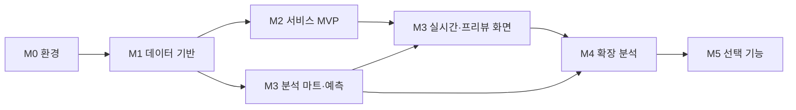

# 배구 전력 분석 플랫폼 개발 계획서 (WBS)

| 항목 | 내용 |
|---|---|
| 문서 버전 | v1.0 |
| 작성일 | 2026-11-16 |
| 목적 | 재개발 작업을 단계·작업 패키지로 나누고, 각 패키지의 산출물·선행 작업·완료 기준·규모를 정한다 |
| 전제 | 개발 기간과 인원은 미정(요구사항 10장 10번). 그래서 규모는 상대 크기(S·M·L)로 적고, 1차 구현 실적을 참고로 붙였다 |
| 관련 문서 | [요구사항 명세서](01-requirements.md)(9장 단계 계획), [테스트 계획서](07-test-plan.md)(8장 단계별 완료 기준), [개발 가이드](08-dev-guide.md) |

| 버전 | 변경 내용 |
|---|---|
| v1.0 | 최초 작성 |

## 1. 단계와 마일스톤

| 마일스톤 | 단계 | 목표 | 완료 판정 |
|---|---|---|---|
| M0 | 0단계 환경 | Compose로 모든 기반 서비스가 뜨고 서로 연결된다 | 테스트 계획서 8장 0단계 |
| M1 | 1단계 데이터 기반 | KOVO → Kafka → HDFS → Spark → PostgreSQL이 DAG로 자동으로 돈다. 전 시즌 백필 | 1단계 기준 + 2025-26 세트 점수 1,042개 재현 |
| M2 | 2단계 서비스 MVP | 일정·경기·순위·팀·선수·기사·검색 화면, 회원, 관리자, Kibana | 2단계 기준 + NFR-11·12 |
| M3 | 3단계 분석·실시간 | Elo·시즌 요약·사이드아웃, 예측(MLflow), 프리뷰, 실시간 경로와 재생 | 3단계 기준 + 시험 시즌 성적이 Elo 기준선보다 좋음 + NFR-14 |
| M4 | 4단계 확장 분석 | 선수 유형, 폼, 예측 검증, 능력치 카드·순위, 선수 Elo, 수상, 관심 팀·선수, 보정, 모델 관리 | 4단계 기준 |
| M5 | 5단계 선택 | AI 프리뷰·질의응답, 해외 리그 | 요구사항 10장 결정 후 따로 계획 |

M2와 M3의 분석 마트는 M1이 끝나면 나란히 진행할 수 있다(화면 담당과 데이터 담당을 나누는 경우).

## 2. 작업 분해(WBS)

규모: **S** 하루 안팎, **M** 2~3일, **L** 4일 이상(한 사람 기준의 대략적인 크기. 1차 구현은 AI 도구와 함께 약 2주에 전체를 만들었다).

### 0. 환경(M0)

| ID | 작업 | 산출물 | 선행 | 요구사항 | 규모 |
|---|---|---|---|---|---|
| 0.1 | 저장소 구조, `.gitignore`·`.gitattributes`, `.env.example` | 폴더 골격 | - | NFR-33 | S |
| 0.2 | Compose 기본(PostgreSQL 3개 DB, Kafka KRaft, 토픽 생성) | `compose.yaml`, `infra/postgres`, `infra/kafka` | 0.1 | NFR-24 | S |
| 0.3 | Hadoop 이미지(HDFS·YARN, Python 3.11), Airflow 이미지(Java·PySpark·수집기 의존성), MLflow 이미지 | `infra/hadoop`, `infra/airflow`, `infra/mlflow` | 0.2 | 2.8 | M |
| 0.4 | Flink 이미지(PyFlink, 커넥터, 하둡 클라이언트), 점검 작업 | `infra/flink`, `flink_jobs/smoke_job.py` | 0.3 | 2.8 | M |
| 0.5 | Elasticsearch(nori)·Kibana·Filebeat·Metricbeat | `infra/elasticsearch`, `infra/filebeat`, `infra/metricbeat` | 0.2 | NFR-23 | S |
| 0.6 | Django 프로젝트(앱 7개 골격, 설정, health), Vue 골격(Vite 프록시) | `backend/`, `frontend/` | 0.2 | NFR-24 | S |
| 0.7 | Spark on YARN 점검 DAG | `dev_smoke_spark_yarn` | 0.3 | 2.8 | S |

### 1. 데이터 기반(M1)

| ID | 작업 | 산출물 | 선행 | 요구사항 | 규모 |
|---|---|---|---|---|---|
| 1.1 | KOVO API 확인과 표본 저장(`probe`) | `collectors/samples/`, 인터페이스 명세서 2장 확인 | 0.2 | 4.1.1 | S |
| 1.2 | 수집기 공통: 클라이언트, 요청 간격(파일 잠금), 발행기, 봉투, 수집 이력, CLI | `collectors/collectors/{kovo_client,rate_limiter,publisher,envelope,collection_log,base,__main__}.py` + 테스트 | 1.1 | PIPE-02, COL-08, NFR-01·04 | M |
| 1.3 | 시즌·일정·경기 상세·문자중계 수집기 | `kovo_collectors.py` + 테스트 | 1.2 | COL-01~03, 10 | M |
| 1.4 | Flink raw-archiver, 제출 스크립트, 체크포인트 복원, job-keeper | `raw_archiver.py`, `submit.sh`, `latest_checkpoint.py` | 0.4, 1.2 | PIPE-03, NFR-26 | M |
| 1.5 | 서빙 DB 모델: 리그·경기·기록·운영(품질·보정·알림·수동 실행) | `backend/{league,matches,ops}/models.py` + 마이그레이션 | 0.6 | ERD 3.1, 3.5 | M |
| 1.6 | Spark 정제: 파싱·최신 사본·변환·포지션 변환·랠리 점수 | `curate_kovo.py` | 1.3, 1.4 | PIPE-04 | L |
| 1.7 | 적재: staging + 병합 SQL + advisory lock | `pg_merge.py`, `sql/merge_kovo.sql` | 1.5, 1.6 | PIPE-05, NFR-25 | M |
| 1.8 | 품질 검사 11규칙, 경기 상태 결정, 보정 적용 | `curate_kovo.py`, 테스트 | 1.6 | PIPE-10, BR-02, ADM-03(적용) | M |
| 1.9 | Airflow 공통(적재 확인 센서, Spark 제출, 실패 알림)과 DAG `kovo_daily`·`kovo_postgame`·`kovo_backfill`·`kovo_reprocess` | `airflow/dags/`, `kovo_tasks/` + 테스트 | 1.7 | PIPE-01, 08, 09 | L |
| 1.10 | 전 시즌 백필 실행과 원천 누락 정리 | `CONFIRMED` 경기, 알려진 원천 누락 표 | 1.9 | COL-04 | M(대부분 대기 시간) |

### 2. 서비스 MVP(M2)

| ID | 작업 | 산출물 | 선행 | 요구사항 | 규모 |
|---|---|---|---|---|---|
| 2.1 | 조회 API: 시즌·팀·경기 목록·상세·문자중계·순위(자체 계산) | `league`, `matches` 뷰 + 테스트 | 1.7 | WEB-02, 03, 05, COL-05 | M |
| 2.2 | 화면 공통: 디자인 토큰, 머리글·바닥글, `AsyncState`, 표·필터, 반응형 | `App.vue`, `tokens.css`, 공용 컴포넌트 | 0.6 | WEB-13, 14, NFR-41~44 | M |
| 2.3 | 홈·일정(목록·달력)·경기 상세·순위 화면 | `views/` | 2.1, 2.2 | WEB-01~03, 05 | L |
| 2.4 | 팀·선수 화면(기본 기록) | `TeamView`, `PlayerView` | 2.1, 2.2 | WEB-06, 07 | M |
| 2.5 | 기사 수집기, `news_collect`, Flink article-enricher(중복·태깅), 기사 모델 | `news.py`, `article_enricher.py`, `article_tags.py` + 테스트 | 1.4, 1.5 | COL-07, PIPE-07 | M |
| 2.6 | 검색: `entities` 색인 작업, 검색·자동완성 API, 검색 화면·머리글 검색창 | `index_entities.py`, `articles/search.py`, `SearchView`, `SearchBox` | 2.5 | WEB-09, 10 | M |
| 2.7 | 회원: 가입·로그인·토큰·탈퇴, 시도 제한 | `accounts` + `AuthView`, `AccountView` | 0.6 | WEB-11, NFR-31·35·36 | M |
| 2.8 | 관리자: 품질 검사 결과, 수집 현황(Airflow REST·ES), 수동 실행, 미확인 실패 안내 | `ops/admin.py`, `jobs.py`, `forms.py`, 템플릿 | 1.9 | ADM-01, 02, 06, 07 | M |
| 2.9 | Kibana 대시보드(코드로 생성), kafka-lag | `infra/kibana/build_dashboard.py`, `kafka_lag.py` | 0.5 | ADM-04 | M |
| 2.10 | 응답 시간 측정과 튜닝 | `scripts/measure_latency.py` 결과 | 2.3~2.6 | NFR-11, 12 | S |

### 3. 분석·실시간(M3)

| ID | 작업 | 산출물 | 선행 | 요구사항 | 규모 |
|---|---|---|---|---|---|
| 3.1 | 분석 마트: 팀 Elo, 팀·선수 시즌 요약, 사이드아웃·브레이크·상황별, 백분위 | `build_marts.py`, `merge_marts.sql`, `analytics` 모델 | 1.7 | ANL-01, 02, 05, 11 | L |
| 3.2 | 팀·선수 화면에 분석 반영(Elo 차트, 레이더, 리그 비교, 백분위) | 컴포넌트 `RatingChart`, `RadarChart`, `LeagueCompare`, `PercentileBars` | 3.1, 2.4 | WEB-06, 07 | M |
| 3.3 | 예측 피처(as-of 조인) | `build_features.py` | 3.1 | ANL-03, BR-12 | M |
| 3.4 | 학습·등록(Hyperopt, champion 규칙)·예측·채점, DAG 2개 | `train_model.py`, `predict_matches.py`, `ml_match_winner.py` | 3.3 | ANL-03, 09, BR-11 | L |
| 3.5 | 경기 프리뷰(예측·상대 전적·최근 흐름) API·화면 | `MatchPreview`, `analytics/queries.py` | 3.4 | WEB-08, ANL-04 | M |
| 3.6 | 실시간 모델(`live_*`)과 Flink live-metrics(상태·지표·승리 확률·`live.metrics`) | `live_metrics.py`, `live_state.py` + 테스트 | 1.4, 3.1 | PIPE-06, ANL-07 | L |
| 3.7 | 실시간 수집기, 경기 재생기, `live_replay` | `live.py`, `replay.py` | 3.6 | COL-06, PIPE-11 | M |
| 3.8 | SSE 게이트웨이와 실시간 화면 | `live/hub.py`, `views.py`, `useLiveStream.js`, `MatchLiveView` | 3.6 | WEB-04, NFR-14 | M |

### 4. 확장 분석(M4)

| ID | 작업 | 산출물 | 선행 | 요구사항 | 규모 |
|---|---|---|---|---|---|
| 4.1 | 선수 유형(K-means)과 유사 선수, 화면 | `player_types.py`, `PlayerStyle` | 3.1 | ANL-06 | M |
| 4.2 | 선수 폼 판정, 팀·선수 화면 | `analytics/form.py`, `PlayerForm` | 2.4 | ANL-08 | S |
| 4.3 | 백테스트와 예측 검증 화면 | `train_model.py`(백테스트), `verification.py`, `PredictionsView` | 3.4 | ANL-10, WEB-17 | M |
| 4.4 | 포지션별 능력치 카드(시즌·통산)와 순위 화면 | `player_ratings.py`, `PlayerRatingCard`, `RatingsView` | 3.1 | ANL-13, WEB-16 | L(분석 실험 포함) |
| 4.5 | 선수 Elo와 `squad` 피처, 예측 모델 반영 | `build_marts.py`(player_elo), `build_features.py` | 4.4, 3.4 | ANL-14 | M |
| 4.6 | 수상·주요 기록 수집·정제·화면 | `HonorCollector`, `curate_honors.py`, `kovo_honors`, `PlayerHonors` | 1.9 | COL-04 | M |
| 4.7 | 관심 팀·선수와 홈 "내 관심" | `accounts`(관심, 피드), `FavoriteButton`, `FavoriteFeed` | 2.7 | WEB-12 | M |
| 4.8 | 데이터 보정 관리자 화면 | `ops/corrections.py`, 관리자 | 1.8 | ADM-03 | M |
| 4.9 | 모델 관리 관리자 화면 | `analytics/admin.py`, `registry.py` | 3.4 | ADM-05 | S |

### 5. 공통(전 단계)

| ID | 작업 | 산출물 |
|---|---|---|
| C.1 | 단위 테스트와 표본 회귀 | 모듈별 `tests/` |
| C.2 | 문서 갱신(Markdown 원본, Word 생성) | `docs/*.md`, `scripts/docs/` |
| C.3 | 운영 스크립트(재시작·이전) | `scripts/resume.ps1`, `migrate_*.ps1` |
| C.4 | 단계별 인수 시험 | 테스트 계획서 5장 결과 기록 |

## 3. 1차 구현 실적(참고)

| 날짜 | 커밋 | 내용 | 해당 WBS |
|---|---|---|---|
| 2026-11-02 | - | 요구사항 v0.1~v0.7, 설계서 v0.1 | 문서 |
| 2026-11-03 | `46309db` | 개발 환경 설정 | 0.1~0.7 |
| 2026-11-03 | `df3c692` | KOVO 데이터 수집 절차(수집기, 표본, raw-archiver, 정제 첫 판) | 1.1~1.4, 1.6 |
| 2026-11-03 | `19ab584` | 파이프라인 DAG 3개, 조회 화면, 분석 마트 첫 판 | 1.5, 1.7~1.9 일부, 2.1~2.4, 3.1 |
| 2026-11-06 | `45a3b9f` | 재처리·체크포인트 복원·staging 병합, 기사·검색, 실시간·재생, 회원·관리자, 예측·선수 유형 | 1.4·1.7·1.9 보완, 2.5~2.9, 3.2~3.8, 4.1~4.3, 4.7~4.9 |
| 2026-11-09 | `b9cb765` | 선수 능력치 | 4.4 |
| 2026-11-10 | `4fd6128`, `3aa5e91` | 예측 모델 v8(능력치 반영), 코드 정리·주석 | 4.5 일부, C.1 |
| 2026-11-11~13 | `da83722`~`69ff16d` | UI/UX, 선수 Elo, 수상 기록, 홈 재디자인, 팀 Elo 재조정, 팀 컬러 | 4.5, 4.6, 2.2 |
| 2026-11-16 | `d1094e7` | 문서 정리 | C.2 |

1차 구현은 데이터 범위와 KOVO API 구조를 확인하는 데 시간이 들지 않도록 이 문서들이 그 결과를 이미 담고 있다. 재개발은 확인 작업 없이 바로 구현에 들어갈 수 있다.

## 4. 위험과 대응

| 위험 | 영향 | 대응 |
|---|---|---|
| KOVO API 구조 변경·접근 제한 | 수집 중단 | 명시적 스키마로 바로 감지, 표본 회귀 테스트, 원천 보관으로 정제는 계속. 접근이 막히면 수집을 멈추고 우회하지 않는다(NFR-04) |
| 비시즌(5~9월) | 실시간·경기 후 경로 시험 불가 | 경기 재생(PIPE-11)으로 같은 경로 시험. 실제 생중계 검증은 개막 후 일정에 넣는다 |
| 단일 PC 메모리 | 서비스 OOM, Spark 실패 | 프로필별 기동, `mem_limit`, Airflow 병렬 6, Spark 작업 차례 실행 |
| 신규 기술 학습(Flink, Spark, Airflow, ES) | 일정 지연 | 상세 설계서와 개발 가이드의 결정·함정 목록을 먼저 읽는다. 0단계 점검 작업으로 연결부터 확인 |
| 백필 시간(약 9시간) | 대기 | 시험은 `limit`로 작게, 전체 백필은 밤에. 확정 경기 건너뛰기로 재시작 비용 최소화 |
| 분석 결과의 과적합·누출 | 화면 숫자의 신뢰 상실 | 시간순 분할, 경기 전 정보만, Elo 기준선과 함께 공개(BR-11·12) |
| 원천 데이터 누락 | 경기 미확정 | 품질 검사 + "확인함" + 알려진 누락 표 |
| 문서와 코드 불일치 | 재개발 비용 증가 | Markdown 원본 하나, 변경 체크리스트(개발 가이드 6장), 단계마다 문서 갱신 |

## 5. 착수 전 결정할 것

요구사항 10장의 미결정 항목 중 일정에 영향을 주는 것:

| 항목 | 결정이 필요한 시점 |
|---|---|
| 일정·인원(10번) | 착수 전 |
| 배포 환경(8번) | M2 전(외부 공개 여부에 따라 Nginx·HTTPS 작업 추가) |
| 선수 프로필 수집(4번) | M1 중(수집기 하나 추가) |
| KOVO컵 수집(12번) | M1 중(대회 종류는 이미 지원) |
| LLM 사용(11번) | M4 끝 |
| 보관 정책(13번) | 운영 전환 때 |
